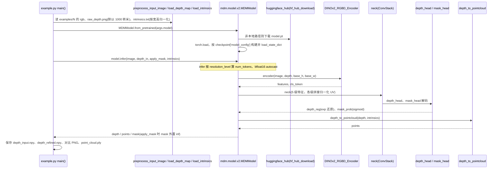

# LingBot-Depth：深度补全与修复

## 一句话定义

LingBot-Depth 通过 masked depth modeling 学习 RGB 与几何关联，将含噪或稀疏传感器深度补全为稠密深度和点云，属于感知层而非动作策略。

## 英文缩写速查

| 缩写 | 英文全称 | 简要说明 |
| --- | --- | --- |
| RGB-D | Red-Green-Blue and Depth | 彩色图像与深度 |
| MDM | Masked Depth Modeling | 通过遮挡深度监督学习补全 |
| VLA | Vision-Language-Action | 视觉和语言条件下生成动作 |

## 为什么重要

- 反光、遮挡与传感器缺测会直接影响抓取和空间感知。
- 给 VLA 提供几何教师，与实际生成机器人动作是两层职责。

## 核心原理

输入 RGB、原始深度和相机内参，利用视觉先验补全/修复深度。官方 `MDMModel` 返回 `depth` 与 `points`。v0.5 是官方推荐的修正版本，另有稀疏补全任务模型。

公开 **3,019,200 RGB-D 样本**包含真实室内、VLA 采集与仿真子集；[Vision](cn-os-lingbot-vision.md) 中另介绍 Depth 2.0，用新的视觉骨干和更大训练池，不能混淆两代开放数据规模。

## 工程实践

1. 从 `mdm.model.v2.MDMModel.from_pretrained` 加载官方 v0.5 权重。
2. 示例把深度毫米转换为米，并按图像尺寸规范化相机内参。
3. 运行 `python example.py`，检查预测深度、点云尺度和边缘，不只看渲染效果。
4. **已开源（2026-10-05）**：官方仓提供推理实现、HF/ModelScope 权重与 3M RGB-D 数据；全量训练可复现性另核对。

## 局限与风险

- 补全可能生成符合视觉先验但不符合真实几何的表面；接触与避障仍需验证。
- 相机标定、深度单位和输入分辨率不匹配会系统性影响点云。
- Depth 2.0 的 150M 训练规模不代表 150M 数据全量公开。

## 源码运行时序图

入口：`python example.py`（可加 `--example 0..7`、`--model <HF ID 或本地 model.pt>`、`--output result`、`--device`）。

图依据：Robbyant/LingBot-Depth@f3a237e，读过 README.md、example.py、mdm/model/v2.py（from_pretrained、forward、infer）；encoder、neck、decoder、depth_to_pointcloud 的内部实现未读。

## 关联页面

- [机器人视觉感知栈选型闭环](../queries/robot-perception-stack-selection-loop.md)

- [Robbyant](./robbyant.md)
- [LingBot-Vision](./cn-os-lingbot-vision.md)
- [LingBot-VLA](./lingbot-vla.md)

## 参考来源

- [LingBot-Depth 官方仓库核查](../../sources/repos/lingbot-depth.md)
- [官方组织资产索引](../../sources/sites/robbyant_github.md)
- 源码核对（2026-11-02）：Robbyant/LingBot-Depth@f3a237e，读过 README.md、example.py、mdm/model/v2.py；时序图依据以上文件，未运行代码。

## 推荐继续阅读

- [官方项目页](https://technology.robbyant.com/lingbot-depth)
- [官方代码](https://github.com/robbyant/lingbot-depth)
