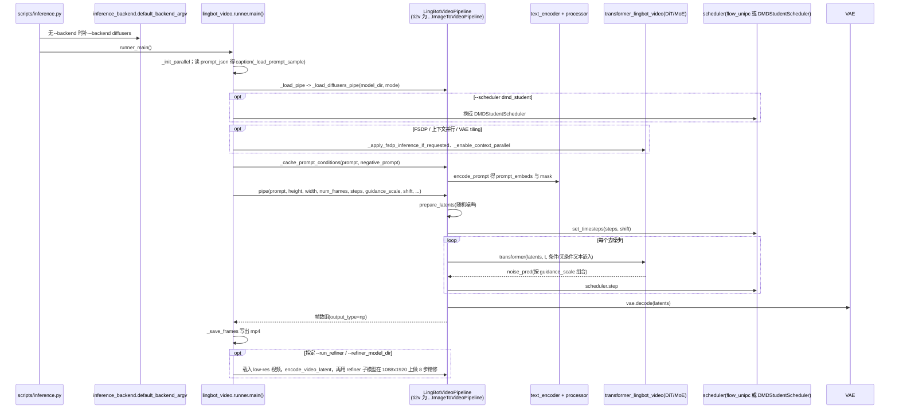

# LingBot-Video：具身视频生成基座

## 一句话定义

LingBot-Video 是面向具身场景的视频生成基座，用 MoE、具身视频数据与多奖励对齐学习视觉动态；视频输出本身不是机器人动作。

## 英文缩写速查

| 缩写 | 英文全称 | 简要说明 |
| --- | --- | --- |
| MoE | Mixture of Experts | 稀疏激活专家以扩展容量 |
| DiT | Diffusion Transformer | 扩散去噪的 Transformer 网络 |
| DMD | Distribution Matching Distillation | 将多步采样蒸馏为少步生成 |

## 为什么重要

- 为世界预测、视频数据生成和后续动作模型提供视觉先验。
- 开放不同规格和采样器，便于测生成质量、时延与资源成本。

## 核心原理

官方包含 Dense **1.3B**、MoE **30B-A3B** 与 refiner 等资产；训练结合网络视频和超过 **7 万小时具身数据**，多奖励关注视觉质量、物理合理性和任务完成。

2026-09-18 发布 **8 步 DMD student**。普通 MoE 与 DMD 使用不同 scheduler 和指导配置，不能只替换 checkpoint 而保留旧采样参数。

## 工程实践

1. 输入采用结构化 JSON caption；普通流程先用 `rewriter/inference.py`，必要时 `rewriter/auto_negative.py`。
2. 用 `scripts/inference.py` 选择 diffusers / SGLang 路径和对应 Dense/MoE 资产。
3. DMD 示例为 `scripts/single-gpu/run_moe_dmd_t2v.sh` / `run_moe_dmd_ti2v.sh`，模型目录须含 tokenizer/编码器、VAE、scheduler 与权重等完整组件。
4. **部分开源（2026-10-05）**：推理代码、模型、rewriter 和 RBench 入口可见；全量训练视频与完整预训练过程不能由推理仓推定开放。

## 局限与风险

- 视频看起来合理不证明机器人能执行对应动作或接触关系。
- 少步采样需同时比较质量和真实显存/延迟，不能把参数稀疏激活率当作实测加速。
- 官方大模型样例对资源要求较高，仓库观测峰值不等于最低显存规格。

## 源码运行时序图

入口：`python scripts/inference.py --backend diffusers --model_dir $MODEL_DIR --mode t2v --prompt_json assets/cases/t2v/example_1/prompt.json --output outputs/x.mp4 ...`（README 的 DMD 8 步示例加 `--scheduler dmd_student --steps 8 --guidance_scale 1`；多卡由 `scripts/multi-gpus/*.sh` 包装同一入口，启用 FSDP 与上下文并行）。

图依据：Robbyant/lingbot-video@dd5c231，读过 README.md、scripts/inference.py、lingbot_video/inference_backend.py（default_backend_argv）、runner.py（main、_load_pipe、refiner 段）、pipeline_lingbot_video.py（encode_prompt、prepare_latents、__call__ 中的关键调用）、scripts/multi-gpus/run_moe_t2v_refiner_fsdp_cp8.sh（环境变量部分）；transformer 内部、SGLang 后端、rewriter/ 未读。

## 关联页面

- [Robbyant](./robbyant.md)
- [LingBot-World](./lingbot-world.md)
- [LingBot-VLA 2.0](./lingbot-vla-v2.md)

## 参考来源

- [官方 Video 仓库核查](../../sources/repos/lingbot-video.md)
- [官方组织资产索引](../../sources/sites/robbyant_github.md)
- 源码核对（2026-11-02）：Robbyant/lingbot-video@dd5c231，读过 README.md、scripts/inference.py、lingbot_video/inference_backend.py、runner.py、pipeline_lingbot_video.py（部分）、scripts/multi-gpus/run_moe_t2v_refiner_fsdp_cp8.sh；时序图依据以上文件，未运行代码。

## 推荐继续阅读

- [项目页](https://technology.robbyant.com/lingbot-video)
- [官方代码](https://github.com/robbyant/lingbot-video)
