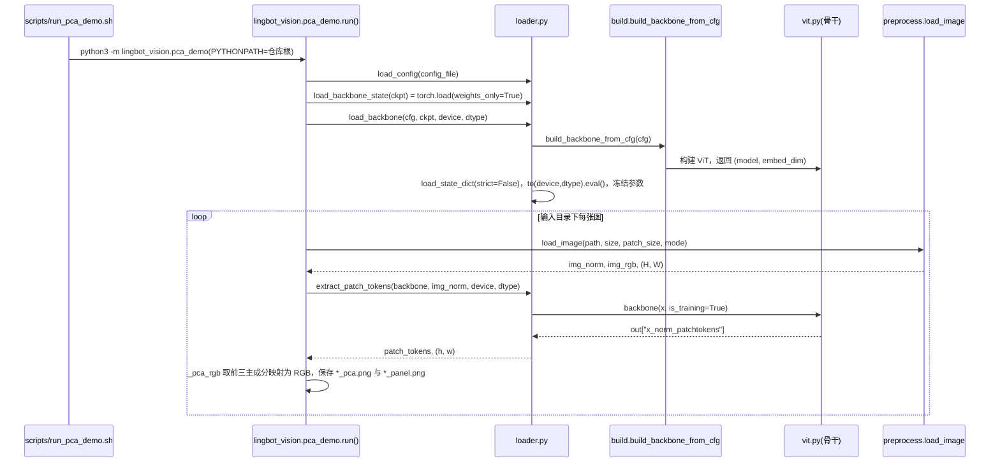

# LingBot-Vision：密集空间感知骨干

## 一句话定义

LingBot-Vision 用 masked boundary modeling 预训练视觉 Transformer，兼顾语义与边界几何，提供供密集任务消费的 patch 特征。

## 英文缩写速查

| 缩写 | 英文全称 | 简要说明 |
| --- | --- | --- |
| ViT | Vision Transformer | 图像 patch 的 Transformer 编码器 |
| PCA | Principal Component Analysis | 将特征投影为可视化颜色 |
| RGB-D | Red-Green-Blue and Depth | 彩色与深度数据 |

## 为什么重要

- 通用语义骨干的物体理解不保证精确边界和空间结构，机器人感知需要两者。
- 官方提供多规格骨干，使特征质量与机载成本可以分开选择。

## 核心原理

通过以边界为中心的自监督目标，使 patch 表征同时保留语义分组与几何结构。官方模型覆盖 ViT-S/B/L/G，Giant 约 **1.1B 参数**，小模型由 teacher 蒸馏。

发布资产是 **backbone-only `.pt`**，不含 optimizer、投影头或训练期 boundary heads。可用于深度估计、分割、视频目标传播；Depth 2.0 把该骨干用于 RGB-D 几何学习。

## 工程实践

1. 从 `lingbot_vision.load_pretrained_backbone` 加载规格匹配的权重。
2. 用 `load_image` 与 `extract_patch_tokens` 获取 `[B,H*W,C]` 特征；对齐输入 patch 网格和预处理。
3. `scripts/run_pca_demo.sh` 只验证特征可运行；下游任务仍需预测头与评测协议。
4. **部分开源（2026-10-05）**：推理/PCA 示例与 backbone 权重可用；完整预训练配方和所有数据未由 checkpoint 发布证明。

## 局限与风险

- PCA 颜色图并不是分割准确率或真实深度。
- 发布骨干不等于所有下游模型和训练组件均公开。
- Giant 与 Small 的成本、精度与输入设置须分别计量。

## 源码运行时序图

入口：`./scripts/run_pca_demo.sh --config-file lingbot_vision/configs/lbot_vision_vitl.yaml --ckpt /path/to/model.pt --input examples/example.png --out outputs/pca_demo`（脚本执行 `python3 -m lingbot_vision.pca_demo`）。README 的 Python 快速开始则直接调用 `load_pretrained_backbone` 与 `extract_patch_tokens`。该仓库是视觉骨干推理与 PCA 可视化，不含机器人控制链路。

图依据：Robbyant/lingbot-vision@151e463，读过 README.md、scripts/run_pca_demo.sh、lingbot_vision/__init__.py、loader.py（load_pretrained_backbone、resolve_pretrained_files、load_backbone、extract_patch_tokens）、pca_demo.py（run 与 _pca_rgb 开头）；vit.py、build.py 与 preprocess.py 内部实现未读。

## 关联页面

- [机器人视觉感知栈选型闭环](../queries/robot-perception-stack-selection-loop.md)

- [LingBot-Depth](./cn-os-lingbot-depth.md)
- [Robbyant](./robbyant.md)
- [视觉骨干](../concepts/vision-backbones.md)

## 参考来源

- [官方 Vision 仓库核查](../../sources/repos/lingbot-vision.md)
- [官方组织资产索引](../../sources/sites/robbyant_github.md)
- 源码核对（2026-11-02）：Robbyant/lingbot-vision@151e463，读过 README.md、scripts/run_pca_demo.sh、lingbot_vision/__init__.py、loader.py、pca_demo.py；时序图依据以上文件，未运行代码。

## 推荐继续阅读

- [项目页](https://technology.robbyant.com/lingbot-vision)
- [官方仓库](https://github.com/robbyant/lingbot-vision)
