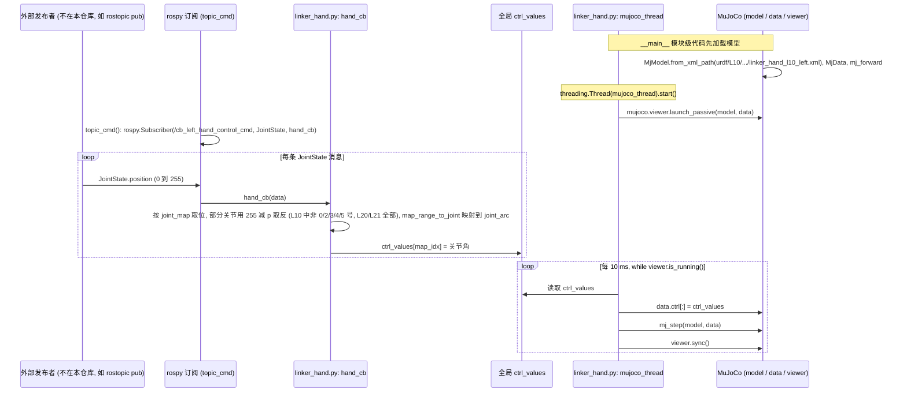

# linkerhand-sim

## 一句话定义

**linkerhand-sim** 是 [灵心巧手](https://github.com/linker-bot) 公开的 **移动操作** 开源项目：提供LinkerHand仿真环境，用于抓取、控制和操作策略在真机前的验证。

## 英文缩写速查

| 缩写 | 英文全称 | 简要说明 |
|------|----------|----------|
| SDK | Software Development Kit | 真机控制与状态读取接口 |
| RL | Reinforcement Learning | 强化学习训练与策略优化 |
| VLA | Vision-Language-Action | 视觉–语言–动作统一策略 |
| Sim2Real | Simulation to Real | 仿真策略迁移真机 |
| URDF | Unified Robot Description Format | 机器人描述与仿真资产 |

## 为什么重要

- 收录于 [国内具身智能开源全景（76 家 · 424 项）](../overview/china-domestic-embodied-opensource-76-companies-technology-map.md) 的 **第三层** 分组。
- 与 [Humanoid Motion Intelligence](../entities/humanoid-motion-intelligence.md) 同源策展；本页为 **独立详情节点**，便于从公司清单跳到机制与入口说明。

## 核心原理

| 字段 | 内容 |
|------|------|
| 机构 | 灵心巧手 |
| 类别 | 移动操作 |
| 官方组织 | https://github.com/linker-bot |

## 工程实践

1. 从官方 GitHub/Gitee 组织检索 `linkerhand-sim` 仓库并核对 README 许可与依赖。
2. 对照本库 [424 项覆盖索引](../queries/china-domestic-opensource-424-coverage.md) 查看同公司其它入口是否共用训练/部署链路。
3. 若与既有方法页（如 RL 框架、VLA、SDK）主题相同，优先读关联页中的「开源入口」小节，避免重复维护平行叙事。

## 局限与风险

- 公众号清单为 **策展快照**（2026-09-06）；仓库更名、归档或许可证变化须回官方组织页核实。
- **开源状态**：以仓库 README 与 release 为准（入库日按文章描述归纳，未逐仓 clone 验证）。

## 关联页面

- [国内具身开源全景技术地图](../overview/china-domestic-embodied-opensource-76-companies-technology-map.md)
- [HMI 开源项目主表导读](../queries/hmi-opensource-projects-coverage.md)
- [Humanoid Motion Intelligence](../entities/humanoid-motion-intelligence.md)

## 源码运行时序图

入口：`roslaunch linker_hand_mujoco_ros linker_hand_mujoco.launch hand_type:=left hand_joint:=L10`（ROS Noetic，对应 `linker_hand_mujoco_ros/scripts/linker_hand.py`；README 另列 Isaac Gym、PyBullet、ROS 2 Jazzy 等变体，本图未画）。节点只订阅 `/cb_<hand_type>_hand_control_cmd`（`sensor_msgs/JointState`），发布者不在本仓库内。`__main__` 中的 `ControlWindow` 滑块 GUI 被注释，未启动。

图依据：linker-bot/linkerhand-sim@539f03b，`README.md`、`linker_hand_mujoco_ros/README_CN.md`、`linker_hand_mujoco_ros/launch/linker_hand_mujoco.launch`、`linker_hand_mujoco_ros/scripts/linker_hand.py`、`linker_hand_mujoco_ros/scripts/utils/mapping.py`（检索 L10 映射表名称与范围，未逐项核对）。

## 参考来源

- [linkerhand-sim 源码归档](../../sources/repos/linkerhand-sim.md)（<https://github.com/linker-bot/linkerhand-sim>）

- [国内具身智能开源全景（微信公众号）](../../sources/blogs/wechat_embodied_station_domestic_opensource_panorama_2026-09-06.md)

## 推荐继续阅读

- [灵心巧手 官方组织](https://github.com/linker-bot)
