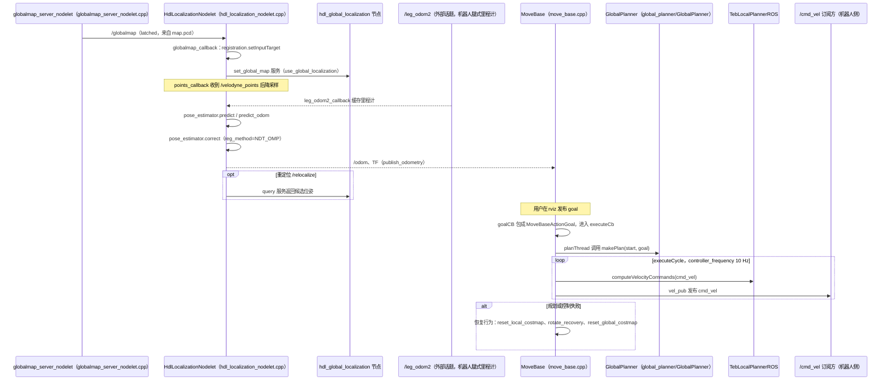

# Lite3_Navigation

## 一句话定义

**Lite3_Navigation** 是 [云深处科技](https://github.com/DeepRoboticsLab) 公开的 **工程与工具** 开源项目：感知/定位/建图模块：为导航与控制提供环境状态

## 英文缩写速查

| 缩写 | 英文全称 | 简要说明 |
|------|----------|----------|
| SDK | Software Development Kit | 真机控制与状态读取接口 |
| RL | Reinforcement Learning | 强化学习训练与策略优化 |
| VLA | Vision-Language-Action | 视觉–语言–动作统一策略 |
| Sim2Real | Simulation to Real | 仿真策略迁移真机 |
| URDF | Unified Robot Description Format | 机器人描述与仿真资产 |

## 为什么重要

- 收录于 [国内具身智能开源全景（76 家 · 424 项）](../overview/china-domestic-embodied-opensource-76-companies-technology-map.md) 的 **第一层** 分组。
- 与 [Humanoid Motion Intelligence](../entities/humanoid-motion-intelligence.md) 同源策展；本页为 **独立详情节点**，便于从公司清单跳到机制与入口说明。

## 核心原理

| 字段 | 内容 |
|------|------|
| 机构 | 云深处科技 |
| 类别 | 工程与工具 |
| 官方组织 | https://github.com/DeepRoboticsLab |

## 工程实践

1. 从官方 GitHub/Gitee 组织检索 `Lite3_Navigation` 仓库并核对 README 许可与依赖。
2. 对照本库 [424 项覆盖索引](../queries/china-domestic-opensource-424-coverage.md) 查看同公司其它入口是否共用训练/部署链路。
3. 若与既有方法页（如 RL 框架、VLA、SDK）主题相同，优先读关联页中的「开源入口」小节，避免重复维护平行叙事。

## 局限与风险

- 公众号清单为 **策展快照**（2026-09-06）；仓库更名、归档或许可证变化须回官方组织页核实。
- **开源状态**：以仓库 README 与 release 为准（入库日按文章描述归纳，未逐仓 clone 验证）。

## 源码运行时序图

入口：定位 `roslaunch hdl_localization hdl_localization.launch`，导航 `roslaunch navigation navigation.launch`（仓库 README 仅一行标题，入口取自两个 launch 文件；本仓库打包的是 ROS1 包 `hdl_localization`、`hdl_global_localization`、`move_base`、`teb_local_planner`、`ndt_omp`、`fast_gicp`、`navigation`，其中 `navigation` 只含 launch 与参数 yaml）

图依据：DeepRoboticsLab/Lite3_Navigation@b091cee，读过 `README.md`、`navigation/launch/navigation.launch`、`navigation/config/move_base_params.yaml`、`hdl_localization/launch/hdl_localization.launch`、`hdl_localization/apps/hdl_localization_nodelet.cpp`、`hdl_localization/apps/globalmap_server_nodelet.cpp`（订阅/发布与回调部分）、`move_base/src/move_base.cpp`、`move_base/src/move_base_node.cpp`；`global_planner`、`teb_local_planner` 内部算法、`hdl_global_localization` 节点内部、`/leg_odom2` 的发布方（机器人侧，不在本仓库）未读；`/odom` 与 costmap 之间的数据关系、`/cmd_vel` 到运动控制的下游为推断，图中以话题名标出，未画成确定调用。

## 关联页面

- [国内具身开源全景技术地图](../overview/china-domestic-embodied-opensource-76-companies-technology-map.md)
- [HMI 开源项目主表导读](../queries/hmi-opensource-projects-coverage.md)
- [Humanoid Motion Intelligence](../entities/humanoid-motion-intelligence.md)

## 参考来源

- [Lite3_Navigation 源码归档](../../sources/repos/lite3_navigation.md)（<https://github.com/DeepRoboticsLab/Lite3_Navigation>）

- [国内具身智能开源全景（微信公众号）](../../sources/blogs/wechat_embodied_station_domestic_opensource_panorama_2026-09-06.md)
- 源码核对（2026-11-02）：DeepRoboticsLab/Lite3_Navigation@b091cee，读过 README.md、navigation/launch/navigation.launch、navigation/config/move_base_params.yaml、hdl_localization/launch/hdl_localization.launch、hdl_localization/apps/{hdl_localization_nodelet,globalmap_server_nodelet}.cpp、move_base/src/{move_base,move_base_node}.cpp；时序图依据以上文件，未运行代码。

## 推荐继续阅读

- [云深处科技 官方组织](https://github.com/DeepRoboticsLab)
