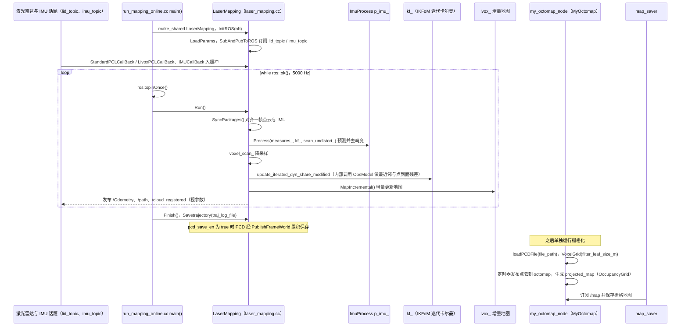

# Lite3_SLAM

## 一句话定义

**Lite3_SLAM** 是 [云深处科技](https://github.com/DeepRoboticsLab) 公开的 **感知/导航** 开源项目：感知/定位/建图模块：为导航与控制提供环境状态

## 英文缩写速查

| 缩写 | 英文全称 | 简要说明 |
|------|----------|----------|
| SDK | Software Development Kit | 真机控制与状态读取接口 |
| RL | Reinforcement Learning | 强化学习训练与策略优化 |
| VLA | Vision-Language-Action | 视觉–语言–动作统一策略 |
| Sim2Real | Simulation to Real | 仿真策略迁移真机 |
| URDF | Unified Robot Description Format | 机器人描述与仿真资产 |

## 为什么重要

- 收录于 [国内具身智能开源全景（76 家 · 424 项）](../overview/china-domestic-embodied-opensource-76-companies-technology-map.md) 的 **第一层** 分组。
- 与 [Humanoid Motion Intelligence](../entities/humanoid-motion-intelligence.md) 同源策展；本页为 **独立详情节点**，便于从公司清单跳到机制与入口说明。

## 核心原理

| 字段 | 内容 |
|------|------|
| 机构 | 云深处科技 |
| 类别 | 感知/导航 |
| 官方组织 | https://github.com/DeepRoboticsLab |

## 工程实践

1. 从官方 GitHub/Gitee 组织检索 `Lite3_SLAM` 仓库并核对 README 许可与依赖。
2. 对照本库 [424 项覆盖索引](../queries/china-domestic-opensource-424-coverage.md) 查看同公司其它入口是否共用训练/部署链路。
3. 若与既有方法页（如 RL 框架、VLA、SDK）主题相同，优先读关联页中的「开源入口」小节，避免重复维护平行叙事。

## 局限与风险

- 公众号清单为 **策展快照**（2026-09-06）；仓库更名、归档或许可证变化须回官方组织页核实。
- **开源状态**：以仓库 README 与 release 为准（入库日按文章描述归纳，未逐仓 clone 验证）。

## 源码运行时序图

入口：建图 `roslaunch faster_lio mapping_velodyne.launch`（启动 `run_mapping_online`，节点名 `laserMapping`）；建图完成后的栅格化用 `pcd2grid/launch/pcd2grid.launch`（启动 `octomap_server` 包的 `my_octomap_node`；README 写的是 `roslaunch build_octomap.launch`，与仓库内 launch 文件名不一致），再 `rosrun map_server map_saver`（见 `pcd2grid/README.md`）。仓库为 ROS1 的 `faster-lio`、`octomap_mapping`、`map_server`、`pcd2grid` 四个子包的合集。

图依据：DeepRoboticsLab/Lite3_SLAM@dcc3190，读过 `README.md`、`faster-lio/launch/mapping_velodyne.launch`、`faster-lio/app/run_mapping_online.cc`、`faster-lio/src/laser_mapping.cc`（`SubAndPubToROS`、`Run`、`SyncPackages` 开头）、`faster-lio/config/velodyne.yaml`（片段）、`pcd2grid/README.md`、`pcd2grid/launch/pcd2grid.launch`、`octomap_mapping/octomap_server/src/my_octomap_node.cpp`、`octomap_mapping/octomap_server/src/MyOctomap.cpp`（构造函数片段与发布函数名）；`ImuProcess`、`ObsModel`、`MapIncremental`、`MyOctomap` 定时器回调内部细节未读；末两步中 `map_saver` 订阅话题名 `/map` 取自 README 的描述，`my_octomap_node` 的 `projected_map` 到 `/map` 的话题重映射关系未核对，属推断。

## 关联页面

- [国内具身开源全景技术地图](../overview/china-domestic-embodied-opensource-76-companies-technology-map.md)
- [HMI 开源项目主表导读](../queries/hmi-opensource-projects-coverage.md)
- [Humanoid Motion Intelligence](../entities/humanoid-motion-intelligence.md)

## 参考来源

- [Lite3_SLAM 源码归档](../../sources/repos/lite3_slam.md)（<https://github.com/DeepRoboticsLab/Lite3_SLAM>）

- [国内具身智能开源全景（微信公众号）](../../sources/blogs/wechat_embodied_station_domestic_opensource_panorama_2026-09-06.md)
- 源码核对（2026-11-02）：DeepRoboticsLab/Lite3_SLAM@dcc3190，读过 README.md、faster-lio/launch/mapping_velodyne.launch、faster-lio/app/run_mapping_online.cc、faster-lio/src/laser_mapping.cc（部分）、pcd2grid/README.md、pcd2grid/launch/pcd2grid.launch、octomap_mapping/octomap_server/src/{my_octomap_node,MyOctomap}.cpp（部分）；时序图依据以上文件，未运行代码。

## 推荐继续阅读

- [云深处科技 官方组织](https://github.com/DeepRoboticsLab)
