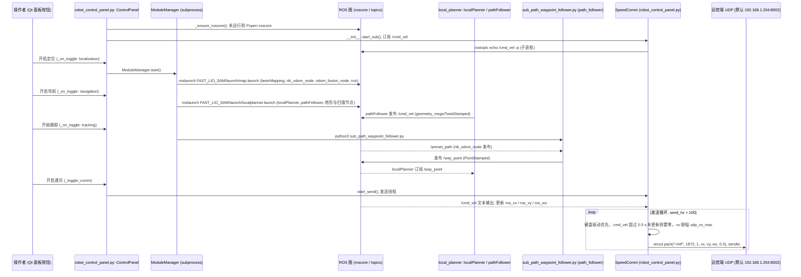

# LoongMarathonNav

## 一句话定义

**LoongMarathonNav** 是 [上海人形机器人创新中心](https://github.com/loongOpen) 公开的 **工程与工具** 开源项目：融合RTK、惯导、视觉和激光雷达处理城市复杂环境中的长程定位、避障与轨迹跟踪。

## 英文缩写速查

| 缩写 | 英文全称 | 简要说明 |
|------|----------|----------|
| SDK | Software Development Kit | 真机控制与状态读取接口 |
| RL | Reinforcement Learning | 强化学习训练与策略优化 |
| VLA | Vision-Language-Action | 视觉–语言–动作统一策略 |
| Sim2Real | Simulation to Real | 仿真策略迁移真机 |
| URDF | Unified Robot Description Format | 机器人描述与仿真资产 |

## 为什么重要

- 收录于 [国内具身智能开源全景（76 家 · 424 项）](../overview/china-domestic-embodied-opensource-76-companies-technology-map.md) 的 **第一层** 分组。
- 与 [Humanoid Motion Intelligence](../entities/humanoid-motion-intelligence.md) 同源策展；本页为 **独立详情节点**，便于从公司清单跳到机制与入口说明。

## 核心原理

| 字段 | 内容 |
|------|------|
| 机构 | 上海人形机器人创新中心 |
| 类别 | 工程与工具 |
| 官方组织 | https://github.com/loongOpen |

## 工程实践

1. 从官方 GitHub/Gitee 组织检索 `LoongMarathonNav` 仓库并核对 README 许可与依赖。
2. 对照本库 [424 项覆盖索引](../queries/china-domestic-opensource-424-coverage.md) 查看同公司其它入口是否共用训练/部署链路。
3. 若与既有方法页（如 RL 框架、VLA、SDK）主题相同，优先读关联页中的「开源入口」小节，避免重复维护平行叙事。

## 局限与风险

- 公众号清单为 **策展快照**（2026-09-06）；仓库更名、归档或许可证变化须回官方组织页核实。
- **开源状态**：以仓库 README 与 release 为准（入库日按文章描述归纳，未逐仓 clone 验证）。

## 关联页面

- [国内具身开源全景技术地图](../overview/china-domestic-embodied-opensource-76-companies-technology-map.md)
- [HMI 开源项目主表导读](../queries/hmi-opensource-projects-coverage.md)
- [Humanoid Motion Intelligence](../entities/humanoid-motion-intelligence.md)

## 源码运行时序图

入口：`python3 src/robot_control_panel.py`（ROS Noetic；脚本启动时自动 `source devel/setup.bash` 并在无 roscore 时拉起 `roscore`。面板按钮依次调用 `roslaunch` 与 `python3`，分别对应下图各模块）。

图依据：loongOpen/LoongMarathonNav@40abd0b，`README.md`、`src/robot_control_panel.py`（MODULE_DEFS、`_ensure_roscore`、`_on_toggle`、`_toggle_comm`、SpeedComm 的 start_sub / _send_loop，节选）、`src/sub_path_waypoint_follower.py`（节选）、`src/FAST_LIO_SAM/launch/map.launch`、`src/FAST_LIO_SAM/launch/localplanner.launch`、`src/rtk_odom/launch/rtk_odom.launch`（节选）、`src/odom_fusion/launch/odom_fusion.launch`（节选）、`src/local_planner/launch/local_planner.launch`（节选）、`src/local_planner/src/localPlanner.cpp` 与 `pathFollower.cpp`（订阅与发布话题检索）。

## 参考来源

- [LoongMarathonNav 源码归档](../../sources/repos/cn_os_loongmarathonnav.md)（<https://github.com/loongOpen/LoongMarathonNav>）

- [LoongMarathonNav 源码归档](../../sources/repos/loongmarathonnav.md)（<https://github.com/loongOpen/LoongMarathonNav>）

- [国内具身智能开源全景（微信公众号）](../../sources/blogs/wechat_embodied_station_domestic_opensource_panorama_2026-09-06.md)
- 源码核对（2026-11-02）：loongOpen/LoongMarathonNav@40abd0b，读过 README.md、src/robot_control_panel.py（节选）、src/sub_path_waypoint_follower.py（节选）、src/FAST_LIO_SAM/launch/map.launch、src/FAST_LIO_SAM/launch/localplanner.launch、src/local_planner/src/localPlanner.cpp 与 pathFollower.cpp（话题检索）；时序图依据以上文件，未运行代码。

## 推荐继续阅读

- [上海人形机器人创新中心 官方组织](https://github.com/loongOpen)
