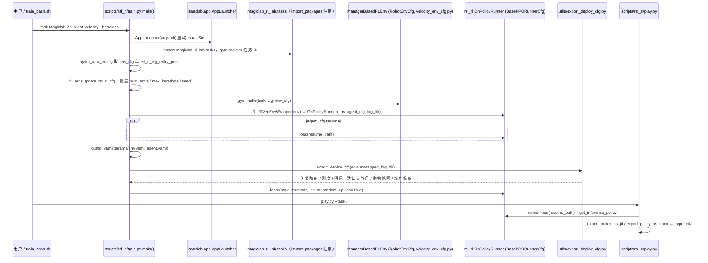

# magiclab_rl_lab

## 一句话定义

**magiclab_rl_lab** 是 [魔法原子](https://github.com/MagiclabRobotics) 公开的 **运动RL/技能训练** 开源项目：为魔法原子机器人提供基于Isaac Lab的强化学习训练环境与任务配置。

## 英文缩写速查

| 缩写 | 英文全称 | 简要说明 |
|------|----------|----------|
| SDK | Software Development Kit | 真机控制与状态读取接口 |
| RL | Reinforcement Learning | 强化学习训练与策略优化 |
| VLA | Vision-Language-Action | 视觉–语言–动作统一策略 |
| Sim2Real | Simulation to Real | 仿真策略迁移真机 |
| URDF | Unified Robot Description Format | 机器人描述与仿真资产 |

## 为什么重要

- 收录于 [国内具身智能开源全景（76 家 · 424 项）](../overview/china-domestic-embodied-opensource-76-companies-technology-map.md) 的 **第一层** 分组。
- 与 [Humanoid Motion Intelligence](../entities/humanoid-motion-intelligence.md) 同源策展；本页为 **独立详情节点**，便于从公司清单跳到机制与入口说明。

## 核心原理

| 字段 | 内容 |
|------|------|
| 机构 | 魔法原子 |
| 类别 | 运动RL/技能训练 |
| 官方组织 | https://github.com/MagiclabRobotics |

## 工程实践

1. 从官方 GitHub/Gitee 组织检索 `magiclab_rl_lab` 仓库并核对 README 许可与依赖。
2. 对照本库 [424 项覆盖索引](../queries/china-domestic-opensource-424-coverage.md) 查看同公司其它入口是否共用训练/部署链路。
3. 若与既有方法页（如 RL 框架、VLA、SDK）主题相同，优先读关联页中的「开源入口」小节，避免重复维护平行叙事。

## 局限与风险

- 公众号清单为 **策展快照**（2026-09-06）；仓库更名、归档或许可证变化须回官方组织页核实。
- **开源状态**：以仓库 README 与 release 为准（入库日按文章描述归纳，未逐仓 clone 验证）。

## 源码运行时序图

入口：`python scripts/rsl_rl/train.py --headless --task Magiclab-Z1-12dof-Velocity`（或 `./train_bash.sh`，其中固定了 `--max_iterations=10000 --num_envs=8192`）；回放导出：`python scripts/rsl_rl/play.py --task Magiclab-Z1-12dof-Velocity`。需要 Isaac Lab 环境。

图依据：magiclab_rl_lab@e762473，读过 README.md、train_bash.sh、scripts/rsl_rl/train.py、scripts/rsl_rl/play.py（导出相关行）、tasks/locomotion/robots/z1/12dof/__init__.py、tasks/__init__.py、utils/export_deploy_cfg.py（前半）。`velocity_env_cfg.py`、奖励/观测/课程（mdp/）、`play_keyboard.py` 未读内部。`export_deploy_cfg` 写出的具体文件名未读，图中未标注。

## 关联页面

- [国内具身开源全景技术地图](../overview/china-domestic-embodied-opensource-76-companies-technology-map.md)
- [HMI 开源项目主表导读](../queries/hmi-opensource-projects-coverage.md)
- [Humanoid Motion Intelligence](../entities/humanoid-motion-intelligence.md)

## 参考来源

- [magiclab_rl_lab 源码归档](../../sources/repos/magiclab_rl_lab.md)（<https://github.com/MagiclabRobotics/magiclab_rl_lab>）

- [国内具身智能开源全景（微信公众号）](../../sources/blogs/wechat_embodied_station_domestic_opensource_panorama_2026-09-06.md)
- 源码核对（2026-11-02）：MagiclabRobotics/magiclab_rl_lab@e762473，读过 README.md、train_bash.sh、scripts/rsl_rl/train.py、scripts/rsl_rl/play.py（导出相关行）、tasks/locomotion/robots/z1/12dof/__init__.py、utils/export_deploy_cfg.py；时序图依据以上文件，未运行代码。

## 推荐继续阅读

- [魔法原子 官方组织](https://github.com/MagiclabRobotics)
