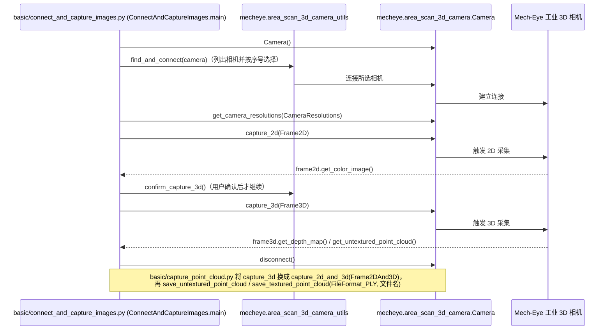

# mecheye_python_samples

## 一句话定义

**mecheye_python_samples** 是 [梅卡曼德](https://github.com/MechMindRobotics) 公开的 **数据采集/工具** 开源项目：提供Mech-Eye API的Python示例，覆盖相机连接、图像和点云采集以及常见参数设置。

## 英文缩写速查

| 缩写 | 英文全称 | 简要说明 |
|------|----------|----------|
| SDK | Software Development Kit | 真机控制与状态读取接口 |
| RL | Reinforcement Learning | 强化学习训练与策略优化 |
| VLA | Vision-Language-Action | 视觉–语言–动作统一策略 |
| Sim2Real | Simulation to Real | 仿真策略迁移真机 |
| URDF | Unified Robot Description Format | 机器人描述与仿真资产 |

## 为什么重要

- 收录于 [国内具身智能开源全景（76 家 · 424 项）](../overview/china-domestic-embodied-opensource-76-companies-technology-map.md) 的 **第五层** 分组。
- 与 [Humanoid Motion Intelligence](../entities/humanoid-motion-intelligence.md) 同源策展；本页为 **独立详情节点**，便于从公司清单跳到机制与入口说明。

## 核心原理

| 字段 | 内容 |
|------|------|
| 机构 | 梅卡曼德 |
| 类别 | 数据采集/工具 |
| 官方组织 | https://github.com/MechMindRobotics |

## 工程实践

1. 从官方 GitHub/Gitee 组织检索 `mecheye_python_samples` 仓库并核对 README 许可与依赖。
2. 对照本库 [424 项覆盖索引](../queries/china-domestic-opensource-424-coverage.md) 查看同公司其它入口是否共用训练/部署链路。
3. 若与既有方法页（如 RL 框架、VLA、SDK）主题相同，优先读关联页中的「开源入口」小节，避免重复维护平行叙事。

## 局限与风险

- 公众号清单为 **策展快照**（2026-09-06）；仓库更名、归档或许可证变化须回官方组织页核实。
- **开源状态**：以仓库 README 与 release 为准（入库日按文章描述归纳，未逐仓 clone 验证）。

## 源码运行时序图

入口：`pip install MechEyeAPI` 并安装 Mech-Eye SDK 后，进入 `area_scan_3d_camera/` 运行 `python connect_and_capture_images.py`（README 的运行方式为 `python sample_name.py`；本仓库样例按 `basic/`、`advanced/`、`util/` 分目录，此处以 `basic/connect_and_capture_images.py` 与 `basic/capture_point_cloud.py` 为代表）。`find_and_connect`、`show_error` 等辅助函数来自 `mecheye.area_scan_3d_camera_utils` / `mecheye.shared`（pip 包，不在本仓库内，其内部未读）。

图依据：mecheye_python_samples@0b6a0b2，读过 README.md、area_scan_3d_camera/README.md、area_scan_3d_camera/basic/connect_and_capture_images.py、area_scan_3d_camera/basic/capture_point_cloud.py。`profiler/` 目录样例与其余 advanced/util 样例未读；与相机之间的通信协议由闭源 `MechEyeAPI` 实现，不在本仓库内，图中 HW 一列为概念性参与者。

## 关联页面

- [国内具身开源全景技术地图](../overview/china-domestic-embodied-opensource-76-companies-technology-map.md)
- [HMI 开源项目主表导读](../queries/hmi-opensource-projects-coverage.md)
- [Humanoid Motion Intelligence](../entities/humanoid-motion-intelligence.md)

## 参考来源

- [mecheye_python_samples 源码归档](../../sources/repos/mecheye_python_samples.md)（<https://github.com/MechMindRobotics/mecheye_python_samples>）

- [国内具身智能开源全景（微信公众号）](../../sources/blogs/wechat_embodied_station_domestic_opensource_panorama_2026-09-06.md)
- 源码核对（2026-11-02）：MechMindRobotics/mecheye_python_samples@0b6a0b2，读过 README.md、area_scan_3d_camera/README.md、area_scan_3d_camera/basic/connect_and_capture_images.py、area_scan_3d_camera/basic/capture_point_cloud.py；时序图依据以上文件，未运行代码。

## 推荐继续阅读

- [梅卡曼德 官方组织](https://github.com/MechMindRobotics)
