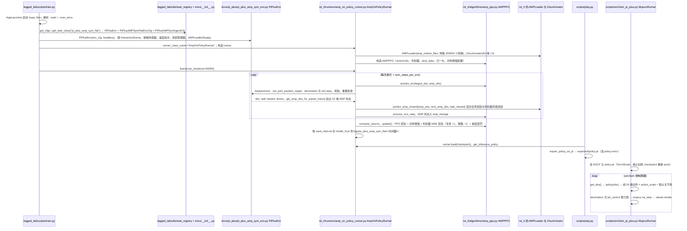

# Mini Pi Plus AMP

## 一句话定义

**Mini Pi Plus AMP** 是 [高擎机电](https://github.com/HighTorque-Robotics) 公开的 **运动RL/技能训练** 开源项目：高擎官方仓库提供Mini Pi Plus人形机器人的AMP运动训练与仿真工具：Isaac Lab GPU并行训练、AMP+PPO与镜像轨迹增强（pi_plus_amp_sym_flat，4096并行环境、50000迭代）、MuJoCo sim2sim验证、策略回放与AMP动画、TensorBoard日志及TorchScript导出，并附带三个示例权重；README明确面向研究与仿真，实机连接前需受控验证。

## 英文缩写速查

| 缩写 | 英文全称 | 简要说明 |
|------|----------|----------|
| SDK | Software Development Kit | 真机控制与状态读取接口 |
| RL | Reinforcement Learning | 强化学习训练与策略优化 |
| VLA | Vision-Language-Action | 视觉–语言–动作统一策略 |
| Sim2Real | Simulation to Real | 仿真策略迁移真机 |
| URDF | Unified Robot Description Format | 机器人描述与仿真资产 |

## 为什么重要

- 收录于 [国内具身智能开源全景（76 家 · 424 项）](../overview/china-domestic-embodied-opensource-76-companies-technology-map.md) 的 **第一层** 分组。
- 与 [Humanoid Motion Intelligence](../entities/humanoid-motion-intelligence.md) 同源策展；本页为 **独立详情节点**，便于从公司清单跳到机制与入口说明。

## 核心原理

| 字段 | 内容 |
|------|------|
| 机构 | 高擎机电 |
| 类别 | 运动RL/技能训练 |
| 官方组织 | https://github.com/HighTorque-Robotics |

## 工程实践

1. 从官方 GitHub/Gitee 组织检索 `Mini Pi Plus AMP` 仓库并核对 README 许可与依赖。
2. 对照本库 [424 项覆盖索引](../queries/china-domestic-opensource-424-coverage.md) 查看同公司其它入口是否共用训练/部署链路。
3. 若与既有方法页（如 RL 框架、VLA、SDK）主题相同，优先读关联页中的「开源入口」小节，避免重复维护平行叙事。

## 局限与风险

- 公众号清单为 **策展快照**（2026-09-06）；仓库更名、归档或许可证变化须回官方组织页核实。
- **开源状态**：以仓库 README 与 release 为准（入库日按文章描述归纳，未逐仓 clone 验证）。

## 源码运行时序图

入口：训练 `python legged_lab/scripts/train.py --task=pi_plus_amp_sym_flat --headless --logger=tensorboard --num_envs=4096`；回放 `python legged_lab/scripts/play.py --task=pi_plus_amp_sym_flat --load_run=<run> --checkpoint=model_40000.pt`；MuJoCo 仿真 `python legged_lab/scripts/sim2sim_pi_plus.py --policy=Exported_policy/model_40000.pt --duration=30`。需要 Isaac Sim 4.5 / Isaac Lab 2.1 与 NVIDIA GPU（README）。

图依据：HighTorque-Robotics/Mini-Pi-Plus_AMP@6a71f08，读过 README.md、legged_lab/scripts/train.py、legged_lab/scripts/play.py（导出与循环部分）、legged_lab/scripts/sim2sim_pi_plus.py、legged_lab/envs/__init__.py、legged_lab/envs/pi_plus/pi_plus_amp_sym_cfg.py（关键配置项）、legged_lab/envs/pi_plus/pi_plus_amp_sym_env.py（init、step、check_reset、get_amp_obs_for_expert_trans）、rsl_rl/rsl_rl/runners/amp_on_policy_runner.py、rsl_rl/rsl_rl/algorithms/amp_ppo.py。奖励函数、域随机化事件、`AMPLoader` / `Discriminator` 内部与观测构造未细读。

## 关联页面

- [国内具身开源全景技术地图](../overview/china-domestic-embodied-opensource-76-companies-technology-map.md)
- [HMI 开源项目主表导读](../queries/hmi-opensource-projects-coverage.md)
- [Humanoid Motion Intelligence](../entities/humanoid-motion-intelligence.md)

## 参考来源

- [Mini Pi Plus AMP 源码归档](../../sources/repos/mini-pi-plus_amp.md)（<https://github.com/HighTorque-Robotics/Mini-Pi-Plus_AMP>）

- [国内具身智能开源全景（微信公众号）](../../sources/blogs/wechat_embodied_station_domestic_opensource_panorama_2026-09-06.md)
- 源码核对（2026-11-02）：HighTorque-Robotics/Mini-Pi-Plus_AMP@6a71f08，读过 README.md、legged_lab/scripts/（train.py、play.py、sim2sim_pi_plus.py）、legged_lab/envs/__init__.py、legged_lab/envs/pi_plus/（pi_plus_amp_sym_cfg.py、pi_plus_amp_sym_env.py）、rsl_rl/rsl_rl/runners/amp_on_policy_runner.py、rsl_rl/rsl_rl/algorithms/amp_ppo.py；时序图依据以上文件，未运行代码。

## 推荐继续阅读

- [高擎机电 官方组织](https://github.com/HighTorque-Robotics)
