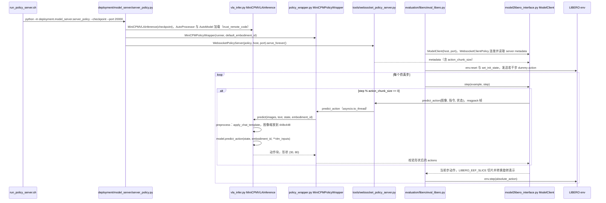

# MiniCPM-Robot

## 一句话定义

**MiniCPM-Robot** 是 [面壁智能](https://github.com/OpenBMB) 公开的 **具身Agent/规划** 开源项目：将小型多模态模型用于机器人视觉跟踪、目标理解和动作决策，并提供Jetson、ROS 2及机器人SDK集成入口；项目强调本地断网运行和工程部署。

## 英文缩写速查

| 缩写 | 英文全称 | 简要说明 |
|------|----------|----------|
| SDK | Software Development Kit | 真机控制与状态读取接口 |
| RL | Reinforcement Learning | 强化学习训练与策略优化 |
| VLA | Vision-Language-Action | 视觉–语言–动作统一策略 |
| Sim2Real | Simulation to Real | 仿真策略迁移真机 |
| URDF | Unified Robot Description Format | 机器人描述与仿真资产 |

## 为什么重要

- 收录于 [国内具身智能开源全景（76 家 · 424 项）](../overview/china-domestic-embodied-opensource-76-companies-technology-map.md) 的 **第二层** 分组。
- 与 [Humanoid Motion Intelligence](../entities/humanoid-motion-intelligence.md) 同源策展；本页为 **独立详情节点**，便于从公司清单跳到机制与入口说明。

## 核心原理

| 字段 | 内容 |
|------|------|
| 机构 | 面壁智能 |
| 类别 | 具身Agent/规划 |
| 官方组织 | https://github.com/OpenBMB |

## 工程实践

1. 从官方 GitHub/Gitee 组织检索 `MiniCPM-Robot` 仓库并核对 README 许可与依赖。
2. 对照本库 [424 项覆盖索引](../queries/china-domestic-opensource-424-coverage.md) 查看同公司其它入口是否共用训练/部署链路。
3. 若与既有方法页（如 RL 框架、VLA、SDK）主题相同，优先读关联页中的「开源入口」小节，避免重复维护平行叙事。

## 局限与风险

- 公众号清单为 **策展快照**（2026-09-06）；仓库更名、归档或许可证变化须回官方组织页核实。
- **开源状态**：以仓库 README 与 release 为准（入库日按文章描述归纳，未逐仓 clone 验证）。

## 源码运行时序图

入口（仓库含 MiniCPM-RobotManip 与 MiniCPM-RobotTrack 两个子项目，本图只画 RobotManip）：单样本推理 `cd MiniCPM-RobotManip && python vla_infer.py --image frame.jpg --text "..." --checkpoint ./checkpoint --embodiment-id 0`；LIBERO 评测先 `EMBODIMENT_ID=<id> bash evaluation/libero/run_policy_server.sh` 起策略服务，再 `LIBERO_HOME=<LIBERO 路径> bash evaluation/libero/eval_libero.sh` 起客户端。模型结构代码不在本仓库中，由 `AutoModel.from_pretrained(..., trust_remote_code=True)` 从 checkpoint 目录加载。

图依据：OpenBMB/MiniCPM-Robot@f666593，读过 `README.md`、`MiniCPM-RobotManip/vla_infer.py`、`deployment/model_server/server_policy.py`、`policy_wrapper.py`、`tools/websocket_policy_server.py`、`tools/websocket_policy_client.py`（仅函数签名）、`evaluation/libero/run_policy_server.sh`、`eval_libero.sh`、`eval_libero.py`、`model2libero_interface.py`；`MiniCPM-RobotTrack` 未读。

## 关联页面

- [国内具身开源全景技术地图](../overview/china-domestic-embodied-opensource-76-companies-technology-map.md)
- [HMI 开源项目主表导读](../queries/hmi-opensource-projects-coverage.md)
- [Humanoid Motion Intelligence](../entities/humanoid-motion-intelligence.md)

## 参考来源

- [MiniCPM-Robot 源码归档](../../sources/repos/minicpm-robot.md)（<https://github.com/OpenBMB/MiniCPM-Robot>）

- [国内具身智能开源全景（微信公众号）](../../sources/blogs/wechat_embodied_station_domestic_opensource_panorama_2026-09-06.md)
- 源码核对（2026-11-02）：OpenBMB/MiniCPM-Robot@f666593，读过 README.md、MiniCPM-RobotManip/vla_infer.py、deployment/model_server/server_policy.py、policy_wrapper.py、tools/websocket_policy_server.py、tools/websocket_policy_client.py、evaluation/libero/run_policy_server.sh、eval_libero.sh、eval_libero.py、model2libero_interface.py；时序图依据以上文件，未运行代码；MiniCPM-RobotTrack 子项目未读。

## 推荐继续阅读

- [面壁智能 官方组织](https://github.com/OpenBMB)
