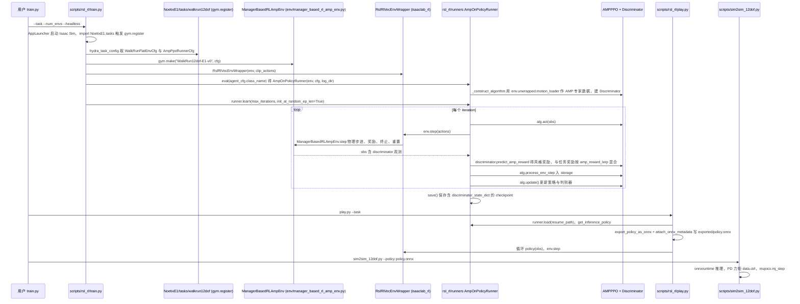

# noetix_e1_lab

## 一句话定义

**noetix_e1_lab** 是 [松延动力](https://github.com/Noetix-Robotics) 公开的 **运动RL/技能训练** 开源项目：为E1人形机器人提供Isaac Lab强化学习训练环境和任务配置。

## 英文缩写速查

| 缩写 | 英文全称 | 简要说明 |
|------|----------|----------|
| SDK | Software Development Kit | 真机控制与状态读取接口 |
| RL | Reinforcement Learning | 强化学习训练与策略优化 |
| VLA | Vision-Language-Action | 视觉–语言–动作统一策略 |
| Sim2Real | Simulation to Real | 仿真策略迁移真机 |
| URDF | Unified Robot Description Format | 机器人描述与仿真资产 |

## 为什么重要

- 收录于 [国内具身智能开源全景（76 家 · 424 项）](../overview/china-domestic-embodied-opensource-76-companies-technology-map.md) 的 **第一层** 分组。
- 与 [Humanoid Motion Intelligence](../entities/humanoid-motion-intelligence.md) 同源策展；本页为 **独立详情节点**，便于从公司清单跳到机制与入口说明。

## 核心原理

| 字段 | 内容 |
|------|------|
| 机构 | 松延动力 |
| 类别 | 运动RL/技能训练 |
| 官方组织 | https://github.com/Noetix-Robotics |

## 工程实践

1. 从官方 GitHub/Gitee 组织检索 `noetix_e1_lab` 仓库并核对 README 许可与依赖。
2. 对照本库 [424 项覆盖索引](../queries/china-domestic-opensource-424-coverage.md) 查看同公司其它入口是否共用训练/部署链路。
3. 若与既有方法页（如 RL 框架、VLA、SDK）主题相同，优先读关联页中的「开源入口」小节，避免重复维护平行叙事。

## 局限与风险

- 公众号清单为 **策展快照**（2026-09-06）；仓库更名、归档或许可证变化须回官方组织页核实。
- **开源状态**：以仓库 README 与 release 为准（入库日按文章描述归纳，未逐仓 clone 验证）。

## 源码运行时序图

入口：`python scripts/rsl_rl/train.py --task=WalkRun12dof-E1-v0 --num_envs=4096 --headless`（训练）→ `python scripts/rsl_rl/play.py --task=WalkRun12dof-E1-v0 --num_envs=1`（回放并导出 ONNX）→ `python scripts/sim2sim_12dof.py --policy .../exported/policy.onnx`（MuJoCo 跨仿真验证）。下图画 WalkRun12dof（AMP-PPO）链路；`Mimic-E1-v0` 任务另有 `tasks/mimic`，本次未读。

图依据：Noetix-Robotics/noetix_e1_lab@5a1d62d，读过 README.md、scripts/rsl_rl/{train,play}.py、scripts/sim2sim_12dof.py（run 循环）、source/NoetixE1/NoetixE1/tasks/walkrun12dof/noetix_e1/{__init__.py,agents/rsl_rl_amp_ppo_cfg.py,env/manager_based_rl_amp_env.py}（仅 step 文档串与类定义）、rsl_rl/rsl_rl/runners/amp_on_policy_runner.py（learn、save、_construct_algorithm 相关段）；Isaac Lab 自身代码、mdp 奖励细节、`tasks/mimic` 与 `sim2sim_mimic.py` 未读。注意 play.py 里文件前半部分是被注释掉的旧版本，实际生效的是 318 行之后的代码。

## 关联页面

- [国内具身开源全景技术地图](../overview/china-domestic-embodied-opensource-76-companies-technology-map.md)
- [HMI 开源项目主表导读](../queries/hmi-opensource-projects-coverage.md)
- [Humanoid Motion Intelligence](../entities/humanoid-motion-intelligence.md)

## 参考来源

- [noetix_e1_lab 源码归档](../../sources/repos/noetix_e1_lab.md)（<https://github.com/Noetix-Robotics/noetix_e1_lab>）

- [国内具身智能开源全景（微信公众号）](../../sources/blogs/wechat_embodied_station_domestic_opensource_panorama_2026-09-06.md)
- 源码核对（2026-11-02）：Noetix-Robotics/noetix_e1_lab@5a1d62d，读过 README.md、scripts/rsl_rl/train.py、scripts/rsl_rl/play.py、scripts/sim2sim_12dof.py、walkrun12dof 的 __init__.py / agents/rsl_rl_amp_ppo_cfg.py / env/manager_based_rl_amp_env.py、rsl_rl/rsl_rl/runners/amp_on_policy_runner.py；时序图依据以上文件，未运行代码。

## 推荐继续阅读

- [松延动力 官方组织](https://github.com/Noetix-Robotics)
