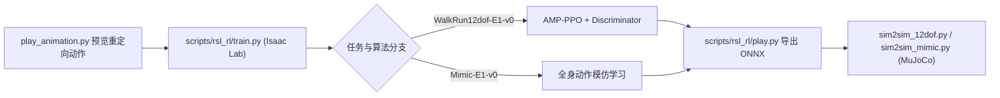
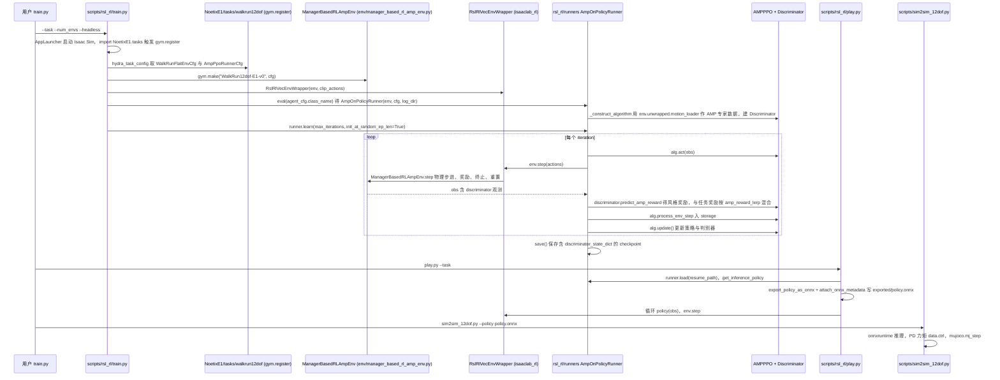

# noetix_e1_lab

## 一句话定义

**noetix_e1_lab** 是 [松延动力](https://github.com/Noetix-Robotics) 公开的 **运动RL/技能训练** 开源项目：为E1人形机器人提供Isaac Lab强化学习训练环境和任务配置。

## 英文缩写速查

| 缩写 | 英文全称 | 简要说明 |
|------|----------|----------|
| SDK | Software Development Kit | 真机控制与状态读取接口 |
| RL | Reinforcement Learning | 强化学习训练与策略优化 |
| VLA | Vision-Language-Action | 视觉–语言–动作统一策略 |
| Sim2Real | Simulation to Real | 仿真策略迁移真机 |
| URDF | Unified Robot Description Format | 机器人描述与仿真资产 |

## 为什么重要

- 收录于 [国内具身智能开源全景（76 家 · 424 项）](../overview/china-domestic-embodied-opensource-76-companies-technology-map.md) 的 **第一层** 分组。
- 与 [Humanoid Motion Intelligence](../entities/humanoid-motion-intelligence.md) 同源策展；本页为 **独立详情节点**，便于从公司清单跳到机制与入口说明。

## 核心原理

`noetix_e1_lab` 是 [松延动力](https://github.com/Noetix-Robotics) 基于现代 **Isaac Sim 5.0.0 + Isaac Lab (2.2.1/2.3.0) + RSL-RL 3.0.1** 构建的 E1 人形机器人强化学习框架（BSD-3-Clause License）：

- **双任务体系**：面向下肢走跑的 `WalkRun12dof-E1-v0`（采用 **AMP-PPO**，由 `Discriminator` 联合专家 `motion_loader` 与任务奖励 `amp_reward_lerp` 共同塑形步态风格）与面向全身动作跟踪的 `Mimic-E1-v0`。
- **数据预览 → 训练 → ONNX 导出闭环**：支持训练前通过 `play_animation.py` 检视重定向动作数据集；训练由 `scripts/rsl_rl/train.py` 驱动 `AmpOnPolicyRunner` 完成，结束后由 `scripts/rsl_rl/play.py` 导出带元数据的 `policy.onnx`。
- **双分支 MuJoCo Sim2Sim 验证**：针对走跑与模仿两类策略分别提供 `scripts/sim2sim_12dof.py` 与 `scripts/sim2sim_mimic.py`，用 `onnxruntime` 在 MuJoCo 内做 PD 扭矩跨仿真验收。

> 图依据：[`Noetix-Robotics/noetix_e1_lab@5a1d62d`](https://github.com/Noetix-Robotics/noetix_e1_lab) `README.md`、`scripts/rsl_rl/{train,play}.py`、`scripts/sim2sim_12dof.py`。

## 工程实践

1. **版本组合安装**：在 Python 3.11 环境中配合 Isaac Sim 5.0.0 与 Isaac Lab 2.2.1/2.3.0 安装仓库内置的 `rsl_rl==3.0.1` 定制版及 `NoetixE1` 扩展包；从旧版 [noetix_n2_gym](./cn-os-noetix-n2-gym.md) 迁移时可参考此技术栈升级路径。
2. **走跑与模仿验证分离**：训练 `WalkRun12dof-E1-v0` 后用 `sim2sim_12dof.py` 测试抗扰步态；训练 `Mimic-E1-v0` 则对应使用 `sim2sim_mimic.py` 并核对参考轨迹同步频率。
3. **代码维护注意**：源码审读发现 `scripts/rsl_rl/play.py` 前半部分保留了已注释的旧版代码，实际生效逻辑从第 318 行开始，二次开发修改导出字段时需定位至生效段。

## 局限与风险

- 强依赖 **Isaac Sim 5.0.0** 商业软件环境与高显存 NVIDIA GPU，轻量化或 CI 离线训练门槛高于纯 MuJoCo/Brax 框架。
- 仓库覆盖训练、ONNX 导出及 MuJoCo Sim2Sim，不包含真机底层电机/DDS 驱动（Bumi 平台真机部署模式可对照 [noetix_sdk_bumi](./cn-os-noetix-sdk-bumi.md)）；本次核对未物理执行仿真与训练。

## 源码运行时序图

入口：`python scripts/rsl_rl/train.py --task=WalkRun12dof-E1-v0 --num_envs=4096 --headless`（训练）→ `python scripts/rsl_rl/play.py --task=WalkRun12dof-E1-v0 --num_envs=1`（回放并导出 ONNX）→ `python scripts/sim2sim_12dof.py --policy .../exported/policy.onnx`（MuJoCo 跨仿真验证）。下图画 WalkRun12dof（AMP-PPO）链路；`Mimic-E1-v0` 任务另有 `tasks/mimic`，本次未读。

图依据：Noetix-Robotics/noetix_e1_lab@5a1d62d，读过 README.md、scripts/rsl_rl/{train,play}.py、scripts/sim2sim_12dof.py（run 循环）、source/NoetixE1/NoetixE1/tasks/walkrun12dof/noetix_e1/{__init__.py,agents/rsl_rl_amp_ppo_cfg.py,env/manager_based_rl_amp_env.py}（仅 step 文档串与类定义）、rsl_rl/rsl_rl/runners/amp_on_policy_runner.py（learn、save、_construct_algorithm 相关段）；Isaac Lab 自身代码、mdp 奖励细节、`tasks/mimic` 与 `sim2sim_mimic.py` 未读。注意 play.py 里文件前半部分是被注释掉的旧版本，实际生效的是 318 行之后的代码。

## 关联页面

- [国内具身开源全景技术地图](../overview/china-domestic-embodied-opensource-76-companies-technology-map.md)
- [HMI 开源项目主表导读](../queries/hmi-opensource-projects-coverage.md)
- [Humanoid Motion Intelligence](../entities/humanoid-motion-intelligence.md)

## 参考来源

- [noetix_e1_lab 源码归档](../../sources/repos/noetix_e1_lab.md)（<https://github.com/Noetix-Robotics/noetix_e1_lab>）

- [国内具身智能开源全景（微信公众号）](../../sources/blogs/wechat_embodied_station_domestic_opensource_panorama_2026-09-06.md)
- 源码核对（2026-11-02）：Noetix-Robotics/noetix_e1_lab@5a1d62d，读过 README.md、scripts/rsl_rl/train.py、scripts/rsl_rl/play.py、scripts/sim2sim_12dof.py、walkrun12dof 的 __init__.py / agents/rsl_rl_amp_ppo_cfg.py / env/manager_based_rl_amp_env.py、rsl_rl/rsl_rl/runners/amp_on_policy_runner.py；时序图依据以上文件，未运行代码。

## 推荐继续阅读

- [松延动力 官方组织](https://github.com/Noetix-Robotics)
