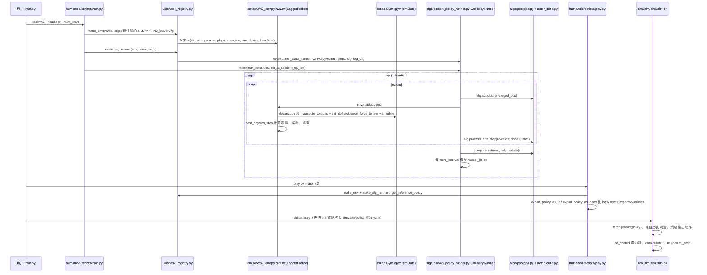

# noetix_n2_gym

## 一句话定义

**noetix_n2_gym** 是 [松延动力](https://github.com/Noetix-Robotics) 公开的 **运动RL/技能训练** 开源项目：为N2人形机器人提供Isaac Gym训练环境、动作加载、AMP和Sim2Sim工具。

## 英文缩写速查

| 缩写 | 英文全称 | 简要说明 |
|------|----------|----------|
| SDK | Software Development Kit | 真机控制与状态读取接口 |
| RL | Reinforcement Learning | 强化学习训练与策略优化 |
| VLA | Vision-Language-Action | 视觉–语言–动作统一策略 |
| Sim2Real | Simulation to Real | 仿真策略迁移真机 |
| URDF | Unified Robot Description Format | 机器人描述与仿真资产 |

## 为什么重要

- 收录于 [国内具身智能开源全景（76 家 · 424 项）](../overview/china-domestic-embodied-opensource-76-companies-technology-map.md) 的 **第一层** 分组。
- 与 [Humanoid Motion Intelligence](../entities/humanoid-motion-intelligence.md) 同源策展；本页为 **独立详情节点**，便于从公司清单跳到机制与入口说明。

## 核心原理

| 字段 | 内容 |
|------|------|
| 机构 | 松延动力 |
| 类别 | 运动RL/技能训练 |
| 官方组织 | https://github.com/Noetix-Robotics |

## 工程实践

1. 从官方 GitHub/Gitee 组织检索 `noetix_n2_gym` 仓库并核对 README 许可与依赖。
2. 对照本库 [424 项覆盖索引](../queries/china-domestic-opensource-424-coverage.md) 查看同公司其它入口是否共用训练/部署链路。
3. 若与既有方法页（如 RL 框架、VLA、SDK）主题相同，优先读关联页中的「开源入口」小节，避免重复维护平行叙事。

## 局限与风险

- 公众号清单为 **策展快照**（2026-09-06）；仓库更名、归档或许可证变化须回官方组织页核实。
- **开源状态**：以仓库 README 与 release 为准（入库日按文章描述归纳，未逐仓 clone 验证）。

## 源码运行时序图

入口：`python humanoid/scripts/train.py --task=n2 --headless --num_envs 4096`，随后 `python humanoid/scripts/play.py --task=n2`（导出 JIT/ONNX），再 `python sim2sim/sim2sim.py`（MuJoCo 跨仿真，读 `sim2sim/configs/n2_10dof.yaml` 默认配置）。任务名在 `humanoid/envs/__init__.py` 注册：`n2`、`n2_10dof`、`n2_mimic`。

图依据：Noetix-Robotics/noetix_n2_gym@153aad1，读过 README.md、humanoid/scripts/{train,play}.py、humanoid/envs/__init__.py、humanoid/utils/task_registry.py、humanoid/envs/base/legged_robot.py（step）、humanoid/algo/ppo/on_policy_runner.py（learn 段）、sim2sim/sim2sim.py；`n2_env.py` 的奖励/观测细节、ppo.py、`amp_utils/motion_loader.py`、`n2_mimic` 任务具体实现未读，图中不涉及 AMP。

## 关联页面

- [国内具身开源全景技术地图](../overview/china-domestic-embodied-opensource-76-companies-technology-map.md)
- [HMI 开源项目主表导读](../queries/hmi-opensource-projects-coverage.md)
- [Humanoid Motion Intelligence](../entities/humanoid-motion-intelligence.md)

## 参考来源

- [noetix_n2_gym 源码归档](../../sources/repos/noetix_n2_gym.md)（<https://github.com/Noetix-Robotics/noetix_n2_gym>）

- [国内具身智能开源全景（微信公众号）](../../sources/blogs/wechat_embodied_station_domestic_opensource_panorama_2026-09-06.md)
- 源码核对（2026-11-02）：Noetix-Robotics/noetix_n2_gym@153aad1，读过 README.md、humanoid/scripts/train.py、humanoid/scripts/play.py、humanoid/envs/__init__.py、humanoid/utils/task_registry.py、humanoid/envs/base/legged_robot.py、humanoid/algo/ppo/on_policy_runner.py、sim2sim/sim2sim.py；时序图依据以上文件，未运行代码。

## 推荐继续阅读

- [松延动力 官方组织](https://github.com/Noetix-Robotics)
