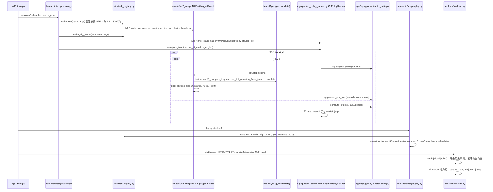

# noetix_n2_gym

## 一句话定义

**noetix_n2_gym** 是 [松延动力](https://github.com/Noetix-Robotics) 公开的 **运动RL/技能训练** 开源项目：为N2人形机器人提供Isaac Gym训练环境、动作加载、AMP和Sim2Sim工具。

## 英文缩写速查

| 缩写 | 英文全称 | 简要说明 |
|------|----------|----------|
| SDK | Software Development Kit | 真机控制与状态读取接口 |
| RL | Reinforcement Learning | 强化学习训练与策略优化 |
| VLA | Vision-Language-Action | 视觉–语言–动作统一策略 |
| Sim2Real | Simulation to Real | 仿真策略迁移真机 |
| URDF | Unified Robot Description Format | 机器人描述与仿真资产 |

## 为什么重要

- 收录于 [国内具身智能开源全景（76 家 · 424 项）](../overview/china-domestic-embodied-opensource-76-companies-technology-map.md) 的 **第一层** 分组。
- 与 [Humanoid Motion Intelligence](../entities/humanoid-motion-intelligence.md) 同源策展；本页为 **独立详情节点**，便于从公司清单跳到机制与入口说明。

## 核心原理

`noetix_n2_gym` 是 [松延动力](https://github.com/Noetix-Robotics) 基于 `humanoid-gym` 构建、面向 N2 人形机器人的 Isaac Gym Preview 4 强化学习运动控制仓库：

- **三类核心任务（`humanoid/envs/__init__.py`）**：注册 `n2`（18DoF 全身双足控制）、`n2_10dof`（10DoF 下肢版本）与 `n2_mimic`（动作模仿任务），依托 `N2Env`（继承 `LeggedRobot`）执行物理步进与奖励计算。
- **PPO / AMP 策略训练栈**：在 `PyTorch 1.13.1 (cu118)` 下通过 `OnPolicyRunner` 与 `ActorCritic` 执行大规模并行 rollout 与策略更新（默认示例 `--num_envs 4096`）。
- **Sim2Sim 跨仿真迁移验证**：`play.py` 将训练权重导出为 TorchScript JIT 与 ONNX 文件至 `logs/<exp>/exported/policies`，随后由 `sim2sim/sim2sim.py` 在 MuJoCo 物理引擎中以历史观测堆叠 + PD 控制闭环验证。

> 图依据：[`Noetix-Robotics/noetix_n2_gym@153aad1`](https://github.com/Noetix-Robotics/noetix_n2_gym) `README.md`、`humanoid/scripts/{train,play}.py`、`sim2sim/sim2sim.py`。

## 工程实践

1. **环境对齐**：严格匹配 README 指定的 `Python 3.8 + Isaac Gym Preview 4 + PyTorch 1.13.1/cu118 + MuJoCo`；新代号/新版本硬件可对比面向 E1 的 [noetix_e1_lab](./cn-os-noetix-e1-lab.md)（Isaac Lab + RSL-RL）。
2. **标准训练与导出**：运行 `python humanoid/scripts/train.py --task=n2 --headless --num_envs 4096`，完成后运行 `python humanoid/scripts/play.py --task=n2` 导出策略至 `exported/policies`。
3. **Sim2Sim 配置文件同步**：运行 `python sim2sim/sim2sim.py` 前务必将导出策略拷入 `sim2sim/policy` 并检查 `sim2sim/configs/` 下对应 YAML 的关节顺序与默认姿态是否匹配所选任务（默认配置指向 `n2_10dof.yaml`）。

## 局限与风险

- 依赖已停止迭代的 **Isaac Gym Preview 4** 与较旧 Python 3.8 / PyTorch 1.13.1 栈，在新架构 GPU 或现代驱动上部署前需确认兼容性。
- 本仓库主要覆盖仿真训练与 MuJoCo Sim2Sim 验证，真机部署仍需对齐实机通讯接口、传感器延迟与关节安全限幅（参考 [noetix_sdk_bumi](./cn-os-noetix-sdk-bumi.md)）；本次核对未物理执行 GPU 训练与仿真。

## 源码运行时序图

入口：`python humanoid/scripts/train.py --task=n2 --headless --num_envs 4096`，随后 `python humanoid/scripts/play.py --task=n2`（导出 JIT/ONNX），再 `python sim2sim/sim2sim.py`（MuJoCo 跨仿真，读 `sim2sim/configs/n2_10dof.yaml` 默认配置）。任务名在 `humanoid/envs/__init__.py` 注册：`n2`、`n2_10dof`、`n2_mimic`。

图依据：Noetix-Robotics/noetix_n2_gym@153aad1，读过 README.md、humanoid/scripts/{train,play}.py、humanoid/envs/__init__.py、humanoid/utils/task_registry.py、humanoid/envs/base/legged_robot.py（step）、humanoid/algo/ppo/on_policy_runner.py（learn 段）、sim2sim/sim2sim.py；`n2_env.py` 的奖励/观测细节、ppo.py、`amp_utils/motion_loader.py`、`n2_mimic` 任务具体实现未读，图中不涉及 AMP。

## 关联页面

- [国内具身开源全景技术地图](../overview/china-domestic-embodied-opensource-76-companies-technology-map.md)
- [HMI 开源项目主表导读](../queries/hmi-opensource-projects-coverage.md)
- [Humanoid Motion Intelligence](../entities/humanoid-motion-intelligence.md)

## 参考来源

- [noetix_n2_gym 源码归档](../../sources/repos/noetix_n2_gym.md)（<https://github.com/Noetix-Robotics/noetix_n2_gym>）

- [国内具身智能开源全景（微信公众号）](../../sources/blogs/wechat_embodied_station_domestic_opensource_panorama_2026-09-06.md)
- 源码核对（2026-11-02）：Noetix-Robotics/noetix_n2_gym@153aad1，读过 README.md、humanoid/scripts/train.py、humanoid/scripts/play.py、humanoid/envs/__init__.py、humanoid/utils/task_registry.py、humanoid/envs/base/legged_robot.py、humanoid/algo/ppo/on_policy_runner.py、sim2sim/sim2sim.py；时序图依据以上文件，未运行代码。

## 推荐继续阅读

- [松延动力 官方组织](https://github.com/Noetix-Robotics)
