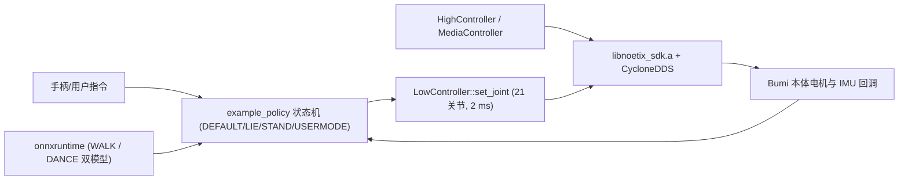
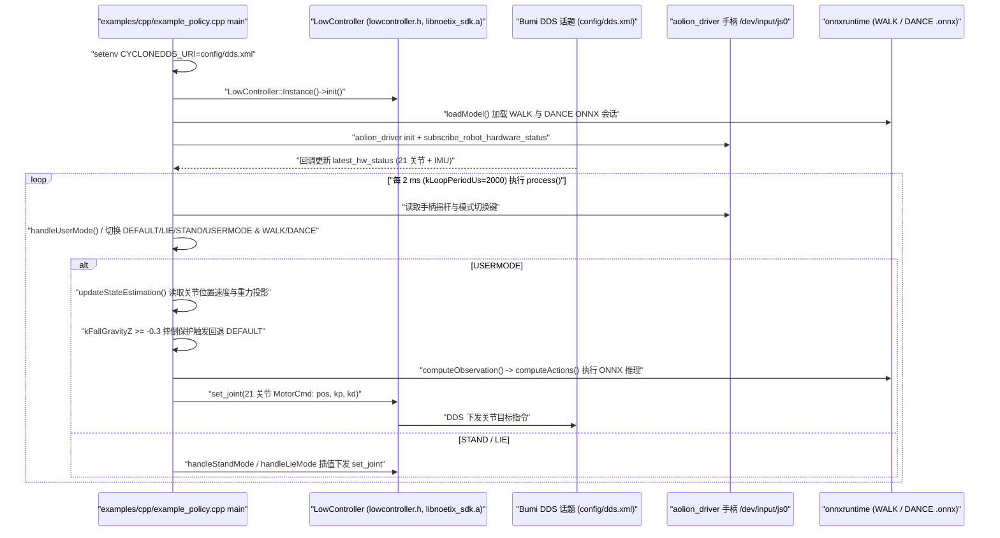

# noetix_sdk_bumi

## 一句话定义

**noetix_sdk_bumi** 是 [松延动力](https://github.com/Noetix-Robotics) 公开的 **SDK/驱动** 开源项目：通过DDS提供Bumi机器人的高层与低层控制示例，支持上层应用和本体联调。

## 英文缩写速查

| 缩写 | 英文全称 | 简要说明 |
|------|----------|----------|
| SDK | Software Development Kit | 真机控制与状态读取接口 |
| RL | Reinforcement Learning | 强化学习训练与策略优化 |
| VLA | Vision-Language-Action | 视觉–语言–动作统一策略 |
| Sim2Real | Simulation to Real | 仿真策略迁移真机 |
| URDF | Unified Robot Description Format | 机器人描述与仿真资产 |

## 为什么重要

- 收录于 [国内具身智能开源全景（76 家 · 424 项）](../overview/china-domestic-embodied-opensource-76-companies-technology-map.md) 的 **第一层** 分组。
- 与 [Humanoid Motion Intelligence](../entities/humanoid-motion-intelligence.md) 同源策展；本页为 **独立详情节点**，便于从公司清单跳到机制与入口说明。

## 核心原理

`noetix_sdk_bumi` 是 [松延动力](https://github.com/Noetix-Robotics) 为小布米（Bumi）人形机器人提供的 **C++17 / Python 混合控制 SDK**，在预编译通信静态库 `libnoetix_sdk.a` 之上分层暴露高层、低层与 ONNX 策略部署接口：

- **三层控制抽象 + 多媒体**：通过 `CMakeLists.txt` 构建 `example_high`（高层运动指令）、`example_low`（低层 21 关节 PD 力矩控制）、`example_policy`（RL ONNX 推理部署）与 `example_media`（语音/媒体控制），并由 **pybind11** 导出 `highcontrol_py`、`lowcontrol_py`、`mediacontrol_py`。
- **500 Hz 实时闭环与状态机保护（`example_policy.cpp`）**：以 `kLoopPeriodUs = 2000`（2 ms / 500 Hz）驱动 `process()` 循环；在 `USERMODE` 下经 `updateStateEstimation()` 读取 **21 关节** 与 IMU，执行摔倒重力检测（`kFallGravityZ = -0.3` 触发回退 `DEFAULT`），按控制分频运行 ONNX 推理并用 `set_joint()` 下发位置、刚度与阻尼目标。
- **双策略热切换（`95b2645` 更新）**：新版 `example_policy.cpp`（替代早期 `example_policy_walk.cpp`）支持手柄按键在 **WALK 与 DANCE** 两套 ONNX 策略模型间动态切换，与 [noetix_n2_gym](./cn-os-noetix-n2-gym.md) / [noetix_e1_lab](./cn-os-noetix-e1-lab.md) 导出的 ONNX 策略管线天然衔接。

> 图依据：[`Noetix-Robotics/noetix_sdk_bumi@95b2645`](https://github.com/Noetix-Robotics/noetix_sdk_bumi) `CMakeLists.txt`、`include/lowcontroller.h`、`examples/cpp/example_policy.cpp`。

## 工程实践

1. **构建与目标环境**：在 Ubuntu 22.04（GCC 11.4.0，支持 `x86_64` 与 `aarch64`）上运行 `./build.sh`；构建产物包含 4 个 C++ 可执行示例及 3 个 Python pybind11 扩展。
2. **CycloneDDS 与手柄初始化**：启动真机或策略程序前必须加载 `CYCLONEDDS_URI=config/dds.xml` 确保网段与本体域 ID 一致；策略模式通过 `/dev/input/js0` 手柄按键从 `DEFAULT → LIE/STAND → USERMODE` 逐级解锁，切勿跳过上电零位校准。
3. **脚本入口变更核对**：最新 `95b2645` 提交已将旧 `example_policy_walk` 重构并统一为 `example_policy`（同时支持行走与舞蹈 ONNX 策略），查阅早期文档时注意可执行文件名差异。

## 局限与风险

- **部分闭源二进制依赖**：DDS 通讯协议细节与硬件桥接封装在预编译静态库 `lib/<arch>/libnoetix_sdk.a` 及 CycloneDDS 库中，用户无法直接阅读或重构底层收发线程。
- 面向 Bumi 特定 `21 关节` 拓扑与 CycloneDDS 话题契约，无法不经适配直接驱动 E1/N2 或第三方本体；仓库根目录许可范围需联系官方核实。
- 本次核对未连接 Bumi 实机验证 500 Hz 实时闭环与摔倒保护动作。

## 源码运行时序图

入口：`./build.sh` 后运行 `build/example_policy`（支持 WALK / DANCE 双 ONNX 模型切换；另有 `example_high`、`example_low`、`example_media` 及 pybind11 模块 `highcontrol_py`/`lowcontrol_py`/`mediacontrol_py`）。核心通信静态库 `lib/<arch>/libnoetix_sdk.a` 为二进制交付（仅 `include/*.h` 可读），下图依据源码可见调用：

> 图依据：[`Noetix-Robotics/noetix_sdk_bumi@95b2645`](https://github.com/Noetix-Robotics/noetix_sdk_bumi) `README.md`、`CMakeLists.txt`、`include/lowcontroller.h`、`examples/cpp/example_policy.cpp`；`libnoetix_sdk.a` 内部实现为预编译静态库，未反汇编或运行实机。

## 关联页面

- [Scalabot / HERON-World Model](./scalabot-heron-world-model.md)（松延动力 2026-09 发布的具身大脑子品牌）
- [国内具身开源全景技术地图](../overview/china-domestic-embodied-opensource-76-companies-technology-map.md)
- [HMI 开源项目主表导读](../queries/hmi-opensource-projects-coverage.md)
- [Humanoid Motion Intelligence](../entities/humanoid-motion-intelligence.md)

- [机器人控制系统架构](../methods/robot-control-architecture.md)：对照相关方法与适用场景。
- [机器人软件系统集成](../methods/robot-software-integration.md)：对照相关方法与适用场景。

## 参考来源

- [noetix_sdk_bumi 源码归档](../../sources/repos/noetix_sdk_bumi.md)（<https://github.com/Noetix-Robotics/noetix_sdk_bumi>）

- [国内具身智能开源全景（微信公众号）](../../sources/blogs/wechat_embodied_station_domestic_opensource_panorama_2026-09-06.md)
- 源码核对（2026-11-21）：`Noetix-Robotics/noetix_sdk_bumi@95b2645`，读过 `README.md`、`CMakeLists.txt`、`include/lowcontroller.h`、`examples/cpp/example_policy.cpp`（并对照早期 `ff0bc6a` 提交差异）；未运行实机，预编译库 `libnoetix_sdk.a` 内部未读。

## 推荐继续阅读

- [松延动力 官方组织](https://github.com/Noetix-Robotics)
