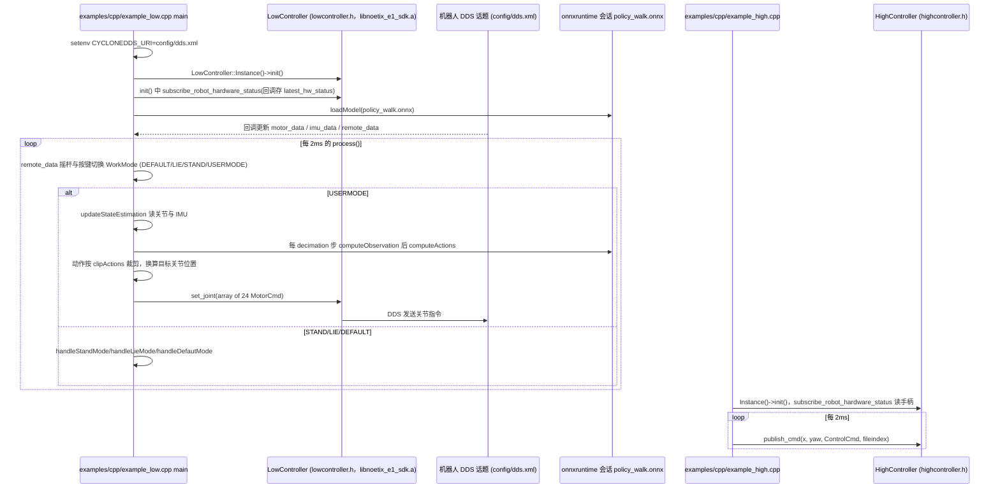

# noetix_sdk_e1

## 一句话定义

**noetix_sdk_e1** 是 [松延动力](https://github.com/Noetix-Robotics) 公开的 **SDK/驱动** 开源项目：提供E1人形机器人控制与状态接口，用于算法部署和二次开发。

## 英文缩写速查

| 缩写 | 英文全称 | 简要说明 |
|------|----------|----------|
| SDK | Software Development Kit | 真机控制与状态读取接口 |
| RL | Reinforcement Learning | 强化学习训练与策略优化 |
| VLA | Vision-Language-Action | 视觉–语言–动作统一策略 |
| Sim2Real | Simulation to Real | 仿真策略迁移真机 |
| URDF | Unified Robot Description Format | 机器人描述与仿真资产 |

## 为什么重要

- 收录于 [国内具身智能开源全景（76 家 · 424 项）](../overview/china-domestic-embodied-opensource-76-companies-technology-map.md) 的 **第一层** 分组。
- 与 [Humanoid Motion Intelligence](../entities/humanoid-motion-intelligence.md) 同源策展；本页为 **独立详情节点**，便于从公司清单跳到机制与入口说明。

## 核心原理

| 字段 | 内容 |
|------|------|
| 机构 | 松延动力 |
| 类别 | SDK/驱动 |
| 官方组织 | https://github.com/Noetix-Robotics |

## 工程实践

1. 从官方 GitHub/Gitee 组织检索 `noetix_sdk_e1` 仓库并核对 README 许可与依赖。
2. 对照本库 [424 项覆盖索引](../queries/china-domestic-opensource-424-coverage.md) 查看同公司其它入口是否共用训练/部署链路。
3. 若与既有方法页（如 RL 框架、VLA、SDK）主题相同，优先读关联页中的「开源入口」小节，避免重复维护平行叙事。

## 局限与风险

- 公众号清单为 **策展快照**（2026-09-06）；仓库更名、归档或许可证变化须回官方组织页核实。
- **开源状态**：以仓库 README 与 release 为准（入库日按文章描述归纳，未逐仓 clone 验证）。

## 源码运行时序图

入口：`./build.sh` 后在仓库根目录运行 `build/example_low`（ONNX 策略走路，读 `policy/policy_walk.onnx`）或 `build/example_high`（高层指令）；另有 pybind 模块 `highcontrol_py` / `lowcontrol_py` 与 `examples/py/test_*.py`。SDK 本体是预编译静态库 `lib/<arch>/libnoetix_e1_sdk.a`（DDS 通信在库内，仓库只有头文件），库内部不可读，下图只画示例源码可见的调用。

图依据：Noetix-Robotics/noetix_sdk_e1@3055bdc，读过 README.md、CMakeLists.txt（仅 add_executable/依赖 grep）、include/{lowcontroller,highcontroller}.h、include/common.h（ControlCmd 枚举）、examples/cpp/example_low.cpp（main、init、handleUserMode 开头与末尾、process 开头）、examples/cpp/example_high.cpp、examples/py/test_low.py；libnoetix_e1_sdk.a 内部为二进制未读；STAND/LIE/DEFAULT 分支内是否调用 set_joint 未逐行核对，故图中只写函数名；pybind 与 test_high.py 未读。

## 关联页面

- [国内具身开源全景技术地图](../overview/china-domestic-embodied-opensource-76-companies-technology-map.md)
- [HMI 开源项目主表导读](../queries/hmi-opensource-projects-coverage.md)
- [Humanoid Motion Intelligence](../entities/humanoid-motion-intelligence.md)

## 参考来源

- [noetix_sdk_e1 源码归档](../../sources/repos/noetix_sdk_e1.md)（<https://github.com/Noetix-Robotics/noetix_sdk_e1>）

- [国内具身智能开源全景（微信公众号）](../../sources/blogs/wechat_embodied_station_domestic_opensource_panorama_2026-09-06.md)
- 源码核对（2026-11-02）：Noetix-Robotics/noetix_sdk_e1@3055bdc，读过 README.md、include/lowcontroller.h、include/highcontroller.h、include/common.h、examples/cpp/example_low.cpp、example_high.cpp、examples/py/test_low.py；时序图依据以上文件，未运行代码；预编译库内部未读。

## 推荐继续阅读

- [松延动力 官方组织](https://github.com/Noetix-Robotics)
