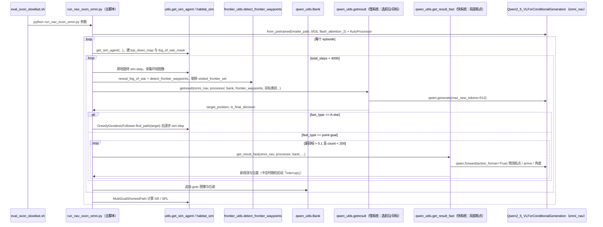

# OmniNav

## 一句话定义

**OmniNav** 是 [阿里巴巴](https://github.com/amap-cvlab) 公开的 **感知/导航** 开源项目：统一前瞻探索与视觉语言导航框架

## 英文缩写速查

| 缩写 | 英文全称 | 简要说明 |
|------|----------|----------|
| SDK | Software Development Kit | 真机控制与状态读取接口 |
| RL | Reinforcement Learning | 强化学习训练与策略优化 |
| VLA | Vision-Language-Action | 视觉–语言–动作统一策略 |
| Sim2Real | Simulation to Real | 仿真策略迁移真机 |
| URDF | Unified Robot Description Format | 机器人描述与仿真资产 |

## 为什么重要

- 收录于 [国内具身智能开源全景（76 家 · 424 项）](../overview/china-domestic-embodied-opensource-76-companies-technology-map.md) 的 **第四层** 分组。
- 与 [Humanoid Motion Intelligence](../entities/humanoid-motion-intelligence.md) 同源策展；本页为 **独立详情节点**，便于从公司清单跳到机制与入口说明。

## 核心原理

| 字段 | 内容 |
|------|------|
| 机构 | 阿里巴巴 |
| 类别 | 感知/导航 |
| 官方组织 | https://github.com/amap-cvlab、https://github.com/alibaba-damo-academy |

## 工程实践

1. 从官方 GitHub/Gitee 组织检索 `OmniNav` 仓库并核对 README 许可与依赖。
2. 对照本库 [424 项覆盖索引](../queries/china-domestic-opensource-424-coverage.md) 查看同公司其它入口是否共用训练/部署链路。
3. 若与既有方法页（如 RL 框架、VLA、SDK）主题相同，优先读关联页中的「开源入口」小节，避免重复维护平行叙事。

## 局限与风险

- 公众号清单为 **策展快照**（2026-09-06）；仓库更名、归档或许可证变化须回官方组织页核实。
- **开源状态**：以仓库 README 与 release 为准（入库日按文章描述归纳，未逐仓 clone 验证）。

## 关联页面

- [国内具身开源全景技术地图](../overview/china-domestic-embodied-opensource-76-companies-technology-map.md)
- [HMI 开源项目主表导读](../queries/hmi-opensource-projects-coverage.md)
- [Humanoid Motion Intelligence](../entities/humanoid-motion-intelligence.md)

## 源码运行时序图

入口：`bash eval_ovon_slowfast.sh`（`infer_ovon_slowfast/`，内部 `python ./infer_ovon_slowfast/run_nav_ovon_omni.py --pattern --model_path --name --fast_type`；`fast_type` 取 `A-star` 或 `point-goal`）。README 另列 `infer_ovon/eval_ovon.sh`（`FLOW_MATCH=true/false`，纯视觉快系统）与 R2R/RxR 的 `infer_r2r_rxr/eval_*.sh`、训练 `train_code/`，本图只画慢快协同的 OVON 脚本；其余未读。

图依据：amap-cvlab/OmniNav@e8b4859，读过 README.md、infer_ovon_slowfast/eval_ovon_slowfast.sh、infer_ovon_slowfast/run_nav_ovon_omni.py、infer_ovon_slowfast/qwen_utils.py（getresult、get_result_fast、函数列表）。

## 参考来源

- [OmniNav 源码归档](../../sources/repos/omninav.md)（<https://github.com/amap-cvlab/OmniNav>）

- [国内具身智能开源全景（微信公众号）](../../sources/blogs/wechat_embodied_station_domestic_opensource_panorama_2026-09-06.md)
- 源码核对（2026-11-02）：amap-cvlab/OmniNav@e8b4859，读过 README.md、infer_ovon_slowfast/{eval_ovon_slowfast.sh,run_nav_ovon_omni.py,qwen_utils.py}；时序图依据以上文件，未运行代码。

## 推荐继续阅读

- [阿里巴巴 官方组织](https://github.com/amap-cvlab)
