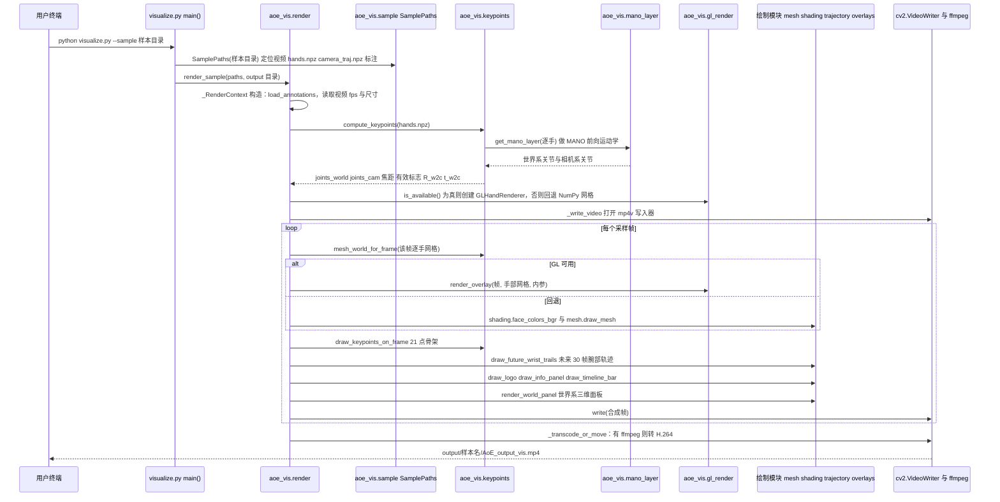

# Open-AoE

## 一句话定义

**Open-AoE** 是 [蚂蚁集团](https://github.com/ant-research) 公开的 **数据集/Benchmark** 开源项目：把消费级手机视频接到数据质检、相机与手部运动恢复、原子动作标注、可视化、跨本体重定向、机器人回放、模型格式转换和VLA或世界模型训练配方。

## 英文缩写速查

| 缩写 | 英文全称 | 简要说明 |
|------|----------|----------|
| SDK | Software Development Kit | 真机控制与状态读取接口 |
| RL | Reinforcement Learning | 强化学习训练与策略优化 |
| VLA | Vision-Language-Action | 视觉–语言–动作统一策略 |
| Sim2Real | Simulation to Real | 仿真策略迁移真机 |
| URDF | Unified Robot Description Format | 机器人描述与仿真资产 |

## 为什么重要

- 收录于 [国内具身智能开源全景（76 家 · 424 项）](../overview/china-domestic-embodied-opensource-76-companies-technology-map.md) 的 **第二层** 分组。
- 与 [Humanoid Motion Intelligence](../entities/humanoid-motion-intelligence.md) 同源策展；本页为 **独立详情节点**，便于从公司清单跳到机制与入口说明。

## 核心原理

| 字段 | 内容 |
|------|------|
| 机构 | 蚂蚁集团 |
| 类别 | 数据集/Benchmark |
| 官方组织 | https://github.com/ant-research |

## 工程实践

1. 从官方 GitHub/Gitee 组织检索 `Open-AoE` 仓库并核对 README 许可与依赖。
2. 对照本库 [424 项覆盖索引](../queries/china-domestic-opensource-424-coverage.md) 查看同公司其它入口是否共用训练/部署链路。
3. 若与既有方法页（如 RL 框架、VLA、SDK）主题相同，优先读关联页中的「开源入口」小节，避免重复维护平行叙事。

## 局限与风险

- 公众号清单为 **策展快照**（2026-09-06）；仓库更名、归档或许可证变化须回官方组织页核实。
- **开源状态**：以仓库 README 与 release 为准（入库日按文章描述归纳，未逐仓 clone 验证）。

## 源码运行时序图

入口：在 `aoe-visualization/` 目录下运行 `python visualize.py --sample /path/to/open_aoe_segment`（README Quick Start「Render the segment」；输出 `output/<segment-name>/AoE_output_vis.mp4`）

前置条件：需先用 `assets/mano/download_mano.sh` 把 MANO_RIGHT.pkl 与 MANO_LEFT.pkl 装入共享资产目录，并由 `scripts/convert_mano_pkl_to_npz.py` 转为 npz，MANO 模型文件不随仓库提供。

仓库另有 AoE-Reconstruct-Retarget、AoE-Training-Ready 等子项目，本图只取可视化入口一条路线，其余未画。

图依据：ant-research/Open-AoE@a993546，读过 README.md、aoe-visualization/README.md、aoe-visualization/visualize.py、aoe-visualization/aoe_vis/render.py（_RenderContext、compose、_write_video、render_sample）；keypoints.py 与 sample.py 仅核对了函数定义与 import。gl_render.py、mesh.py、shading.py、trajectory.py、overlays.py、mano_layer.py 未读内容，图中相关调用仅依据 render.py 的 import 与调用处。未运行代码。

## 关联页面

- [国内具身开源全景技术地图](../overview/china-domestic-embodied-opensource-76-companies-technology-map.md)
- [HMI 开源项目主表导读](../queries/hmi-opensource-projects-coverage.md)
- [Humanoid Motion Intelligence](../entities/humanoid-motion-intelligence.md)

## 参考来源

- [Open-AoE 源码归档](../../sources/repos/open-aoe.md)（<https://github.com/ant-research/Open-AoE>）

- [国内具身智能开源全景（微信公众号）](../../sources/blogs/wechat_embodied_station_domestic_opensource_panorama_2026-09-06.md)

- 源码核对（2026-11-02）：ant-research/Open-AoE@a993546，读过 README.md、aoe-visualization/README.md、aoe-visualization/visualize.py、aoe-visualization/aoe_vis/render.py、aoe-visualization/aoe_vis/keypoints.py（部分）、aoe-visualization/aoe_vis/sample.py（部分）；时序图依据以上文件，未运行代码。

## 推荐继续阅读

- [蚂蚁集团 官方组织](https://github.com/ant-research)
