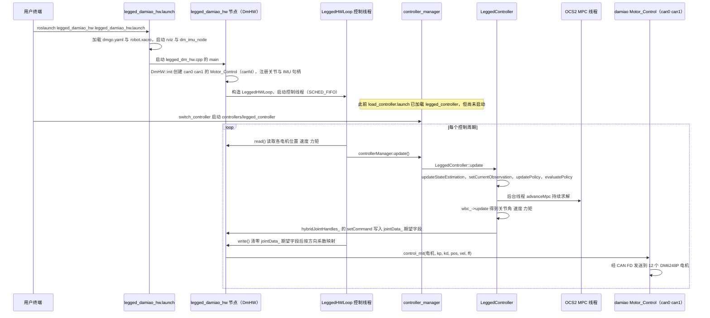

# open-dog

## 一句话定义

**open-dog** 是 [达妙科技](https://github.com/dmBots) 公开的 **工程与工具** 开源项目：公开达妙OpenDog01四足机器人资料，连接关节电机、机械结构和控制开发。

## 英文缩写速查

| 缩写 | 英文全称 | 简要说明 |
|------|----------|----------|
| SDK | Software Development Kit | 真机控制与状态读取接口 |
| RL | Reinforcement Learning | 强化学习训练与策略优化 |
| VLA | Vision-Language-Action | 视觉–语言–动作统一策略 |
| Sim2Real | Simulation to Real | 仿真策略迁移真机 |
| URDF | Unified Robot Description Format | 机器人描述与仿真资产 |

## 为什么重要

- 收录于 [国内具身智能开源全景（76 家 · 424 项）](../overview/china-domestic-embodied-opensource-76-companies-technology-map.md) 的 **第一层** 分组。
- 与 [Humanoid Motion Intelligence](../entities/humanoid-motion-intelligence.md) 同源策展；本页为 **独立详情节点**，便于从公司清单跳到机制与入口说明。

## 核心原理

| 字段 | 内容 |
|------|------|
| 机构 | 达妙科技 |
| 类别 | 工程与工具 |
| 官方组织 | https://github.com/dmBots |

## 工程实践

1. 从官方 GitHub/Gitee 组织检索 `open-dog` 仓库并核对 README 许可与依赖。
2. 对照本库 [424 项覆盖索引](../queries/china-domestic-opensource-424-coverage.md) 查看同公司其它入口是否共用训练/部署链路。
3. 若与既有方法页（如 RL 框架、VLA、SDK）主题相同，优先读关联页中的「开源入口」小节，避免重复维护平行叙事。

## 局限与风险

- 公众号清单为 **策展快照**（2026-09-06）；仓库更名、归档或许可证变化须回官方组织页核实。
- **开源状态**：以仓库 README 与 release 为准（入库日按文章描述归纳，未逐仓 clone 验证）。

## 源码运行时序图

入口（实机路线，取 `src/代码/README.md`「实机」步骤 6 至 8）：

1. `export ROBOT_TYPE=dmgo`，执行 `./can.sh` 配置 CAN FD，然后 `roslaunch legged_damiao_hw legged_damiao_hw.launch`
2. `roslaunch legged_controllers load_controller.launch cheater:=false`（只加载控制器）
3. `rosservice call /controller_manager/switch_controller` 启动 `controllers/legged_controller`

仓库另有仿真路线（`legged_damiao_description/launch/empty_world.launch`）与遥控器路线，本图只取实机路线。

源码注意（未运行代码，待实机核实）：`DmHW::write()` 从 `DmHW.cpp` 第 126 行起，先把 `jointData_` 的 `pos_des_ vel_des_ ff_ kp_ kd_` 全部清零，再发送；而控制器经 `HybridJointHandle` 写入的正是这些字段（`HybridJointInterface.h` 的 `setCommand`）。按读到的代码，控制器的期望值在发送前会被清零，需要核实是否为有意设计或笔误。

图依据：dmBots/open-dog@33b33f2，读过 src/代码/README.md（实机与仿真章节）、legged_damiao_hw/launch/legged_damiao_hw.launch、legged_damiao_hw/launch/dmgo.launch、legged_damiao_hw/src/legged_dm_hw.cpp、legged_damiao_hw/src/DmHW.cpp（init、read、write、setupJoints）、legged_damiao_hw/include/legged_damiao_hw/DmHW.h（部分）、legged_hw/src/LeggedHWLoop.cpp、legged_controllers/launch/load_controller.launch、legged_controllers/src/LeggedController.cpp（update 段）、legged_common/include/legged_common/hardware_interface/HybridJointInterface.h（setCommand 段）。BLE/MPC 内部与 WBC 实现未读。

## 关联页面

- [国内具身开源全景技术地图](../overview/china-domestic-embodied-opensource-76-companies-technology-map.md)
- [HMI 开源项目主表导读](../queries/hmi-opensource-projects-coverage.md)
- [Humanoid Motion Intelligence](../entities/humanoid-motion-intelligence.md)

## 参考来源

- [open-dog 源码归档](../../sources/repos/open-dog.md)（<https://github.com/dmBots/open-dog>）

- [国内具身智能开源全景（微信公众号）](../../sources/blogs/wechat_embodied_station_domestic_opensource_panorama_2026-09-06.md)

- 源码核对（2026-11-02）：dmBots/open-dog@33b33f2，读过 src/代码/README.md、legged_damiao_hw/launch/legged_damiao_hw.launch、legged_damiao_hw/launch/dmgo.launch、legged_damiao_hw/src/legged_dm_hw.cpp、legged_damiao_hw/src/DmHW.cpp、legged_hw/src/LeggedHWLoop.cpp、legged_controllers/launch/load_controller.launch、legged_controllers/src/LeggedController.cpp、legged_common/include/legged_common/hardware_interface/HybridJointInterface.h；时序图依据以上文件，未运行代码。

## 推荐继续阅读

- [达妙科技 官方组织](https://github.com/dmBots)
