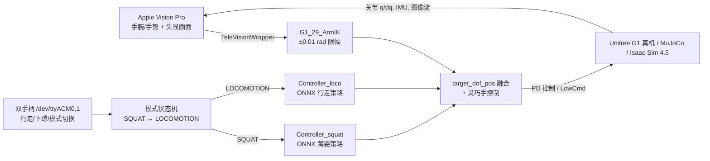
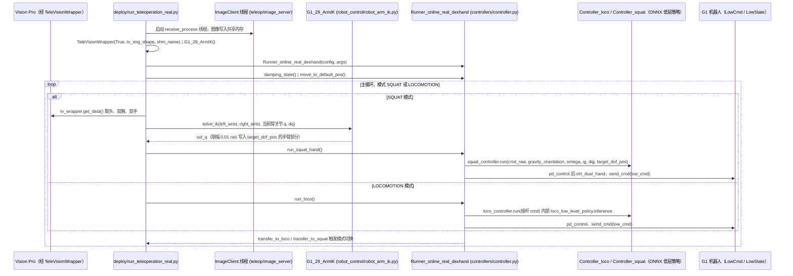

# OpenWBT

## 一句话定义

**OpenWBT** 是 [银河通用](https://github.com/GalaxyGeneralRobotics) 公开的 **具身Agent/规划** 开源项目：头显和手柄提供视角、手部目标与行走命令，上肢通过逆运动学生成手臂目标，下肢策略负责移动和姿态调整；同一部署入口覆盖MuJoCo、Isaac Sim和真实Unitree G1，使全身遥操作链能够分层检查。

## 英文缩写速查

| 缩写 | 英文全称 | 简要说明 |
|------|----------|----------|
| SDK | Software Development Kit | 真机控制与状态读取接口 |
| RL | Reinforcement Learning | 强化学习训练与策略优化 |
| VLA | Vision-Language-Action | 视觉–语言–动作统一策略 |
| Sim2Real | Simulation to Real | 仿真策略迁移真机 |
| URDF | Unified Robot Description Format | 机器人描述与仿真资产 |

## 为什么重要

- 收录于 [国内具身智能开源全景（76 家 · 424 项）](../overview/china-domestic-embodied-opensource-76-companies-technology-map.md) 的 **第二层** 分组。
- 与 [Humanoid Motion Intelligence](../entities/humanoid-motion-intelligence.md) 同源策展；本页为 **独立详情节点**，便于从公司清单跳到机制与入口说明。

## 核心原理

| 字段 | 内容 |
|------|------|
| 机构 | 银河通用（Galbot）· 清华大学 |
| 类别 | 全身遥操作（Whole-Body Teleoperation） |
| 开源仓库 | <https://github.com/GalaxyGeneralRobotics/OpenWBT>（Apache-2.0） |
| 支撑论文 | [R2S2 (arXiv:2505.10918)](./paper-notebook-unleashing-humanoid-reaching-potential-via-real.md)（README 声明非严格论文复现，含工程适配） |

OpenWBT 将单人全身遥操作拆分为**上肢视觉–逆运动学跟踪**与**下肢强化学习策略控制**两条解耦分支，通过模式状态机协同：

1. **上肢与视角通路：** 机器人端 `image_server.py` 采集第一视角图像并推流，主机端 `ImageClient` 写入共享内存并通过 WebRTC/WebSocket（`TeleVisionWrapper`）回传给 Apple Vision Pro；同时读取头、双腕与双手位姿，由 `G1_29_ArmIK.solve_ik` 解算 14 维双臂关节角（第 15–29 自由度），每步对关节目标增量做 `±0.01 rad` 限幅以防突变。
2. **下肢模式状态机与低层策略：** 双手持 USB 手柄（`/dev/ttyACM0`, `/dev/ttyACM1`）发送行走速度或下蹲/俯仰指令，在 `SQUAT`（下蹲姿态调整 + 上肢 IK + 灵巧手控制）与 `LOCOMOTION`（稳定行走）间切换；`Controller_squat` 与 `Controller_loco` 分别推理 ONNX 低层策略输出下肢动作并合并上肢目标，最终经 PD 控制发送至真机 DDS（`LowCmd`）或仿真引擎。

### 流程总览

图依据：`GalaxyGeneralRobotics/OpenWBT@a0154ca` 的 `README.md`、`deploy/run_teleoperation_real.py`、`deploy/run_teleoperation_mujoco.py` 与 `deploy/controllers/controller.py`。

## 工程实践

1. **硬件与网络准备：** 依据仓库 `installation.md` 配置双 USB 手柄权限（`sudo chmod -R 777 /dev/ttyACM0 /dev/ttyACM1`）及 Unitree G1 以太网静态路由；首次连接需在机器人端部署 `deploy/teleop/image_server/image_server.py` 并配置 Vision Pro 自签名 HTTPS 证书（`https://<ip>:8012`）。
2. **安全启动与调试流程：** 先用 Unitree 遥控器 `L2+R2` → `L2+A` → `L2+B` 进入阻尼模式；正式下发策略前建议加 `--debug` 启动真机脚本（`python -m deploy.run_teleoperation_real --config run_teleoperation.yaml --net eno1 --debug`）验证观测与 IK 输出而不驱动电机。
3. **多后端快速切换：**
   - MuJoCo 仿真：`python -m deploy.run_teleoperation_mujoco --config run_teleoperation.yaml`
   - Isaac Sim V4.5.0：分终端启动 `bash start_ik_server.sh` 与 `bash start_isaacsim_vision.sh`（无 VR 用 `start_isaacsim.sh`）。
4. **手柄模式操作：** 右手柄 `power` 键进入预备/启动；左 `A` 切至 `LOCOMOTION`（左 `D` 急停原地），右 `A` 切回 `SQUAT` 调整蹲高与俯仰，右 `D` 触发安全阻尼模式。
5. **开源核查（2026-11-21）：** Apache-2.0 协议已开源 Unitree G1 真机、MuJoCo 与 Isaac Sim 4.5.0 部署与遥操作代码；Unitree H1 支持与 Latent Skill Space 在 README TODO 中仍未发布。

## 局限与风险

- **工程实现与论文差异：** README 明确声明 OpenWBT 并非 [R2S2](paper-notebook-unleashing-humanoid-reaching-potential-via-real.md) 的严格复现（例如 Latent Skill Space 尚未在公开 TODO 中勾选），研究方法指标应以 R2S2 原论文为准。
- **平台与外设绑定：** 当前可运行入口面向 **Unitree G1**，强依赖 Apple Vision Pro（需局域网 HTTPS 证书信任）与特定双 USB 手柄映射；Unitree H1 入口尚未开放。
- **Isaac Sim 接口变动风险：** README 明确提示 Isaac Sim 4.5.0 接入仍在高频演进中，接口可能频繁破坏性变更；真机首次部署须保留急停与安全距离。

## 源码运行时序图

入口：真机 `python -m deploy.run_teleoperation_real --config run_teleoperation.yaml --net eno1`；仿真 `python -m deploy.run_teleoperation_mujoco --config run_teleoperation.yaml`（README 命令；机器人侧另需运行 `deploy/teleop/image_server/image_server.py`）。下图按真机脚本 `deploy_real()` 的实际调用画。

图依据：GalaxyGeneralRobotics/OpenWBT@a0154ca，读过 README.md、deploy/run_teleoperation_real.py、deploy/run_teleoperation_mujoco.py、deploy/controllers/controller.py（run_loco、run_squat_hand、Controller_loco.run）、deploy/teleop/robot_control/robot_arm_ik.py（solve_ik 签名）。TeleVisionWrapper、ik_server、handle_controller、policy_unified 的内部未读。

## 关联页面

- [R2S2（真实世界就绪技能空间）](./paper-notebook-unleashing-humanoid-reaching-potential-via-real.md)
- [Teleoperation](../tasks/teleoperation.md)
- [国内具身开源全景技术地图](../overview/china-domestic-embodied-opensource-76-companies-technology-map.md)
- [HMI 开源项目主表导读](../queries/hmi-opensource-projects-coverage.md)
- [Humanoid Motion Intelligence](../entities/humanoid-motion-intelligence.md)

## 参考来源

- [OpenWBT 源码归档](../../sources/repos/openwbt.md)（<https://github.com/GalaxyGeneralRobotics/OpenWBT>）
- [国内具身智能开源全景（微信公众号）](../../sources/blogs/wechat_embodied_station_domestic_opensource_panorama_2026-09-06.md)
- 源码核对（2026-11-21）：`GalaxyGeneralRobotics/OpenWBT@a0154ca`，通读 `README.md`、`deploy/run_teleoperation_real.py`、`deploy/run_teleoperation_mujoco.py`、`deploy/controllers/controller.py`、`deploy/teleop/robot_control/robot_arm_ik.py`（`solve_ik` 接口）；时序图与流程图依据以上文件，未运行真机/仿真代码。

## 推荐继续阅读

- [银河通用 官方组织](https://github.com/GalaxyGeneralRobotics)
