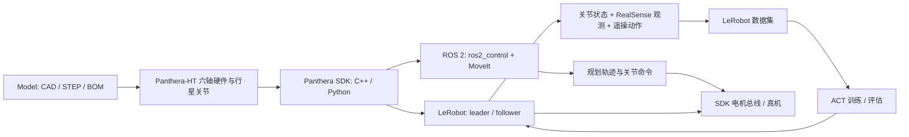
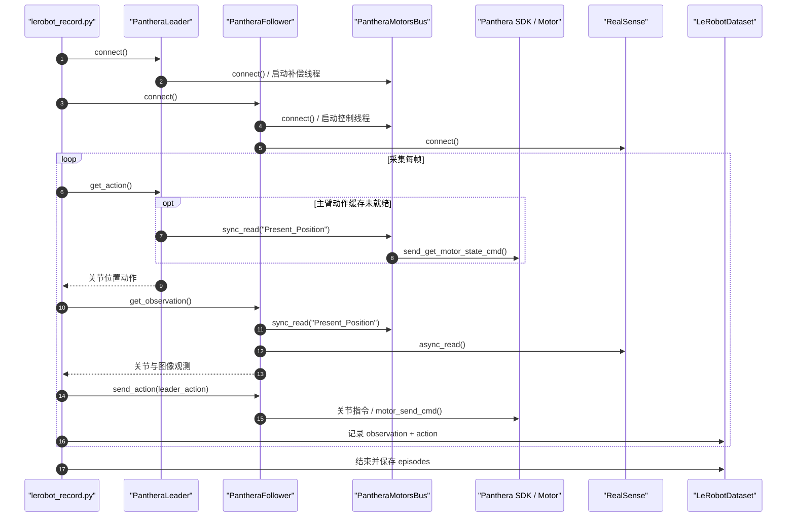

# Panthera-HT：高擎全开源六轴机械臂 / Open-Source 6-Axis Robotic Arm

## 一句话定义

**Panthera-HT** 是高擎动力（HighTorque Robotics）在 [Ragtime Panthera](https://github.com/Ragtime-LAB/Ragtime_Panthera) 社区项目基础上共同完善的桌面级**六轴行星关节模组机械臂**，以开源机械设计、C++/Python 控制 SDK、ROS 2 和 LeRobot 适配连接课程实验、双臂遥操、模仿学习采集与真机验证。**本页承接原有 Panthera-HT_Main 详情页，不另建同名实体。**

## 英文缩写速查

| 缩写 | 英文全称 | 简要说明 |
|---|---|---|
| DoF | Degrees of Freedom | 本体六个运动自由度，夹爪为单独末端执行器 |
| SDK | Software Development Kit | C++/Python 机器人控制、运动学与关节接口 |
| CAD | Computer-Aided Design | SolidWorks/STEP 机械设计与加工资产 |
| BOM | Bill of Materials | 开源结构装配物料清单 |
| CAN-FD | Controller Area Network with Flexible Data-Rate | 官方 Hub 标注的关节通信方式 |
| IL | Imitation Learning | 通过主从示范数据学习操作策略 |
| ACT | Action Chunking with Transformers | 官方 LeRobot README 示例所用策略 |

## 为什么重要

- **开源机械 + 关节可控**：不是只给舵机一个角度，官方 SDK 文档列出位置、速度、力矩、混合/阻抗、重力与摩擦补偿能力；支持机械结构及关节模组替换。
- **同一平台两条开发线**：ROS 2 / MoveIt 适合轨迹规划、控制器集成；LeRobot 适合 leader–follower 遥操作、视频/关节观测采集、ACT 策略训练及评估。
- **教学与复现入口**：官方 Model 仓给出 SolidWorks v3.1、STEP 和 BOM，便于检查装配与加工，而不是仅有外观演示。

## 核心原理与已核实开源边界

| 组件 | 核对到的事实 | 官方资料 |
|---|---|---|
| 整机与关节 | 钣金 + 3D 打印 + CNC + 行星关节模组，六轴结构 | [Main 原文归档](../../sources/repos/panthera-ht_main.md) |
| 机械模型 | SolidWorks v3.1、STEP、BOM.xlsx；Model 仓当前版本指向 v3.1 | [Model](../../sources/repos/panthera-ht_model.md) |
| 控制接口 | Python/C++ SDK：关节运动、力矩/混合控制、动力学和运动学支持 | [SDK 已有详情](./cn-os-panthera-ht-sdk.md) |
| ROS 2 | ros2_control 硬件接口、MoveIt 集成及笛卡尔阻抗示例 | [ROS 2 已有详情](./cn-os-panthera-ht-ros2.md) |
| 学习与遥操 | panthera_leader、panthera_follower、panthera_dual_follower、motor bus 适配 | [LeRobot 原文归档](../../sources/repos/panthera-ht_lerobot.md) |
| 其他 | RoboTwin 2.0 单/双臂仿真采集、视觉伺服等由官方独立仓提供 | [官方主仓](https://github.com/HighTorque-Robotics/Panthera-HT_Main) |

**名词边界：**“力矩控制机械臂”在此是指**关节力矩与阻抗控制**；目前核实的官方资料**不足以证明有独立六轴力/力矩传感器**，也不能由此推导末端六维力测量精度。官网“0.1 mm 重复定位精度”和“860 mm 臂展”是**厂商宣称**，不是本次复现实测结果；官网首屏动态参数区的 0 值属于网页占位，不采纳。

## 项目流程图

依据官方 Hub、Main/Model/SDK/ROS 2/LeRobot README 和适配源码，按“硬件准备—选用软件通道—采集/规划/执行”拆分：

## 源码运行时序图

官方真实示教入口：在 LeRobot 仓的 lerobot/src/lerobot/scripts 下执行 **lerobot_record.py**，指定 **robot.type=panthera_follower** 与 **teleop.type=panthera_leader**；该仓的 adapter 在 panthera_leader.py / panthera_follower.py 中提供 LeRobot API，panthera_motors_bus.py 通过 Panthera SDK 下发命令。

图依据：官方 LeRobot README 的采集命令，以及源码 **panthera_leader.py::get_action**、**panthera_follower.py::get_observation/send_action**、**motors/panthera_motors_bus.py::sync_read/sync_write**。主臂有后台关节状态缓存；力反馈函数 **send_feedback() 当前为空实现**，不能解读为具备双边力反馈。另一条 ROS 2 运行链路请见[ROS 2 详情页已有源码时序图](./cn-os-panthera-ht-ros2.md)。

## 工程实践

1. **硬件装配**：从 Model 仓 v3.1 总装、STEP 和 BOM 核对硬件；官方 README 建议使用稳定的 **24 V / 15 A** 电源，自制结构必须先核对行程/限位和急停。
2. **直接控制**：安装 SDK，按已有 [SDK 详情页](./cn-os-panthera-ht-sdk.md) 的 Python moveJ/关节命令入口逐级核对零位、方向、限位、关节状态与力矩。
3. **ROS 2**：依照 [ROS 2 包](./cn-os-panthera-ht-ros2.md) 配置真实硬件接口和控制器，再尝试 MoveIt 规划及笛卡尔阻抗示例；这与 LeRobot 是不同入口。
4. **LeRobot 采集—训练—评估**：同时准备 SDK 和 LeRobot 适配，连接主/从臂与相机；执行 lerobot_record.py 采集，再用 **lerobot_train.py --policy.type=act** 训练，并以 policy.path 参数录制评估任务。
5. **可复现实验指标**：分别记录遥操延迟、观测/动作时间戳、帧丢失、关节误差、轨迹成功率与紧急停机行为；官方没有给出可直接用于不同负载和任务的统一 benchmark。

## 局限与风险

- **未进行真机或台架复现**：开源代码存在不意味着 ROS 2 / LeRobot 各版本和真实硬件在本环境已成功运行；与自身机器人参数、夹爪、RealSense 相机配置有关。
- **误差与控制带宽边界**：官方主页参数属于厂商口径，未独立确认重复定位精度、控制频率、力矩带宽、负载/温升等工况。
- **力觉边界**：SDK 有力矩/阻抗接口，但当前 LeRobot leader 的 send_feedback() 为 no-op，尚不能作为已验证的双向力反馈遥操平台。
- **版本与安全**：SDK 2026-10 更新支持可选夹爪及 URDF；重力补偿依赖质量/惯性配置。**断电需扶住机械臂**；实操必须考虑限位、碰撞与紧急停机。硬件 CAD、许可证、各模块兼容性需按单仓确认。
- **已发布与规划区分**：官方 Main 里 Pi0 / Pi0.5 等属于后续计划，不能当成可直接下载运行的代码。

## 关联页面

- [机器人操作](../tasks/manipulation.md) — 延伸阅读，理解操作任务与工具接口。
- [高擎动力（HighTorque Robotics）](./hightorque-robotics.md)
- [Panthera-HT SDK](./cn-os-panthera-ht-sdk.md)
- [Panthera-HT ROS 2](./cn-os-panthera-ht-ros2.md)
- [LeRobot](./lerobot.md)
- [遥操作](../tasks/teleoperation.md)
- [遥操作纵深路线](../../roadmap/depth-teleoperation.md)
- [具身数据纵深路线](../../roadmap/depth-embodied-data.md)

## 参考来源

- [官方 Main README 原文归档](../../sources/repos/panthera-ht_main.md)
- [官方 Hub 项目页核对](../../sources/sites/panthera-ht-hub.md)
- [官方 Model CAD/BOM 归档](../../sources/repos/panthera-ht_model.md)
- [官方 LeRobot 适配/源码归档](../../sources/repos/panthera-ht_lerobot.md)
- [SDK 源码归档](../../sources/repos/panthera-ht_sdk.md)
- [ROS 2 源码归档](../../sources/repos/panthera-ht_ros2.md)

## 推荐继续阅读

- [Panthera-HT 官方项目 Hub](https://hightorque.cn/Panthera-HT_Hub/)
- [Panthera-HT Main / 开源仓库矩阵](https://github.com/HighTorque-Robotics/Panthera-HT_Main)
- [Panthera LeRobot 官方适配](https://github.com/HighTorque-Robotics/Panthera-HT_lerobot)
- [Ragtime Panthera 原始社区项目](https://github.com/Ragtime-LAB/Ragtime_Panthera)
