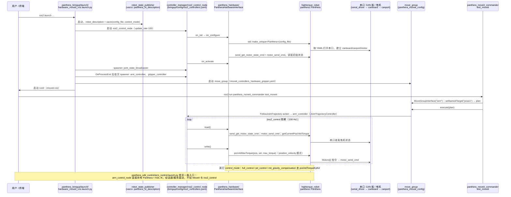

# Panthera-HT_ROS2

## 一句话定义

**Panthera-HT_ROS2** 是 [高擎机电](https://github.com/HighTorque-Robotics) 公开的 **SDK/驱动** 开源项目：官方 SDK：真机控制与状态读取的统一接入层

## 英文缩写速查

| 缩写 | 英文全称 | 简要说明 |
|------|----------|----------|
| SDK | Software Development Kit | 真机控制与状态读取接口 |
| RL | Reinforcement Learning | 强化学习训练与策略优化 |
| VLA | Vision-Language-Action | 视觉–语言–动作统一策略 |
| Sim2Real | Simulation to Real | 仿真策略迁移真机 |
| URDF | Unified Robot Description Format | 机器人描述与仿真资产 |

## 为什么重要

- 收录于 [国内具身智能开源全景（76 家 · 424 项）](../overview/china-domestic-embodied-opensource-76-companies-technology-map.md) 的 **第一层** 分组。
- 与 [Humanoid Motion Intelligence](../entities/humanoid-motion-intelligence.md) 同源策展；本页为 **独立详情节点**，便于从公司清单跳到机制与入口说明。

## 核心原理

| 字段 | 内容 |
|------|------|
| 机构 | 高擎机电 |
| 类别 | SDK/驱动 |
| 官方组织 | https://github.com/HighTorque-Robotics |

## 工程实践

1. 从官方 GitHub/Gitee 组织检索 `Panthera-HT_ROS2` 仓库并核对 README 许可与依赖。
2. 对照本库 [424 项覆盖索引](../queries/china-domestic-opensource-424-coverage.md) 查看同公司其它入口是否共用训练/部署链路。
3. 若与既有方法页（如 RL 框架、VLA、SDK）主题相同，优先读关联页中的「开源入口」小节，避免重复维护平行叙事。

## 局限与风险

- 公众号清单为 **策展快照**（2026-09-06）；仓库更名、归档或许可证变化须回官方组织页核实。
- **开源状态**：以仓库 README 与 release 为准（入库日按文章描述归纳，未逐仓 clone 验证）。

## 源码运行时序图

入口：`ros2 launch panthera_bringup hardware_moveit_rviz.launch.py`（README「MoveIt 控制真实机械臂」；默认 `control_mode:=position_velocity`），之后 `ros2 run panthera_moveit_commander test_moveit` 作为 MoveIt 客户端示例。

图依据：HighTorque-Robotics/Panthera-HT_ROS2@afcdc21，读过 README.md、src/panthera_bringup/launch/{hardware_moveit_rviz,hardware}.launch.py、src/panthera_bringup/config/ros2_controllers.yaml、src/panthera_moveit_config/config/moveit_controllers_hardware_gripper.yaml、src/panthera_hardware/src/panthera_hardware_interface.cpp、src/panthera_hardware/config/panthera_hardware.ros2_control.xacro、src/hightorque_robot/src/panthera/Panthera.cpp、src/hightorque_robot/src/hardware/robot.cpp（grep 级）、src/panthera_moveit_commander/tests/test_moveit.cpp（grep 级）、src/panthera_sdk_control/src/arm_control_node.cpp（grep 级）。

## 关联页面

- [国内具身开源全景技术地图](../overview/china-domestic-embodied-opensource-76-companies-technology-map.md)
- [HMI 开源项目主表导读](../queries/hmi-opensource-projects-coverage.md)
- [Humanoid Motion Intelligence](../entities/humanoid-motion-intelligence.md)

## 参考来源

- [Panthera-HT_ROS2 源码归档](../../sources/repos/panthera-ht_ros2.md)（<https://github.com/HighTorque-Robotics/Panthera-HT_ROS2>）

- [国内具身智能开源全景（微信公众号）](../../sources/blogs/wechat_embodied_station_domestic_opensource_panorama_2026-09-06.md)
- 源码核对（2026-11-02）：HighTorque-Robotics/Panthera-HT_ROS2@afcdc21，读过 README.md、panthera_bringup/launch/hardware_moveit_rviz.launch.py 与 hardware.launch.py、panthera_bringup/config/ros2_controllers.yaml、panthera_moveit_config/config/moveit_controllers_hardware_gripper.yaml、panthera_hardware/src/panthera_hardware_interface.cpp、hightorque_robot/src/panthera/Panthera.cpp；robot.cpp、test_moveit.cpp、arm_control_node.cpp 仅检索关键调用；时序图依据以上文件，未运行代码。

## 推荐继续阅读

- [高擎机电 官方组织](https://github.com/HighTorque-Robotics)
