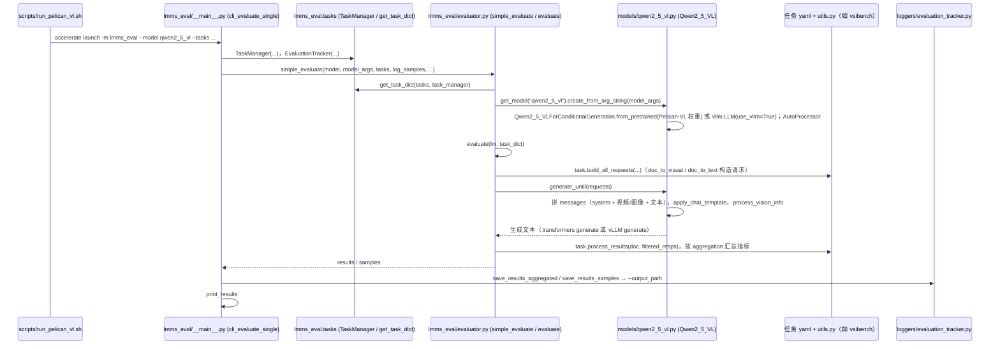

# Pelican-VL

## 一句话定义

**Pelican-VL** 是 [北京人形机器人创新中心](https://github.com/Open-X-Humanoid) 公开的 **具身Agent/规划** 开源项目：Pelican-VL从视觉和语言输入形成空间理解、任务推理与高层动作目标，为下层VLA、技能或运动控制模块提供计划；项目开放多尺度模型入口。

## 英文缩写速查

| 缩写 | 英文全称 | 简要说明 |
|------|----------|----------|
| SDK | Software Development Kit | 真机控制与状态读取接口 |
| RL | Reinforcement Learning | 强化学习训练与策略优化 |
| VLA | Vision-Language-Action | 视觉–语言–动作统一策略 |
| Sim2Real | Simulation to Real | 仿真策略迁移真机 |
| URDF | Unified Robot Description Format | 机器人描述与仿真资产 |

## 为什么重要

- 收录于 [国内具身智能开源全景（76 家 · 424 项）](../overview/china-domestic-embodied-opensource-76-companies-technology-map.md) 的 **第一层** 分组。
- 与 [Humanoid Motion Intelligence](../entities/humanoid-motion-intelligence.md) 同源策展；本页为 **独立详情节点**，便于从公司清单跳到机制与入口说明。

## 核心原理

| 字段 | 内容 |
|------|------|
| 机构 | 北京人形机器人创新中心 |
| 类别 | 具身Agent/规划 |
| 官方组织 | https://github.com/Open-X-Humanoid |

## 工程实践

1. 从官方 GitHub/Gitee 组织检索 `Pelican-VL` 仓库并核对 README 许可与依赖。
2. 对照本库 [424 项覆盖索引](../queries/china-domestic-opensource-424-coverage.md) 查看同公司其它入口是否共用训练/部署链路。
3. 若与既有方法页（如 RL 框架、VLA、SDK）主题相同，优先读关联页中的「开源入口」小节，避免重复维护平行叙事。

## 局限与风险

- 公众号清单为 **策展快照**（2026-09-06）；仓库更名、归档或许可证变化须回官方组织页核实。
- **开源状态**：以仓库 README 与 release 为准（入库日按文章描述归纳，未逐仓 clone 验证）。

## 源码运行时序图

本仓库没有自带模型/训练实现：README 的 LoRA 微调与推理直接调用外部 ms-swift 的 `swift sft` / `swift infer`（仓库只提供命令和 `datasets/*_example_500.json` 样例，swift 内部未读，不画）。仓库自带的可运行代码是 `evaluation/` 下基于 lmms-eval 的评测框架，图只画这一条。

入口：`bash evaluation/scripts/run_pelican_vl.sh`，即 `accelerate launch --num_processes=8 -m lmms_eval --model qwen2_5_vl --model_args pretrained=...,modality=video,... --tasks vsibench --log_samples --process_with_media --output_path ./result`；vLLM 版 `run_pelican_vl_vllm.sh` 同入口，仅 `model_args` 加 `use_vllm=True,tensor_parallel_size=...`。

图依据：Open-X-Humanoid/pelican-vl@717a1fc，读过 `README.md`、`evaluation/README.md`、`evaluation/scripts/run_pelican_vl.sh`、`run_pelican_vl_vllm.sh`、`evaluation/lmms_eval/__main__.py`（`cli_evaluate_single`）、`evaluator.py`（`simple_evaluate` / `evaluate` 的调用关系，用 grep 与片段阅读）、`models/qwen2_5_vl.py`（构造与 `generate_until`）。各 benchmark 任务实现（`tasks/*`）、`qwen3_vl*.py`、`internvl3.py`、API 模型封装及 `evaluator_utils.py` 未读；评测用 `qwen2_5_vl` 封装加载 Pelican-VL 权重是依据 `run_pelican_vl.sh` 的参数，权重本身的架构仓库内未说明。

## 关联页面

- [国内具身开源全景技术地图](../overview/china-domestic-embodied-opensource-76-companies-technology-map.md)
- [HMI 开源项目主表导读](../queries/hmi-opensource-projects-coverage.md)
- [Humanoid Motion Intelligence](../entities/humanoid-motion-intelligence.md)

## 参考来源

- [Pelican-VL 源码归档](../../sources/repos/pelican-vl.md)（<https://github.com/Open-X-Humanoid/pelican-vl>）

- [国内具身智能开源全景（微信公众号）](../../sources/blogs/wechat_embodied_station_domestic_opensource_panorama_2026-09-06.md)
- 源码核对（2026-11-02）：Open-X-Humanoid/pelican-vl@717a1fc，读过 README.md、evaluation/README.md、evaluation/scripts/run_pelican_vl.sh、run_pelican_vl_vllm.sh、evaluation/lmms_eval/__main__.py、evaluator.py、models/qwen2_5_vl.py；时序图依据以上文件，未运行代码。

## 推荐继续阅读

- [北京人形机器人创新中心 官方组织](https://github.com/Open-X-Humanoid)
