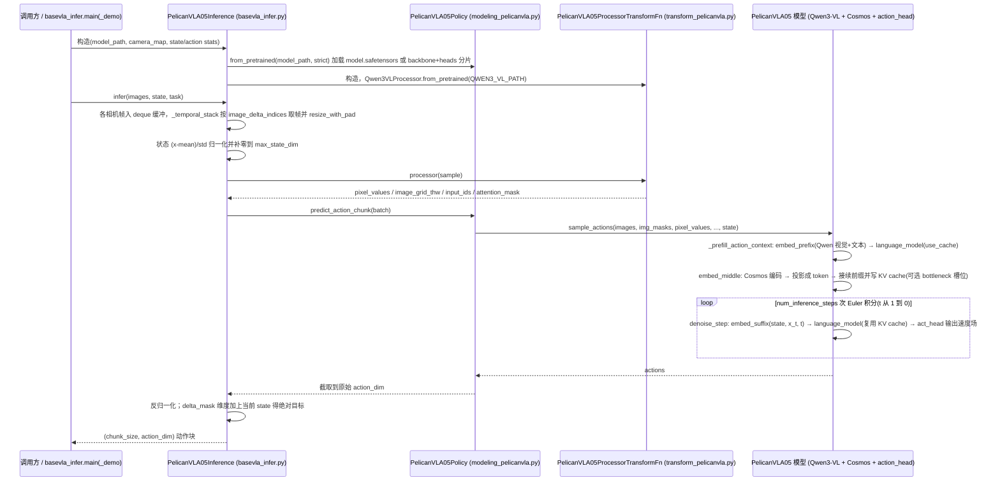

# Pelican-VLA 0.5

## 一句话定义

**Pelican-VLA 0.5** 是 [北京人形机器人创新中心](https://github.com/Open-X-Humanoid) 公开的 **VLA/操作模型** 开源项目：共享Qwen3-VL主干联合视觉语言理解、未来帧和动作预测，固定容量瓶颈Token把与接触相关的视觉信息送入动作通路；当前版本重点验证注意力层面的跨场景与跨本体泛化，并明确承认从表征到可靠动作仍有缺口。

## 英文缩写速查

| 缩写 | 英文全称 | 简要说明 |
|------|----------|----------|
| SDK | Software Development Kit | 真机控制与状态读取接口 |
| RL | Reinforcement Learning | 强化学习训练与策略优化 |
| VLA | Vision-Language-Action | 视觉–语言–动作统一策略 |
| Sim2Real | Simulation to Real | 仿真策略迁移真机 |
| URDF | Unified Robot Description Format | 机器人描述与仿真资产 |

## 为什么重要

- 收录于 [国内具身智能开源全景（76 家 · 424 项）](../overview/china-domestic-embodied-opensource-76-companies-technology-map.md) 的 **第一层** 分组。
- 与 [Humanoid Motion Intelligence](../entities/humanoid-motion-intelligence.md) 同源策展；本页为 **独立详情节点**，便于从公司清单跳到机制与入口说明。

## 核心原理

| 字段 | 内容 |
|------|------|
| 机构 | 北京人形机器人创新中心 |
| 类别 | VLA/操作模型 |
| 官方组织 | https://github.com/Open-X-Humanoid |

## 工程实践

1. 从官方 GitHub/Gitee 组织检索 `Pelican-VLA 0.5` 仓库并核对 README 许可与依赖。
2. 对照本库 [424 项覆盖索引](../queries/china-domestic-opensource-424-coverage.md) 查看同公司其它入口是否共用训练/部署链路。
3. 若与既有方法页（如 RL 框架、VLA、SDK）主题相同，优先读关联页中的「开源入口」小节，避免重复维护平行叙事。

## 局限与风险

- 公众号清单为 **策展快照**（2026-09-06）；仓库更名、归档或许可证变化须回官方组织页核实。
- **开源状态**：以仓库 README 与 release 为准（入库日按文章描述归纳，未逐仓 clone 验证）。

## 源码运行时序图

入口：`python pelicanvla05_infer.py --model_path <pretrained_model> --action_dim 7`（冒烟测试，随机图像、无需真机）；或在自己的控制循环里 `from pelicanvla05_infer import PelicanVLA05Inference` 后调用 `engine.infer(...)`。仓库仅含推理代码，不含训练脚本。

图依据：Open-X-Humanoid/Pelican-VLA05@6de5bce，读过 `pelican_vla0.5_infer/README.md`、`pelicanvla05_infer.py`、`basevla_infer.py`、`src/lerobot/policies/pelicanvla05/modeling_pelicanvla.py`（`PelicanVLA05Policy.from_pretrained` / `predict_action_chunk`、`PelicanVLA05.sample_actions` 及其 `_prefill_action_context`、`_integrate_action_flow`、`denoise_step`、`embed_prefix`、`embed_middle`）、`transform_pelicanvla.py`。`attention_vis/` 子目录（注意力可视化）未读。

## 关联页面

- [国内具身开源全景技术地图](../overview/china-domestic-embodied-opensource-76-companies-technology-map.md)
- [HMI 开源项目主表导读](../queries/hmi-opensource-projects-coverage.md)
- [Humanoid Motion Intelligence](../entities/humanoid-motion-intelligence.md)

## 参考来源

- [Pelican-VLA 0.5 源码归档](../../sources/repos/cn_os_pelican_vla_0_5.md)（<https://github.com/Open-X-Humanoid/Pelican-VLA05>）

- [Pelican-VLA 0.5 源码归档](../../sources/repos/pelican-vla05.md)（<https://github.com/Open-X-Humanoid/Pelican-VLA05>）

- [国内具身智能开源全景（微信公众号）](../../sources/blogs/wechat_embodied_station_domestic_opensource_panorama_2026-09-06.md)
- 源码核对（2026-11-02）：Open-X-Humanoid/Pelican-VLA05@6de5bce，读过 pelican_vla0.5_infer/README.md、pelicanvla05_infer.py、basevla_infer.py、modeling_pelicanvla.py、transform_pelicanvla.py；时序图依据以上文件，未运行代码。

## 推荐继续阅读

- [北京人形机器人创新中心 官方组织](https://github.com/Open-X-Humanoid)
