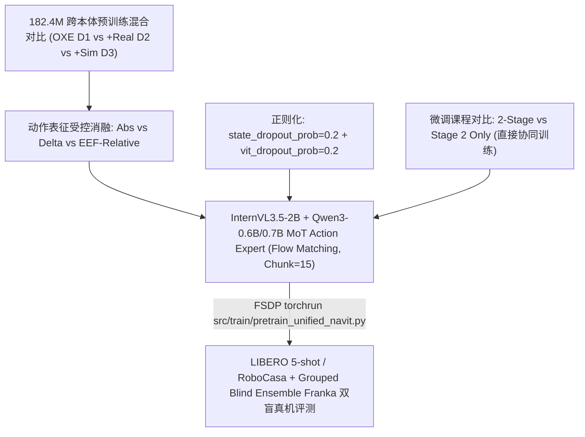
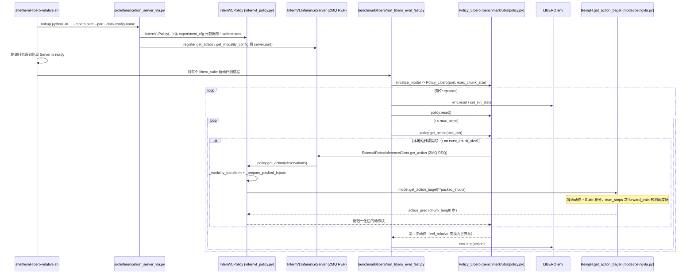

# Rethink_VLA：重新审视 VLA 扩展的动作对齐、混合与正则化策略

## 一句话定义

**Rethink_VLA**（`arXiv:2602.09722`）是智在无界（BeingBeyond）针对视觉-语言-动作模型（VLA）扩展律的受控系统消融与工程基线仓库：围绕 **InternVL-3.5-2B + 0.7B Qwen3 MoT Action Expert** 在 1.824 亿跨本体样本及双盲真机实验上，定量拆解了动作空间对齐、异构数据混合负迁移、感知 Dropout 正则化与两阶段课程必要性。

## 英文缩写速查

| 缩写 | 英文全称 | 简要说明 |
|------|----------|----------|
| MoT | Mixture-of-Transformers | 理解专家（InternVL3.5）与动作专家（Qwen3）分离 FFN 参数、共享因果/块注意力的结构 |
| EEF-Relative | Relative End-Effector Action Space | 以参考帧/动作块首帧末端执行器为坐标基准的相对位姿动作表征 |
| OXE | Open X-Embodiment | 经典开源跨机器人示范数据合集（本研究对比基准 `D1` 构成来源） |
| FSDP | Fully Sharded Data Parallel | 源码 `pretrain_unified_navit.py` 采用的分布式流匹配预训练并行框架 |

## 为什么重要

1. **戳破 VLA 工程中的三个「想当然」误区**：实证表明（a）**不是堆越多异构数据越好**（不经动作/相机口径对齐盲目把真实+仿真数据混进 OXE 反而使 LIBERO 5-shot 从 `77.3%` 跌至 `72.1%`）；（b）**Delta 动作在低频控制下极易在真机 Franka 上诱发 0% 颤振失效**，而 **EEF-Relative** 在保留泛化与真机平滑性上显著胜出；（c）**两阶段（先冻 VLM 再全放开）并非必需**，配合 **0.2 Sensory Dropout** 可直接端到端单阶段稳定扩展。
2. **提供透明、完整的 MoT Flow-Matching 训练与 ZMQ 真机服务模板**：仓库开放从 PackedDataset、FSDP 预训练（`pretrain_unified_navit.py`）、5-shot LIBERO / RoboCasa 后训练到 ZeroMQ 实时策略服务全链代码与预训练权重。

## 核心原理

1. **受控骨干与动作块结构**：固定 `InternVL3.5-2B` 视觉语言理解专家 + `Qwen3-0.6B/0.7B` 动作专家，借助 `Qwen3MoTDecoderLayer` 与流匹配（Flow Matching，chunk 长度 15）严格隔离变量做百步万级规模消融。
2. **四大核心设计法则**：
   - **EEF-Relative 对齐最佳**：固定 VLM 主干对比时，EEF-Relative 在 LIBERO 5-shot 达 **75.1%**（高于绝对坐标 `+8.2%`），在 RoboCasa 达 **50.0%**（`+4.9%`）；真机测试证实增量型 Delta 动作极易产生高频控制震颤导致失败，而 EEF-Relative 轨迹顺滑；
   - **异构数据未对齐混合引发负迁移**：单纯高质量 `OXE (D1)` 5-shot 达 **77.3%（LIBERO）/ 54.7%（RoboCasa）**，强行混入多域真机 `D2` 后掉到 `73.8% / 48.8%`，再叠加仿真 `D3` 进一步掉到 `72.1% / 49.6%`；
   - **Sensory Dropout 消除状态记忆捷径**：训练时以 `p=0.2` 对本体本体状态向量及 ViT 特征随机失活（`state_dropout_prob=0.2`, `vit_dropout_prob=0.2`），迫使模型依托多视角空间语义而非死记状态位置；
   - **单阶段解冻等效/略优于两阶段课程**：在 `Stage 2 Only` 下 LIBERO 10-shot 达到 **85.8%**，反超先冻结 40k 步再联合微调的 `84.5%` 方案。

## 工程实践

- **已验证工程配置与权重开放**：GitHub `BeingBeyond/Rethink_VLA @ d3739ab` 直接给出预训练全参 `shell/pretrain-M1-240k.sh`、阶段微调 `shell/relative-post-{libero,robocasa}*.sh` 与推理评测脚本；Hugging Face 上提供 `wwwyyy/pretrain-oxe-eef-relative` 与 `wwwyyy/pretrain-RealSimEEFJoint-eef-relative` 预训练权重。
- **双盲真机评估流程（Grouped Blind Ensemble）**：真机评估在多模型服务端路由下完全隐藏当前执行权重身份与随机化 rollout 顺序，消除操作员偏差干扰。

## 结论

**Rethink_VLA 通过严格受控消融与双盲真机测试确立了「EEF-Relative 动作空间 + Sensory Dropout (0.2) + 高一致性数据源筛选 + 直接联合训练」这一面向实用落地的 VLA Scaling 黄金配方。**
- 跨数据源缩放的首要约束是**物理/运动学表征对齐质量**而非单纯样本数量堆积；
- EEF-Relative 与 Sensory Dropout 为高频真机控制同时提供了轨迹平滑度与抗过拟合保险；
- 开源的 MoT 训练框架成为智在无界后续 Being-H0.5 与 TTP 仓库的共用代码底座之一。

## 局限与风险

1. **异构负迁移解耦尚未完全自动化**：研究清晰诊断出了 `D1 -> D2 -> D3` 混训掉点现象，如何对大规模不均衡机器人数据进行自动权重调度与动力学口径标定仍有待进一步深入。
2. **任务覆盖集中于双/单视角桌面与家庭操作**：尚未覆盖人形全身动态移动控制场景。

## 源码运行时序图

入口（评测）：`bash shell/eval-libero-relative.sh`，脚本先后台起 `python -m src.inference.run_server_vla`，再在 conda 环境 `libero` 中跑 `python -m src.benchmark.libero.run_libero_eval_fast`；两进程经 ZeroMQ（REQ/REP）通信。

图依据：BeingBeyond/Rethink_VLA@d3739ab，读过 `README.md`、`shell/eval-libero-relative.sh`、`shell/relative-post-libero-full-eef_relative-5shot.sh`、`src/inference/run_server_vla.py`、`src/inference/internvl_service.py`、`src/inference/service.py`、`src/inference/internvl_policy.py`、`src/benchmark/libero/run_libero_eval_fast.py`、`src/benchmark/utils/policy.py`、`src/model/beingvla.py`、`src/train/pretrain_unified_navit.py`。训练入口为 `torchrun src/train/pretrain_unified_navit.py`（`BeingH` + `PackedDataset` + FSDP，损失 `action_loss + und_loss`），未单独画图。

## 关联页面

- 所属机构实体：[智在无界（BeingBeyond）](beingbeyond.md)
- 同底座跨本体演进：[Being-H](cn-os-being-h.md) 与 [Being-H0.7](../methods/being-h07.md)
- 同底座触觉扩展：[TTP：可迁移触觉预训练系统](cn-os-ttp.md)
- [国内具身开源全景技术地图](../overview/china-domestic-embodied-opensource-76-companies-technology-map.md)
- [HMI 开源项目主表导读](../queries/hmi-opensource-projects-coverage.md)

## 参考来源

- 一手论文：`arXiv:2602.09722v1` 全文归档（[rethink-vla_arxiv_2602_09722.md](../../sources/papers/rethink-vla_arxiv_2602_09722.md)）
- 源码核对（2026-11-02）：`BeingBeyond/Rethink_VLA@d3739ab`，读过 README.md、shell/eval-libero-relative.sh、shell/pretrain-M1-240k.sh、src/inference/{run_server_vla,internvl_service,service,internvl_policy}.py、src/benchmark/libero/run_libero_eval_fast.py、src/benchmark/utils/policy.py、src/model/beingvla.py、src/train/pretrain_unified_navit.py，归档于 [rethink_vla.md](../../sources/repos/rethink_vla.md)；时序图依据以上文件，未运行代码。
- [国内具身智能开源全景（微信公众号）](../../sources/blogs/wechat_embodied_station_domestic_opensource_panorama_2026-09-06.md)

## 推荐继续阅读

- [arXiv:2602.09722 论文页面](https://arxiv.org/abs/2602.09722)
- [BeingBeyond/Rethink_VLA GitHub 仓库](https://github.com/BeingBeyond/Rethink_VLA)
- [智在无界官方研究汇总页](https://research.beingbeyond.com/)
