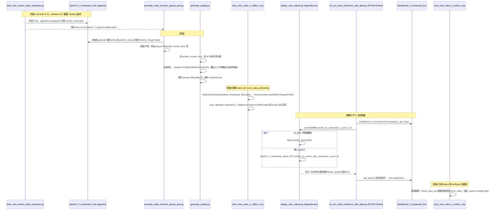

# Robo-ValueRL

## 一句话定义

**Robo-ValueRL** 是 [北京人形机器人创新中心](https://github.com/Open-X-Humanoid) 公开的 **评测** 开源项目：评测基准与工具

## 英文缩写速查

| 缩写 | 英文全称 | 简要说明 |
|------|----------|----------|
| SDK | Software Development Kit | 真机控制与状态读取接口 |
| RL | Reinforcement Learning | 强化学习训练与策略优化 |
| VLA | Vision-Language-Action | 视觉–语言–动作统一策略 |
| Sim2Real | Simulation to Real | 仿真策略迁移真机 |
| URDF | Unified Robot Description Format | 机器人描述与仿真资产 |

## 为什么重要

- 收录于 [国内具身智能开源全景（76 家 · 424 项）](../overview/china-domestic-embodied-opensource-76-companies-technology-map.md) 的 **第一层** 分组。
- 与 [Humanoid Motion Intelligence](../entities/humanoid-motion-intelligence.md) 同源策展；本页为 **独立详情节点**，便于从公司清单跳到机制与入口说明。

## 核心原理

| 字段 | 内容 |
|------|------|
| 机构 | 北京人形机器人创新中心 |
| 类别 | 评测 |
| 官方组织 | https://github.com/Open-X-Humanoid |

## 工程实践

1. 从官方 GitHub/Gitee 组织检索 `Robo-ValueRL` 仓库并核对 README 许可与依赖。
2. 对照本库 [424 项覆盖索引](../queries/china-domestic-opensource-424-coverage.md) 查看同公司其它入口是否共用训练/部署链路。
3. 若与既有方法页（如 RL 框架、VLA、SDK）主题相同，优先读关联页中的「开源入口」小节，避免重复维护平行叙事。

## 局限与风险

- 公众号清单为 **策展快照**（2026-09-06）；仓库更名、归档或许可证变化须回官方组织页核实。
- **开源状态**：以仓库 README 与 release 为准（入库日按文章描述归纳，未逐仓 clone 验证）。

## 源码运行时序图

入口（均在 `robo_valuerl/` 下，README 的四阶段流程）：`bash scripts/train_robo_valuerl_value_estimator.sh` → `python generate_action_quality/annotate_value_function_sparse_part.py ...` → `python generate_action_quality/generate_quality.py --data_dir ...` → `bash scripts/train_robo_valuerl_offline.sh` → 部署 `python deploy_robo_valuerl.py` + `python rtc_env_client_inference_with_delta.py` → `bash scripts/train_robo_valuerl_online.sh`。

图依据：Open-X-Humanoid/Robo-ValueRL@1618bcb，读过 `README.md`、`install_simple.sh`、`robo_valuerl/scripts/train_robo_valuerl_offline.sh`、`scripts/train_robo_valuerl_online.sh`、`train_robo_valuerl_value_estimator.py`、`generate_action_quality/annotate_value_function_sparse_part.py`、`generate_action_quality/generate_quality.py`、`train_robo_value_rl_offline_rl.py`、`train_robo_value_rl_online_rl.py`、`deploy_robo_valuerl.py`、`rtc_env_client_inference_with_delta.py`。`agents/`、`algorithm/`、`openpi/` 内部实现与 `env_rtc_with_delta.py` 未读，Critic/Agent 的内部训练损失不在图中展开。

## 关联页面

- [国内具身开源全景技术地图](../overview/china-domestic-embodied-opensource-76-companies-technology-map.md)
- [HMI 开源项目主表导读](../queries/hmi-opensource-projects-coverage.md)
- [Humanoid Motion Intelligence](../entities/humanoid-motion-intelligence.md)

## 参考来源

- [Robo-ValueRL 源码归档](../../sources/repos/robo-valuerl.md)（<https://github.com/Open-X-Humanoid/Robo-ValueRL>）

- [国内具身智能开源全景（微信公众号）](../../sources/blogs/wechat_embodied_station_domestic_opensource_panorama_2026-09-06.md)
- 源码核对（2026-11-02）：Open-X-Humanoid/Robo-ValueRL@1618bcb，读过 README.md、install_simple.sh、robo_valuerl/ 下 scripts/*.sh、train_robo_valuerl_value_estimator.py、annotate_value_function_sparse_part.py、generate_quality.py、train_robo_value_rl_offline_rl.py、train_robo_value_rl_online_rl.py、deploy_robo_valuerl.py、rtc_env_client_inference_with_delta.py；时序图依据以上文件，未运行代码。

## 推荐继续阅读

- [北京人形机器人创新中心 官方组织](https://github.com/Open-X-Humanoid)
