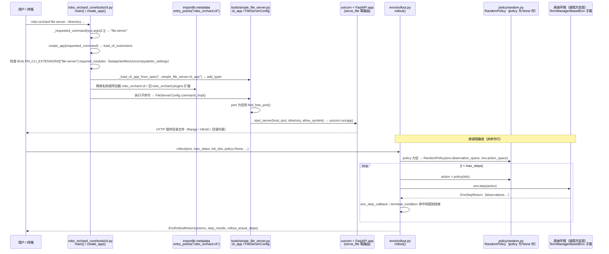

# RoboOrchardCore

## 一句话定义

**RoboOrchardCore** 是 [地平线](https://github.com/HorizonRobotics) 公开的 **数据采集/工具** 开源项目：用类型化配置和批量张量容器统一相机、坐标变换、关节状态与环境数据，再由动作、观测和事件管理器组织控制循环；本地或Ray远程策略沿同一接口接入，使仿真、训练和部署代码共享显式的数据形状与运行边界。

## 英文缩写速查

| 缩写 | 英文全称 | 简要说明 |
|------|----------|----------|
| SDK | Software Development Kit | 真机控制与状态读取接口 |
| RL | Reinforcement Learning | 强化学习训练与策略优化 |
| VLA | Vision-Language-Action | 视觉–语言–动作统一策略 |
| Sim2Real | Simulation to Real | 仿真策略迁移真机 |
| URDF | Unified Robot Description Format | 机器人描述与仿真资产 |

## 为什么重要

- 收录于 [国内具身智能开源全景（76 家 · 424 项）](../overview/china-domestic-embodied-opensource-76-companies-technology-map.md) 的 **第四层** 分组。
- 与 [Humanoid Motion Intelligence](../entities/humanoid-motion-intelligence.md) 同源策展；本页为 **独立详情节点**，便于从公司清单跳到机制与入口说明。

## 核心原理

| 字段 | 内容 |
|------|------|
| 机构 | 地平线 |
| 类别 | 数据采集/工具 |
| 官方组织 | https://github.com/HorizonRobotics |

## 工程实践

1. 从官方 GitHub/Gitee 组织检索 `RoboOrchardCore` 仓库并核对 README 许可与依赖。
2. 对照本库 [424 项覆盖索引](../queries/china-domestic-opensource-424-coverage.md) 查看同公司其它入口是否共用训练/部署链路。
3. 若与既有方法页（如 RL 框架、VLA、SDK）主题相同，优先读关联页中的「开源入口」小节，避免重复维护平行叙事。

## 局限与风险

- 公众号清单为 **策展快照**（2026-09-06）；仓库更名、归档或许可证变化须回官方组织页核实。
- **开源状态**：以仓库 README 与 release 为准（入库日按文章描述归纳，未逐仓 clone 验证）。

## 源码运行时序图

本仓库是 Python 库，唯一的命令行入口是 `robo-orchard`（`pyproject.toml` 的 `[project.scripts]`：`robo_orchard_core.tools.cli:main`）。下图第一段为入口 `robo-orchard file-server --directory <dir>` 的实际调用链；第二段为库内 `envs.rollout.rollout(env, ...)` 的调用顺序。`TermManagerBasedEnv.step()` / `reset()` 在本仓库内为抽象方法（`raise NotImplementedError`），具体环境（仿真或真机）由下游包实现，因此第二段中的 `env` 是调用方提供的具体环境。

图依据：HorizonRobotics/RoboOrchardCore@1b6df5b，读过 README.md、pyproject.toml（scripts 与 entry-points）、robo_orchard_core/tools/cli.py（BUILTIN_CLI_EXTENSIONS、create_app、load_cli_extensions、main）、robo_orchard_core/tools/simple_file_server.py（FileServerConfig、start_server）、robo_orchard_core/envs/rollout.py（rollout）、robo_orchard_core/envs/manager_based_env.py（step / reset 抽象签名）。

## 关联页面

- [国内具身开源全景技术地图](../overview/china-domestic-embodied-opensource-76-companies-technology-map.md)
- [HMI 开源项目主表导读](../queries/hmi-opensource-projects-coverage.md)
- [Humanoid Motion Intelligence](../entities/humanoid-motion-intelligence.md)

## 参考来源

- [RoboOrchardCore 源码归档](../../sources/repos/roboorchardcore.md)（<https://github.com/HorizonRobotics/RoboOrchardCore>）

- [国内具身智能开源全景（微信公众号）](../../sources/blogs/wechat_embodied_station_domestic_opensource_panorama_2026-09-06.md)
- 源码核对（2026-11-02）：HorizonRobotics/RoboOrchardCore@1b6df5b，读过 README.md、pyproject.toml、robo_orchard_core/tools/cli.py、tools/simple_file_server.py、envs/rollout.py、envs/manager_based_env.py；managers、policy/remote.py、controllers、kinematics、datatypes 内部未读；时序图依据以上文件，未运行代码。

## 推荐继续阅读

- [地平线 官方组织](https://github.com/HorizonRobotics)
