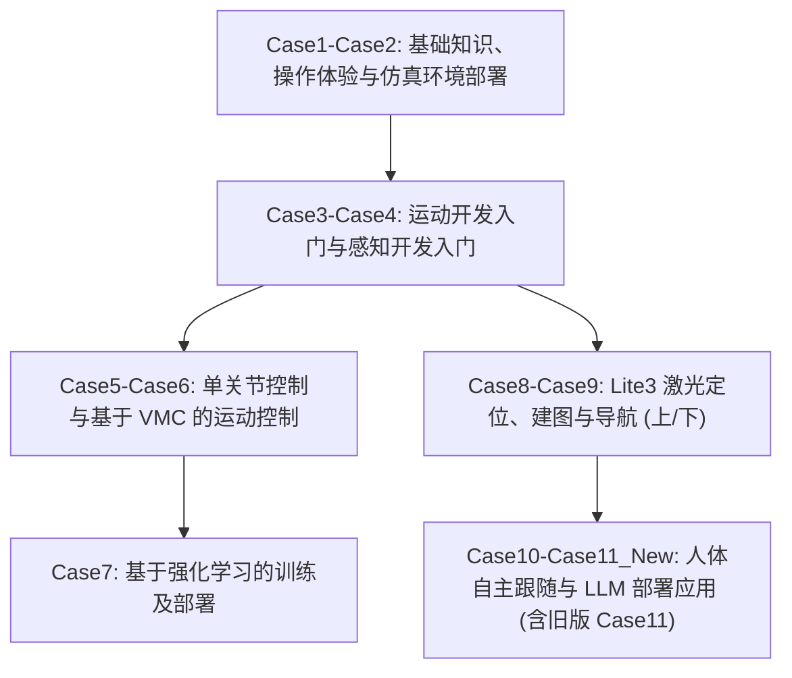
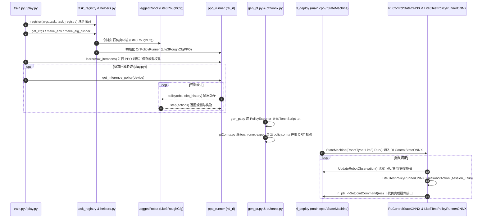

# Robot_Training_Cases

## 一句话定义

**Robot_Training_Cases** 是 [云深处科技](https://github.com/DeepRoboticsLab) 公开的 **运动RL/技能训练** 开源项目：并行 RL 运动训练框架（含仿真任务与策略导出链路）

## 英文缩写速查

| 缩写 | 英文全称 | 简要说明 |
|------|----------|----------|
| SDK | Software Development Kit | 真机控制与状态读取接口 |
| RL | Reinforcement Learning | 强化学习训练与策略优化 |
| VLA | Vision-Language-Action | 视觉–语言–动作统一策略 |
| Sim2Real | Simulation to Real | 仿真策略迁移真机 |
| URDF | Unified Robot Description Format | 机器人描述与仿真资产 |

## 为什么重要

- 收录于 [国内具身智能开源全景（76 家 · 424 项）](../overview/china-domestic-embodied-opensource-76-companies-technology-map.md) 的 **第一层** 分组。
- 与 [Humanoid Motion Intelligence](../entities/humanoid-motion-intelligence.md) 同源策展；本页为 **独立详情节点**，便于从公司清单跳到机制与入口说明。

## 核心原理

| 字段 | 内容 |
|------|------|
| 机构 | 云深处科技 |
| 类别 | 运动RL/技能训练 |
| 官方组织 | https://github.com/DeepRoboticsLab |

### 架构流程图

## 源码运行时序图

主仓库 [DeepRoboticsLab/Robot_Training_Cases](https://github.com/DeepRoboticsLab/Robot_Training_Cases)（`main` 分支）本身为实训案例索引与目录（含 `README.md`、`Case1`–`Case11_New/README.md` 与 `.gitmodules`），通过 `git clone --recurse-submodule` 挂载各案例对应的官方子模块仓库。针对本页核心的 **Case2 / Case7 并行 RL 训练、策略导出与部署链路**，真实入口位于子模块 `Case7/Lite3_rl_training`（`DeepRoboticsLab/Lite3_rl_training`）与 `Case7/Lite3_rl_deploy`（`DeepRoboticsLab/Lite3_rl_deploy`）：

- **训练与评估**：`python3 legged_gym/legged_gym/scripts/train.py --rl_device cuda:0 --sim_device cuda:0 --headless` 与 `play.py`。
- **导出与转换**：`legged_gym/legged_gym/scripts/gen_pt.py` 导出 TorchScript `.pt`；部署仓 `policy/pt2onnx.py` 转为 `.onnx` 并做一致性校验。
- **仿真与真机运行**：编译 `Lite3_rl_deploy` 后运行 `build/rl_deploy`（详细状态机与 UDP/硬件接口时序见 [Lite3 RL Deploy](./cn-os-lite3-rl-deploy.md)）。

图依据：`DeepRoboticsLab/Robot_Training_Cases`（`main` 分支）`.gitmodules`、`README.md`、`Case2/README.md`、`Case7/README.md`，以及所挂载子模块 `DeepRoboticsLab/Lite3_rl_training`（`legged_gym/legged_gym/scripts/train.py`、`play.py`、`gen_pt.py`、`legged_gym/utils/helpers.py`、`task_registry.py`、`envs/lite3/lite3_config.py`）与 `DeepRoboticsLab/Lite3_rl_deploy`（`policy/pt2onnx.py`、`main.cpp`、`state_machine/state_machine.hpp`、`state_machine/rl_control_state_onnx.hpp`、`run_policy/lite3_test_policy_runner_onnx.hpp`）。注：`Lite3_rl_training` 上游 README 已标注不再维护，新版 Isaac Lab 训练链路可参见 [Deep Robotics rl_training](./deeprobotics-rl-training.md)。

## 工程实践

1. 从官方 GitHub/Gitee 组织检索 `Robot_Training_Cases` 仓库并核对 README 许可与依赖。
2. 对照本库 [424 项覆盖索引](../queries/china-domestic-opensource-424-coverage.md) 查看同公司其它入口是否共用训练/部署链路。
3. 若与既有方法页（如 RL 框架、VLA、SDK）主题相同，优先读关联页中的「开源入口」小节，避免重复维护平行叙事。

## 局限与风险

- 公众号清单为 **策展快照**（2026-09-06）；仓库更名、归档或许可证变化须回官方组织页核实。
- **开源状态**：以仓库 README 与 release 为准（入库日按文章描述归纳，未逐仓 clone 验证）。

## 关联页面

- [策略优化](../methods/policy-optimization.md) — 延伸阅读，了解策略学习的优化目标。
- [强化学习](../methods/reinforcement-learning.md) — 延伸阅读，了解基于奖励的策略训练。
- [国内具身开源全景技术地图](../overview/china-domestic-embodied-opensource-76-companies-technology-map.md)
- [HMI 开源项目主表导读](../queries/hmi-opensource-projects-coverage.md)
- [Humanoid Motion Intelligence](../entities/humanoid-motion-intelligence.md)

## 参考来源

- [Robot_Training_Cases 源码归档](../../sources/repos/robot_training_cases.md)（<https://github.com/DeepRoboticsLab/Robot_Training_Cases>）

- [国内具身智能开源全景（微信公众号）](../../sources/blogs/wechat_embodied_station_domestic_opensource_panorama_2026-09-06.md)

## 推荐继续阅读

- [云深处科技 官方组织](https://github.com/DeepRoboticsLab)
