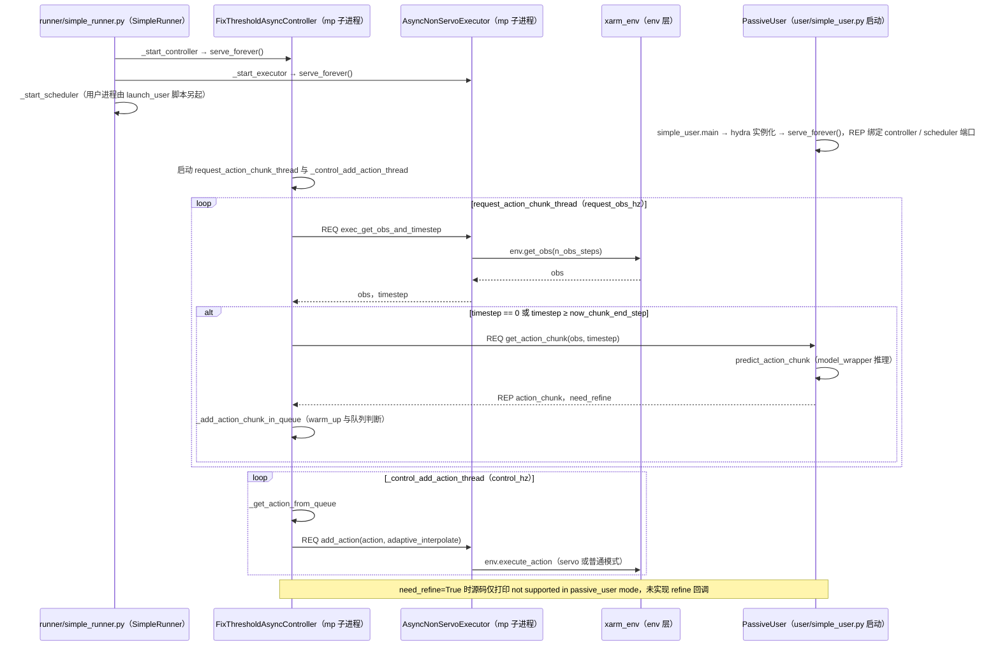

# RTR

## 一句话定义

**RTR** 是 [它石智航](https://github.com/tars-robotics) 公开的 **VLA/操作模型** 开源项目：在连续潜空间学习高频动作块，并以Reuse-then-Refine处理异步推理时新旧动作块的边界，使接触操作保持连续执行。

## 英文缩写速查

| 缩写 | 英文全称 | 简要说明 |
|------|----------|----------|
| SDK | Software Development Kit | 真机控制与状态读取接口 |
| RL | Reinforcement Learning | 强化学习训练与策略优化 |
| VLA | Vision-Language-Action | 视觉–语言–动作统一策略 |
| Sim2Real | Simulation to Real | 仿真策略迁移真机 |
| URDF | Unified Robot Description Format | 机器人描述与仿真资产 |

## 为什么重要

- 收录于 [国内具身智能开源全景（76 家 · 424 项）](../overview/china-domestic-embodied-opensource-76-companies-technology-map.md) 的 **第二层** 分组。
- 与 [Humanoid Motion Intelligence](../entities/humanoid-motion-intelligence.md) 同源策展；本页为 **独立详情节点**，便于从公司清单跳到机制与入口说明。

## 核心原理

| 字段 | 内容 |
|------|------|
| 机构 | 它石智航 |
| 类别 | VLA/操作模型 |
| 官方组织 | https://github.com/tars-robotics |

## 工程实践

1. 从官方 GitHub/Gitee 组织检索 `RTR` 仓库并核对 README 许可与依赖。
2. 对照本库 [424 项覆盖索引](../queries/china-domestic-opensource-424-coverage.md) 查看同公司其它入口是否共用训练/部署链路。
3. 若与既有方法页（如 RL 框架、VLA、SDK）主题相同，优先读关联页中的「开源入口」小节，避免重复维护平行叙事。

## 局限与风险

- 公众号清单为 **策展快照**（2026-09-06）；仓库更名、归档或许可证变化须回官方组织页核实。
- **开源状态**：以仓库 README 与 release 为准（入库日按文章描述归纳，未逐仓 clone 验证）。

## 源码运行时序图

入口（系统侧）：`python src/rtr_async_sys/runner/simple_runner.py --config-name simple_runner_without_user controller=fix_threshold_async_controller executor=async_servo_executor scheduler=simple_scheduler ...`；用户侧：`python -m rtr_async_sys.user.simple_user --config-dir configs --config-name openvla_oft_passive_user ...`（在 `third_party/openvla_oft_latent/openvla-oft` 目录下运行；参数取自 `scripts/eval/xarm/closedloop/write_board_60hz/oft_latent/oft_latent_rtr_async24_closedloop_launch_{system,user}.sh`）

图依据：rtr@0589f84，`src/rtr_async_sys/runner/simple_runner.py`、`src/rtr_async_sys/controller/fix_threshold_async_controller.py`、`src/rtr_async_sys/executor/async_nonservo_executor.py`（类定义与 add_action / get_obs 分支）、`src/rtr_async_sys/user/simple_user.py`、`src/rtr_async_sys/user/passive_user.py`（_init_sock、_handle_controller_request、serve_forever）、`src/rtr_async_sys/core/controller_base.py`（RPC 封装）、`src/rtr_async_sys/configs/simple_runner_without_user.yaml`、`scripts/eval/xarm/closedloop/write_board_60hz/oft_latent/oft_latent_rtr_async24_closedloop_launch_{system,user}.sh`；未运行代码。模型内部的 VAE 解码与 RTR 重用细节未读，未画入。

## 关联页面

- [国内具身开源全景技术地图](../overview/china-domestic-embodied-opensource-76-companies-technology-map.md)
- [HMI 开源项目主表导读](../queries/hmi-opensource-projects-coverage.md)
- [Humanoid Motion Intelligence](../entities/humanoid-motion-intelligence.md)

## 参考来源

- [RTR 源码归档](../../sources/repos/rtr.md)（<https://github.com/tars-robotics/RTR>）

- [国内具身智能开源全景（微信公众号）](../../sources/blogs/wechat_embodied_station_domestic_opensource_panorama_2026-09-06.md)
- 源码核对（2026-11-02）：tars-robotics/RTR@0589f84，读过 README.md、src/rtr_async_sys/runner/simple_runner.py、src/rtr_async_sys/controller/fix_threshold_async_controller.py、src/rtr_async_sys/executor/async_nonservo_executor.py、src/rtr_async_sys/user/simple_user.py、src/rtr_async_sys/user/passive_user.py、src/rtr_async_sys/core/controller_base.py、src/rtr_async_sys/configs/simple_runner_without_user.yaml、scripts/eval/xarm/closedloop/write_board_60hz/oft_latent/ 下 RTR launch 脚本；时序图依据以上文件，未运行代码。

## 推荐继续阅读

- [它石智航 官方组织](https://github.com/tars-robotics)
