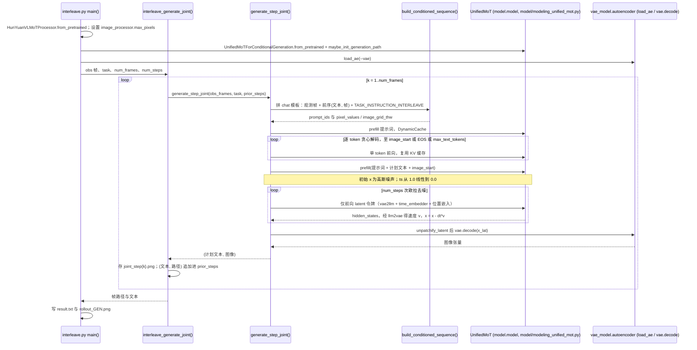

# RxBrain-1.0

## 一句话定义

**RxBrain-1.0** 是 [腾讯机器人实验室](https://github.com/Tencent-Hunyuan) 公开的 **具身Agent/规划** 开源项目：视觉与语言输入形成场景理解和任务计划，再向下层操作或导航策略发出目标；项目用于区分高层认知、策略动作与低层控制三种职责。

## 英文缩写速查

| 缩写 | 英文全称 | 简要说明 |
|------|----------|----------|
| SDK | Software Development Kit | 真机控制与状态读取接口 |
| RL | Reinforcement Learning | 强化学习训练与策略优化 |
| VLA | Vision-Language-Action | 视觉–语言–动作统一策略 |
| Sim2Real | Simulation to Real | 仿真策略迁移真机 |
| URDF | Unified Robot Description Format | 机器人描述与仿真资产 |

## 为什么重要

- 收录于 [国内具身智能开源全景（76 家 · 424 项）](../overview/china-domestic-embodied-opensource-76-companies-technology-map.md) 的 **第四层** 分组。
- 与 [Humanoid Motion Intelligence](../entities/humanoid-motion-intelligence.md) 同源策展；本页为 **独立详情节点**，便于从公司清单跳到机制与入口说明。

## 核心原理

| 字段 | 内容 |
|------|------|
| 机构 | 腾讯机器人实验室 |
| 类别 | 具身Agent/规划 |
| 官方组织 | https://github.com/Tencent-Hunyuan |

## 工程实践

1. 从官方 GitHub/Gitee 组织检索 `RxBrain-1.0` 仓库并核对 README 许可与依赖。
2. 对照本库 [424 项覆盖索引](../queries/china-domestic-opensource-424-coverage.md) 查看同公司其它入口是否共用训练/部署链路。
3. 若与既有方法页（如 RL 框架、VLA、SDK）主题相同，优先读关联页中的「开源入口」小节，避免重复维护平行叙事。

## 局限与风险

- 公众号清单为 **策展快照**（2026-09-06）；仓库更名、归档或许可证变化须回官方组织页核实。
- **开源状态**：以仓库 README 与 release 为准（入库日按文章描述归纳，未逐仓 clone 验证）。

## 源码运行时序图

入口：`python inference/interleave.py --ckpt ./ckpts/rxbrain --vae /path/to/ae.safetensors --frames demo_cases/$CASE/input/*.jpg --task "$(cat demo_cases/$CASE/prompt.txt)" --max_frames 5 --num_steps 50 --out_dir out_$CASE`（README「④ Interleaved Embodied Planning」）。同目录另有 `text2image.py`、`multiframe.py`、`vqa.py`；`vqa.py` 复用同一套 `build_conditioned_sequence` 与 KV 缓存逐 token 解码，直到 EOS，不用 VAE。

图依据：Hy-Embodied-RxBrain-1.0@7d35a9c，`README.md`、`inference/interleave.py`、`inference/vqa.py`、`inference/utils.py`；`model/` 内部（注意力、MoT 三流）未读。

## 关联页面

- [国内具身开源全景技术地图](../overview/china-domestic-embodied-opensource-76-companies-technology-map.md)
- [HMI 开源项目主表导读](../queries/hmi-opensource-projects-coverage.md)
- [Humanoid Motion Intelligence](../entities/humanoid-motion-intelligence.md)

## 参考来源

- [RxBrain-1.0 源码归档](../../sources/repos/cn_os_rxbrain_1_0.md)（<https://github.com/Tencent-Hunyuan/Hy-Embodied-RxBrain-1.0>）

- [RxBrain-1.0 源码归档](../../sources/repos/hy-embodied-rxbrain-1_0.md)（<https://github.com/Tencent-Hunyuan/Hy-Embodied-RxBrain-1.0>）

- [国内具身智能开源全景（微信公众号）](../../sources/blogs/wechat_embodied_station_domestic_opensource_panorama_2026-09-06.md)
- 源码核对（2026-11-02）：Tencent-Hunyuan/Hy-Embodied-RxBrain-1.0@7d35a9c，读过 README.md、inference/interleave.py、inference/vqa.py、inference/utils.py；时序图依据以上文件，未运行代码。

## 推荐继续阅读

- [腾讯机器人实验室 官方组织](https://github.com/Tencent-Hunyuan)
