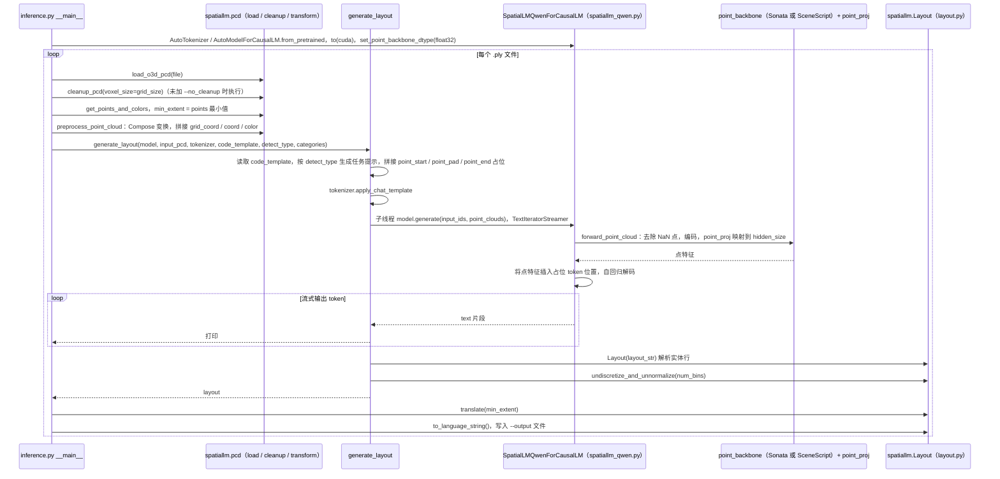

# SpatialLM

## 一句话定义

**SpatialLM** 是 [群核科技](https://github.com/manycore-research) 公开的 **世界模型** 开源项目：空间智能大模型（NeurIPS 2025）：点云→结构化室内场景理解（墙体/门窗/物体 3D 框与语义），Llama-1B 与 Qwen-0.5B 两档，训练代码与 12,328 场景合成数据公开，常被用于机器人场景理解与仿真资产生成

## 英文缩写速查

| 缩写 | 英文全称 | 简要说明 |
|------|----------|----------|
| SDK | Software Development Kit | 真机控制与状态读取接口 |
| RL | Reinforcement Learning | 强化学习训练与策略优化 |
| VLA | Vision-Language-Action | 视觉–语言–动作统一策略 |
| Sim2Real | Simulation to Real | 仿真策略迁移真机 |
| URDF | Unified Robot Description Format | 机器人描述与仿真资产 |

## 为什么重要

- 收录于 [国内具身智能开源全景（76 家 · 424 项）](../overview/china-domestic-embodied-opensource-76-companies-technology-map.md) 的 **第二层** 分组。
- 与 [Humanoid Motion Intelligence](../entities/humanoid-motion-intelligence.md) 同源策展；本页为 **独立详情节点**，便于从公司清单跳到机制与入口说明。

## 核心原理

| 字段 | 内容 |
|------|------|
| 机构 | 群核科技 |
| 类别 | 世界模型 |
| 官方组织 | https://github.com/manycore-research |

## 工程实践

1. 从官方 GitHub/Gitee 组织检索 `SpatialLM` 仓库并核对 README 许可与依赖。
2. 对照本库 [424 项覆盖索引](../queries/china-domestic-opensource-424-coverage.md) 查看同公司其它入口是否共用训练/部署链路。
3. 若与既有方法页（如 RL 框架、VLA、SDK）主题相同，优先读关联页中的「开源入口」小节，避免重复维护平行叙事。

## 局限与风险

- 公众号清单为 **策展快照**（2026-09-06）；仓库更名、归档或许可证变化须回官方组织页核实。
- **开源状态**：以仓库 README 与 release 为准（入库日按文章描述归纳，未逐仓 clone 验证）。

## 源码运行时序图

入口：`python inference.py --point_cloud pcd/scene0000_00.ply --output scene0000_00.txt --model_path manycore-research/SpatialLM1.1-Qwen-0.5B`（README「Inference」；`--point_cloud` 可为单个 `.ply` 或目录）

图依据：SpatialLM@8913c44，`inference.py`（main、preprocess_point_cloud、generate_layout）、`spatiallm/model/spatiallm_qwen.py`（forward_point_cloud、forward 中点特征插入段）、`spatiallm/layout/layout.py`（from_str、undiscretize_and_unnormalize、translate 等签名）、`spatiallm/pcd/pcd_loader.py`（函数签名）、`README.md`（Inference 段）；未运行代码。SceneScript 与 Sonata 两条编码分支仅按源码分支示意，未核对两种 checkpoint 的权重差异。

## 关联页面

- [国内具身开源全景技术地图](../overview/china-domestic-embodied-opensource-76-companies-technology-map.md)
- [HMI 开源项目主表导读](../queries/hmi-opensource-projects-coverage.md)
- [Humanoid Motion Intelligence](../entities/humanoid-motion-intelligence.md)

## 参考来源

- [SpatialLM 源码归档](../../sources/repos/spatiallm.md)（<https://github.com/manycore-research/SpatialLM>）

- [国内具身智能开源全景（微信公众号）](../../sources/blogs/wechat_embodied_station_domestic_opensource_panorama_2026-09-06.md)
- 源码核对（2026-11-02）：manycore-research/SpatialLM@8913c44，读过 README.md、inference.py（main、preprocess_point_cloud、generate_layout）、spatiallm/model/spatiallm_qwen.py（forward_point_cloud 与 forward 点特征插入段）、spatiallm/layout/layout.py（函数签名与 from_str 段）、spatiallm/pcd/pcd_loader.py（函数签名）；时序图依据以上文件，未运行代码。

## 推荐继续阅读

- [群核科技 官方组织](https://github.com/manycore-research)
