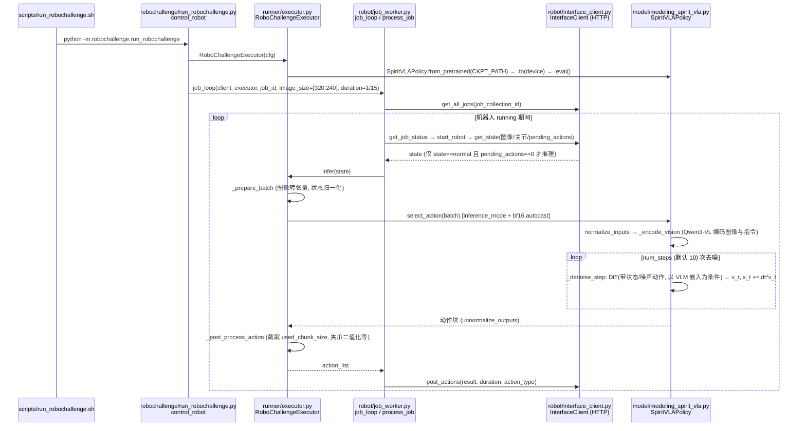

# Spirit-v1.5

## 一句话定义

**Spirit-v1.5** 是 [千寻智能](https://github.com/Spirit-AI-Team) 公开的 **VLA/操作模型** 开源项目：模型根据视觉、语言和机器人状态生成操作动作，面向多任务和真实场景泛化；仓库提供Spirit-v1.5的模型与研究入口。

## 英文缩写速查

| 缩写 | 英文全称 | 简要说明 |
|------|----------|----------|
| SDK | Software Development Kit | 真机控制与状态读取接口 |
| RL | Reinforcement Learning | 强化学习训练与策略优化 |
| VLA | Vision-Language-Action | 视觉–语言–动作统一策略 |
| Sim2Real | Simulation to Real | 仿真策略迁移真机 |
| URDF | Unified Robot Description Format | 机器人描述与仿真资产 |

## 为什么重要

- 收录于 [国内具身智能开源全景（76 家 · 424 项）](../overview/china-domestic-embodied-opensource-76-companies-technology-map.md) 的 **第二层** 分组。
- 与 [Humanoid Motion Intelligence](../entities/humanoid-motion-intelligence.md) 同源策展；本页为 **独立详情节点**，便于从公司清单跳到机制与入口说明。

## 核心原理

| 字段 | 内容 |
|------|------|
| 机构 | 千寻智能 |
| 类别 | VLA/操作模型 |
| 官方组织 | https://github.com/Spirit-AI-Team |

## 工程实践

1. 从官方 GitHub/Gitee 组织检索 `Spirit-v1.5` 仓库并核对 README 许可与依赖。
2. 对照本库 [424 项覆盖索引](../queries/china-domestic-opensource-424-coverage.md) 查看同公司其它入口是否共用训练/部署链路。
3. 若与既有方法页（如 RL 框架、VLA、SDK）主题相同，优先读关联页中的「开源入口」小节，避免重复维护平行叙事。

## 局限与风险

- 公众号清单为 **策展快照**（2026-09-06）；仓库更名、归档或许可证变化须回官方组织页核实。
- **开源状态**：以仓库 README 与 release 为准（入库日按文章描述归纳，未逐仓 clone 验证）。

## 源码运行时序图

入口：`./scripts/run_robochallenge.sh`（需设置 `TASK_NAME`、`ROBOCHALLENGE_JOB_ID`、`USER_TOKEN`、`CKPT_PATH`，`USED_CHUNK_SIZE` 默认 60），内部执行 `python -m robochallenge.run_robochallenge --single_task ...`。训练入口为 `scripts/run_finetune.sh` → `train.py`（本图未覆盖）。

图依据：Spirit-AI-Team/Spirit-v1.5@6d67377，读过 README.md、scripts/run_robochallenge.sh、robochallenge/run_robochallenge.py、robochallenge/runner/executor.py、robochallenge/robot/job_worker.py、robochallenge/robot/interface_client.py（部分）、model/modeling_spirit_vla.py（select_action、去噪采样及类定义行）。

## 关联页面

- [国内具身开源全景技术地图](../overview/china-domestic-embodied-opensource-76-companies-technology-map.md)
- [HMI 开源项目主表导读](../queries/hmi-opensource-projects-coverage.md)
- [Humanoid Motion Intelligence](../entities/humanoid-motion-intelligence.md)

## 参考来源

- [Spirit-v1.5 源码归档](../../sources/repos/spirit-v1_5.md)（<https://github.com/Spirit-AI-Team/Spirit-v1.5>）

- [国内具身智能开源全景（微信公众号）](../../sources/blogs/wechat_embodied_station_domestic_opensource_panorama_2026-09-06.md)
- 源码核对（2026-11-02）：Spirit-AI-Team/Spirit-v1.5@6d67377，读过 README.md、scripts/run_robochallenge.sh、robochallenge/run_robochallenge.py、robochallenge/runner/executor.py、robochallenge/robot/job_worker.py、robochallenge/robot/interface_client.py、model/modeling_spirit_vla.py（部分）；时序图依据以上文件，未运行代码。

## 推荐继续阅读

- [千寻智能 官方组织](https://github.com/Spirit-AI-Team)
