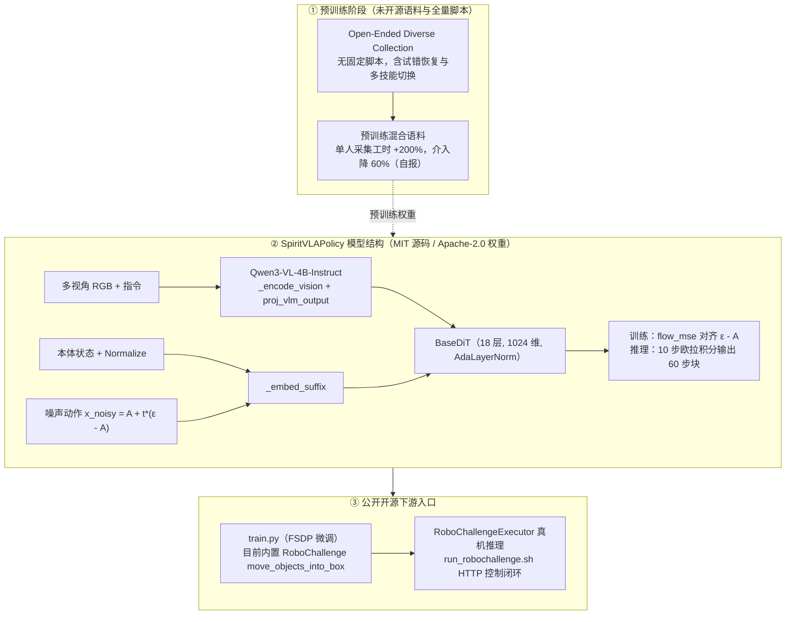
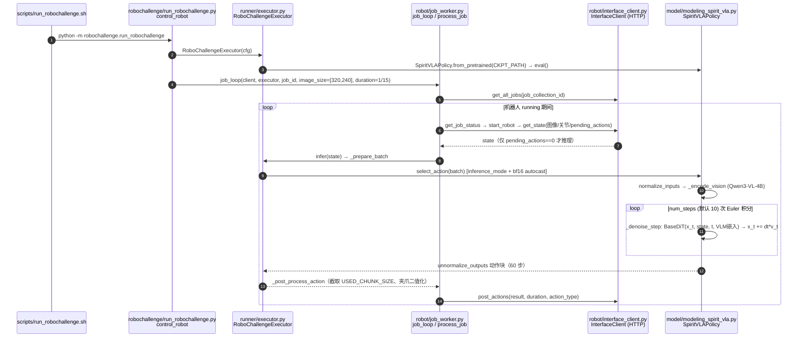
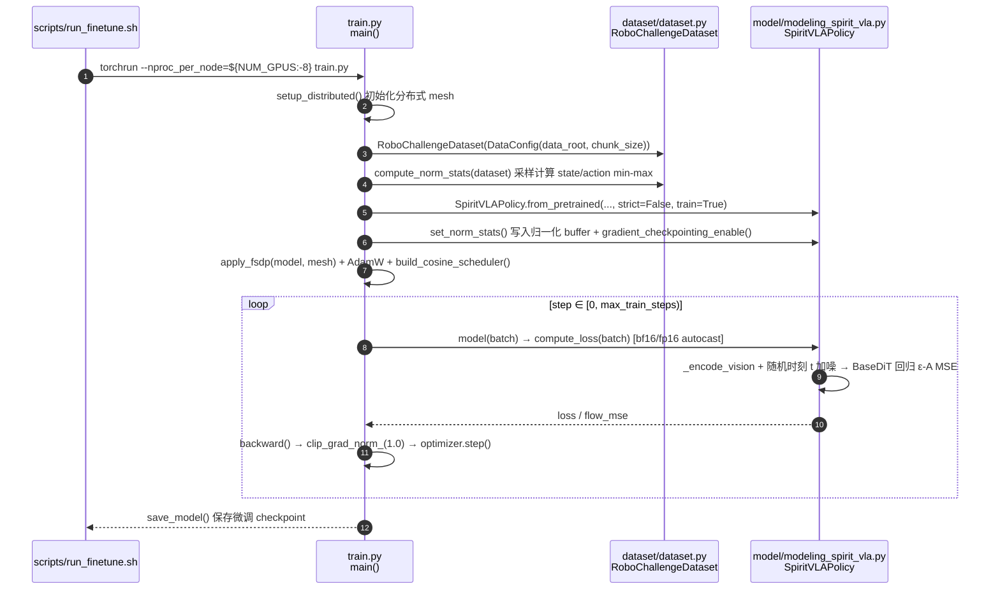

# Spirit-v1.5

**Spirit-v1.5** 是 [千寻智能（Spirit.AI）](./spirit-ai.md) 于 **2026-01-11** 发布的开源 [VLA](../methods/vla.md) 操作基础模型（[官网博客](https://www.spirit-ai.com/blog/spirit-v1-5)，[GitHub 源码](https://github.com/Spirit-AI-Team/spirit-v1.5)，[HF 模型卡](https://huggingface.co/Spirit-AI-robotics/Spirit-v1.5)），同时收录于[国内具身智能开源全景](../overview/china-domestic-embodied-opensource-76-companies-technology-map.md) 与 [HMI 开源项目主表](../queries/hmi-opensource-projects-coverage.md)。模型以 `Qwen3-VL-4B-Instruct` 编码多模态观测与指令，驱动 `BaseDiT` 流匹配动作专家预测 60 步动作块，并围绕 **Open-Ended Diverse Collection（开放式目标驱动多样采集）** 阐述数据多样性对泛化迁移的决定性作用。

## 一句话定义

> **Spirit-v1.5 以「Qwen3-VL-4B 骨干 + 18 层 BaseDiT 流匹配动作头（60-step chunk）」为双组件架构，并验证非脚本开放式多样采集相比 Clean Data 可使未见任务微调收敛迭代减少 40%。**

## 英文缩写速查

| 缩写 | 英文全称 | 简要说明 |
|------|----------|----------|
| VLA | Vision-Language-Action | 视觉–语言–动作统一操作策略模型 |
| DiT | Diffusion Transformer | 本文 `BaseDiT` 流匹配连续动作解码骨干（1024 维、18 层） |
| FSDP | Fully Sharded Data Parallel | 源码 `train.py` 采用的 PyTorch 多卡分布式微调框架 |
| VLM | Vision-Language Model | 视觉语言基座，`Spirit-v1.5` 采用 `Qwen/Qwen3-VL-4B-Instruct` |
| DoF | Degree of Freedom | 自由度；公开微调数据示例把 7 维单臂零填充至 14 维双臂接口 |
| MIT / Apache-2.0 | Massachusetts Institute of Technology / Apache License 2.0 | GitHub 源码为 MIT，HuggingFace 公开权重为 Apache-2.0 |

## 为什么重要

- **正面挑战具身预训练的「Clean Data 教条」：** 博客直指 OXE / AgiBot World / RoboCOIN 式高脚本、仅保留单条成功轨迹的数据范式存在场景孤立（Low Diversity）和脚本规模成本高（Limited Scalability）的缺陷；转向仅给定「做一件有用的事」约束的连续杂乱长程采集（含失败、滑脱与纠偏回环）。
- **控制变量给出可量化迁移与 Scaling 趋势：** 在等同预训练规模下微调未见任务，Diverse Collection 预训练达成相同验证误差所需步数比脚本数据组减少 **40%**；将数据规模从 S 扩到 L 时未见任务验证误差呈一致单调下降。
- **工程结构与权重开放度在同批次开源模型中较高：** 同时释放 MIT 推理/微调源码与 Apache-2.0 基础权重及 RoboChallenge 微调示例权重（`Qwen3-VL-4B` + `BaseDiT`），降低学术界复现多视角真机桌面操作的门槛；但其预训练原始数据与端到端预训练全套脚本仍保留在公司内部。

## 流程总览

下图依据 [官方技术博客](../../sources/blogs/spirit_ai_spirit_v1_5_blog_2026-01-11.md) 与 [源码模型定义](../../sources/repos/spirit-v1_5.md) 概括数据–架构–微调/推理全链路：

## 核心原理

### 1. 数据工程范式：Open-Ended Diverse Collection

- **对比对象：** 传统固定桌面布局、人工写脚本并剔除恢复轨迹的 Clean / Curated 数据集。
- **采集方法：** 在真实环境不加僵化流程脚本，仅要求采集员「do something useful（做一件有用的事）」，允许单段会话自由穿插调酒、素描、叠积木、玩具钓鱼等原子动作及失败后的自主重启与复位尝试。博客报告该机制将单名采集员有效数据输出提升 **200%**、研究员现场介入降低 **60%**。
- **消融发现（博客 Figure 2–3）：** Group B（Diverse Collection）相对同体积 Group A（任务脚本演示）在微调阶段迁移到完全未见任务时收敛迭代步数减少 **40%**；随 Diverse Collection 从 Small（S）扩展到 Large（L），未见任务验证误差单调下降。*注意：博客未披露精确预训练小时数、A/B 绝对数据量及超参细节。*

### 2. 双组件模型结构（`model/modeling_spirit_vla.py`）

| 组件 / 参数 | 源码实测规格（`Spirit-AI-Team/spirit-v1.5`） | 说明 |
|-------------|----------------------------------------------|------|
| 视觉–语言骨干 | `Qwen/Qwen3-VL-4B-Instruct` | 图像与文本由 `_encode_vision()` 编码，经 `proj_vlm_output` 映射到 DiT 条件空间；微调时对 `model.qwen` 启用梯度检查点 |
| 动作流专家 | `BaseDiT`（`dit_hidden_size=1024`, `8` attention heads, `18` transformer blocks） | 含 `TimestepEncoder` + `AdaLayerNorm`；奇数层可交错 `interleave_self_attention` |
| 动作与去噪设置 | `action_horizon=60`（默认执行 `USED_CHUNK_SIZE=60`）、`num_steps=10` | 通过 `Normalize`/`Unnormalize` 缓存 `state_min/max` 与 `action_min/max` |
| 流匹配训练目标 | $x_{\mathrm{noisy}} = A + t(\epsilon - A)$，回归目标 $\epsilon - A$ | `compute_loss` 对有效位掩码 `action_mask` / `action_is_pad` 计算 `loss/flow_mse` |

### 3. 评测结果（截至 2026-01-11 博客披露）

- **RoboChallenge Table30 真机基准：** 在涵盖 Franka、Arx5、UR5 单臂与 ALOHA 双臂的 30 项桌面任务上采用同批微调数据横向对比，截至 **2026-01-11** 博客公布 Spirit-v1.5 位居总榜 **#1**，明显领先 `π₀.₅` 等同期开源基础模型。

## 源码运行时序图

以下两条序列图均经源码原文直接核对（`Spirit-AI-Team/spirit-v1.5`，未在本机 GPU 实机执行）：

### 1. RoboChallenge 真机推理入口（`scripts/run_robochallenge.sh`）

入口：`./scripts/run_robochallenge.sh`（设置 `TASK_NAME`、`ROBOCHALLENGE_JOB_ID`、`USER_TOKEN`、`CKPT_PATH`），内部调用 `python -m robochallenge.run_robochallenge --single_task ...`。

### 2. FSDP 分布式微调入口（`scripts/run_finetune.sh` → `train.py`）

2026-04 仓内增补微调链路，依赖 `PRETRAINED_PATH` 与 `DATA_ROOT` 环境变量：

## 工程实践

- **许可证必须分层审查（MIT vs Apache-2.0）：** GitHub 仓库根目录 `LICENSE` 为 **MIT License**，但 HuggingFace 模型卡 `Spirit-AI-robotics/Spirit-v1.5` 与微调权重卡均标注为 **`apache-2.0`**；商业或二次分发前需同时遵守 Apache-2.0 专利与署名条款以及基座 `Qwen3-VL-4B-Instruct` 的上游模型许可。
- **`RoboChallengeDataset` 目前只覆盖单任务示例格式：** 阅读 `dataset/dataset.py` 可见当前公开数据解析器明确限定用于 Franka `move_objects_into_box` 数据目录（读取 `handeye` / `main` / `side_realsense_rgb.mp4` 与 `states.jsonl`，将 7 维末位姿与夹爪零填充为 14 维）。复现 Table30 其余 29 个任务或迁移至 Moz1 / ALOHA 须先重写 Dataset 读取与维度映射。
- **地瓜机器人芯片适配与硬件部署：** 2026 年 3–5 月千寻联合地瓜机器人宣布将 Spirit-v1.5 适配至端侧算力平台「旭日 S600」（详见[千寻官网归档](../../sources/sites/spirit-ai.md)），但公开 GitHub 仓内暂未见对应量化与 ONNX/TensorRT 导出脚本。

## 局限与风险

- **预训练语料与完整 pretrain 脚本未开源：** 博客强调 Diverse Collection 带来性能飞跃，但 HuggingFace `Spirit-AI-robotics` 组织下的公开 Datasets 数量为 `0`（仅公开 2 个模型权重），外部团队无法直接下载原始多样语料复现预训练从零 scaling 实验。
- **博客数据披露粒度有限：** 「单人采集工时 +200%」「研究员介入降 60%」「收敛迭代降 40%」均未在文中公开具体数据总时长、任务抽样误差棒或 Group A/B 超参细节，须作为**公司博客自报研究结论**参考。
- **版本迭代口径区分：** 2026-06 发布的后续模型 **Spirit v1.6**（融合世界模型与 VLA，曾涉 RoboArena 早期排名后随榜单改版撤榜事件）并未随本仓库开源；请勿将闭源的 Spirit v1.6 与开源的 Spirit-v1.5（以及 [Legato](./paper-legato.md) 另文发表的延续机制）混为同一代码实现。

## 关联页面

- [千寻智能（Spirit.AI）](./spirit-ai.md) — 发布方全栈架构、产品时间线与开源全景
- [Legato](./paper-legato.md) — 千寻与高校合作解决异步块切换与延迟延续问题的 RSS 2026 论文
- [VLA（Vision-Language-Action）](../methods/vla.md) — VLM + Flow Matching 动作头方法体系
- [Action Chunking](../methods/action-chunking.md) — 60-step 动作块预测与异步执行边界问题
- [操作（Manipulation）](../tasks/manipulation.md) — 桌面操作核心基准（RoboChallenge Table30）
- [国内具身开源全景技术地图](../overview/china-domestic-embodied-opensource-76-companies-technology-map.md)
- [HMI 开源项目主表导读](../queries/hmi-opensource-projects-coverage.md) · [424 项国内开源覆盖索引](../queries/china-domestic-opensource-424-coverage.md)
- [VLA 纵深路线 · Stage 3 数据与 Scaling](../../roadmap/depth-vla.md)

## 参考来源

- [Spirit-v1.5 官方技术博客归档（2026-01-11）](../../sources/blogs/spirit_ai_spirit_v1_5_blog_2026-01-11.md)（原文：<https://www.spirit-ai.com/blog/spirit-v1-5>）
- [Spirit-v1.5 源码与许可证核查归档](../../sources/repos/spirit-v1_5.md)（源码：<https://github.com/Spirit-AI-Team/spirit-v1.5>）
- [国内具身智能开源全景（微信公众号）](../../sources/blogs/wechat_embodied_station_domestic_opensource_panorama_2026-09-06.md)
- 源码精读复核（2026-11-02 / 2026-11-19）：`Spirit-AI-Team/spirit-v1.5` 主分支 `README.md`、`LICENSE`、`scripts/run_robochallenge.sh`、`scripts/run_finetune.sh`、`train.py`、`dataset/dataset.py`、`model/modeling_spirit_vla.py` 与 HF 模型卡 `Spirit-AI-robotics/Spirit-v1.5`。

## 推荐继续阅读

- [Spirit-v1.5 Official Blog: Clean Data Is the Enemy of Great Robot Foundation Models](https://www.spirit-ai.com/blog/spirit-v1-5)
- [GitHub 仓库：Spirit-AI-Team/spirit-v1.5](https://github.com/Spirit-AI-Team/spirit-v1.5)
- [HuggingFace 模型卡：Spirit-AI-robotics/Spirit-v1.5](https://huggingface.co/Spirit-AI-robotics/Spirit-v1.5)
