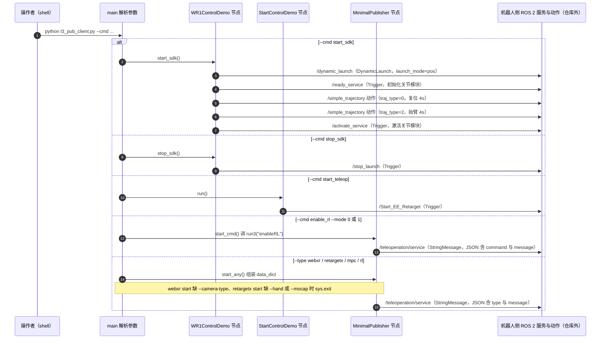

# teleop_client：遥操作生命周期与消息入口

## 一句话定义

为星动纪元遥操作接入提供命令和消息入口，依赖厂商环境与授权文件。

## 英文缩写速查

| 缩写 | 英文全称 | 简要说明 |
| --- | --- | --- |
| ROS | Robot Operating System | 机器人通信与软件中间件 |
| SDK | Software Development Kit | 对接机器人运行环境的开发工具 |
| VLA | Vision-Language-Action | 由视觉和语言生成动作的策略 |
| MPC | Model Predictive Control | 基于预测模型优化控制目标 |

## 为什么重要

这一入口补足[星动纪元](./robotera.md)研究与产品之间的工程接口；读者可核对公开代码和厂商运行环境的边界，避免仅凭仓库名推断完整复现能力。

## 核心结构

| 机构 | 星动纪元（ROBOTERA） |
| --- | --- |
| 官方仓 | [roboterax/teleop_client](https://github.com/roboterax/teleop_client) |

| 阶段 | README 入口与约束 |
| --- | --- |
| 启动 SDK | `pub_client.py --cmd start_sdk` |
| 初始化 | `init_teleop` 指定授权文件、XHAND/Lite、VR/gamepad 与相机类型 |
| 接入设备 | 在设备端连接机器人网页，确认数据通道建立 |
| 启动/收尾 | `start_teleop → stop_teleop → stop_sdk` |

## 工程实践

README 的开发链还引用厂商 GitLab `rbclient` 和 `pub_client.py`。SDK 文档使用公开 `teleop_client` 仓构建 ROS 2 消息定义；读者须分别核对消息包与机器人侧遥操作服务，而不能把一个仓库视为完整系统。授权文件路径和厂商部署环境是初始化前提。

## 局限与风险

截至 2026-10-08，公开 README 能确认生命周期和配置项，但不足以证明服务端、录像器和完整数据采集栈开放。原策展摘要提到示范采集，本页按可核实接口收窄描述；实际采集/导出契约见 M7 VLA 基线。未确认单一首发日期。

## 源码运行时序图

入口：`python l3_pub_client.py --cmd start_sdk`（或 `--cmd start_teleop` / `--cmd stop_sdk` / `--type webxr --cmd start --camera-type dummy` 等，同一入口分派）

图依据：roboterax/teleop_client@578353e，l3_pub_client.py、q5_pub_client.py、README.md

## 关联页面

- [星动纪元](./robotera.md)
- [M7 VLA 基线](./cn-os-robotera-vla.md)、[控制 SDK](./cn-os-xbot-sdk-api.md)
- [VLA](../methods/vla.md)、[Humanoid-Gym](./humanoid-gym.md)

## 公司路线日期口径

默认分支根提交 35aaa7b：2025-08-01，含 pub_client.py 和 ROS 接口；是含实现的历史起点，不证明首次公开或产品首发。 [日期证据](https://github.com/roboterax/teleop_client/commit/35aaa7b84c27377aac3ba46f7684cd655845d608)。详见[本轮日期核查](../../sources/sites/company-roadmap-date-audit-2026-10-08.md)；版本事件与原始产品首发分别记录。

## 参考来源

- [公司路线日期核查](../../sources/sites/company-roadmap-date-audit-2026-10-08.md)

- [官方 README 补核](../../sources/repos/teleop_client.md)
- [既有国内具身开源策展](../../sources/blogs/wechat_embodied_station_domestic_opensource_panorama_2026-09-06.md)
- 源码核对（2026-11-02）：roboterax/teleop_client@578353e，读过 README.md、l3_pub_client.py、q5_pub_client.py；时序图依据以上文件，未运行代码。

## 推荐继续阅读

- [官方 README](https://github.com/roboterax/teleop_client/blob/main/README.md)
