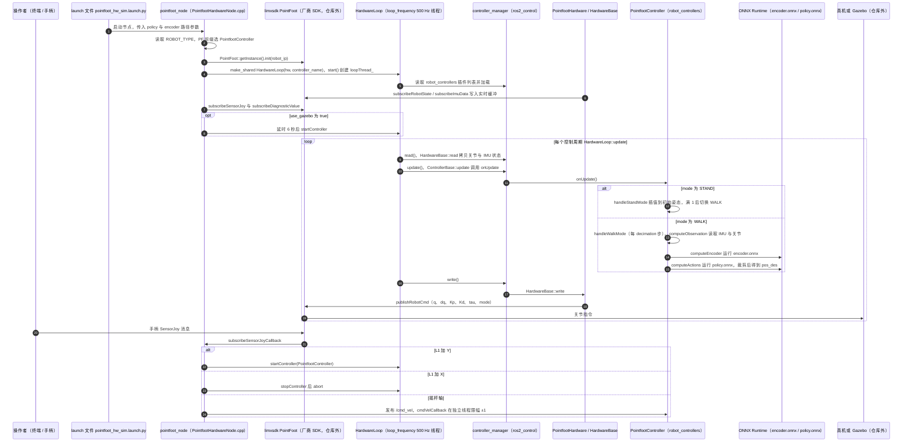

# TRON1 RL Deploy ROS2：策略部署接口

## 一句话定义

TRON1 RL Deploy ROS2 用 ROS 2 控制器与 ONNX Runtime 执行训练后的运动策略，通过 robot_hw 与低层 SDK 对接仿真或 TRON1 真机。

## 英文缩写速查

| 缩写 | 英文全称 | 简要说明 |
| --- | --- | --- |
| RL | Reinforcement Learning | 用交互反馈优化策略 |
| ROS | Robot Operating System | 模块通信与控制器基础设施 |
| ONNX | Open Neural Network Exchange | 策略网络交换与推理格式 |
| SDK | Software Development Kit | 低层机器人状态与命令接口 |

## 为什么重要

- 部署成败常在观测、动作顺序、归一化与控制频率，不能由“模型成功导出 ONNX”判断。
- 仿真/真机共用控制器结构，便于先检查接口再验证动力学差异。

## 核心原理

`robot_hw` 负责状态读取、仿真/真机抽象与执行；`robot_controllers` 把观测组织成策略输入，经 ONNX 推理生成动作，再交给硬件层。低层依赖 `limxsdk-lowlevel`。

这是训练结果的部署仓库，不能把它当成训练数据、奖励与 PPO 实现均已包含的 RL 框架。

## 工程实践

1. 按 README 的 Ubuntu 22.04 / ROS 2 Iron 与 ONNX Runtime 环境检查依赖。
2. 在同一 ROS 工作区获取低层 SDK 和本仓，使用 `colcon` 编译。
3. 先运行 `ros2 launch robot_hw pointfoot_hw_sim.launch.py`，检查状态更新、关节映射与策略输出。
4. 真机使用 README 对应硬件入口，核对本体配置、通信设备与低层命令模式。
5. **已开源**：2026-10-05 已打开官方仓库，Apache-2.0；策略训练资产和具体本体配置另查。

## 局限与风险

- ROS 2/ONNX/SDK 版本须匹配 README 的配置，不能仅凭依赖安装成功判断控制循环正确。
- 上机前用仿真与状态回放对齐观测顺序、关节符号和动作缩放。
- 本次完成源码入口核查，未进行 TRON1 真机试验。

## 源码运行时序图

入口：先 `export ROBOT_TYPE=PF_P441C`、`export RL_TYPE=isaacgym`，再 `ros2 launch robot_hw pointfoot_hw_sim.launch.py`（仿真；真机对应 `pointfoot_hw.launch.py`，IP 参数为代码内写死的 10.192.1.2）

图依据：tron1-rl-deploy-ros2@2e70026，robot_hw/src/PointfootHardwareNode.cpp、robot_hw/src/HardwareLoop.cpp、robot_hw/src/HardwareBase.cpp、robot_hw/src/PointfootHardware.cpp、robot_hw/launch/pointfoot_hw.launch.py、robot_hw/launch/pointfoot_hw_sim.launch.py、robot_controllers/src/ControllerBase.cpp、robot_controllers/src/PointfootController.cpp、robot_controllers/config/robot_controllers.yaml、README.md

## 关联页面

- [FluxVLA](./fluxvla-engine.md)
- [COSA](./limx-cosa.md)
- [强化学习](../methods/reinforcement-learning.md)

## 公司路线日期口径

2024-11-04 官方提交含 PF/SF/WF_TRON1A 配置与 ONNX 策略；上一条 09-20 提交无 TRON，早期 06 月是 PointFoot 前序。提交时间不证明首次公开。 [日期证据](https://github.com/limxdynamics/tron1-rl-deploy-ros2/commit/5980ee3d16d56a28d6b497cec603e6151183619a)。详见[本轮日期核查](../../sources/sites/company-roadmap-date-audit-2026-10-08.md)；版本事件与原始产品首发分别记录。

## 参考来源

- [公司路线日期核查](../../sources/sites/company-roadmap-date-audit-2026-10-08.md)

- [官方部署仓库归档](../../sources/repos/tron1-rl-deploy-ros2.md)

- 源码核对（2026-11-02）：limxdynamics/tron1-rl-deploy-ros2@2e70026，读过 README.md、robot_hw/src/PointfootHardwareNode.cpp、robot_hw/src/HardwareLoop.cpp、robot_hw/src/HardwareBase.cpp、robot_hw/src/PointfootHardware.cpp、robot_hw/launch/pointfoot_hw.launch.py、robot_hw/launch/pointfoot_hw_sim.launch.py、robot_controllers/config/robot_controllers.yaml、robot_controllers/src/ControllerBase.cpp，以及 robot_controllers/src/PointfootController.cpp 的关键段；时序图依据以上文件，未运行代码。

## 推荐继续阅读

- [官方仓库](https://github.com/limxdynamics/tron1-rl-deploy-ros2)
