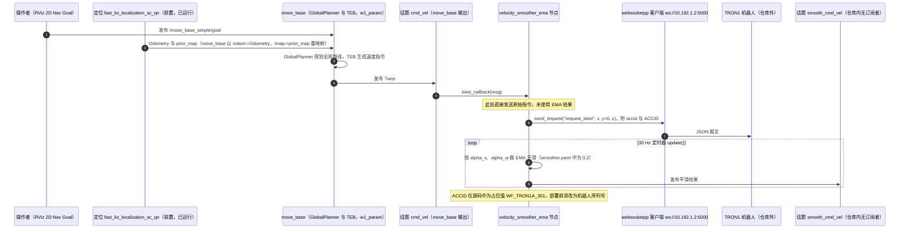

# tron1-ss

## 一句话定义

**tron1-ss** 是 [逐际动力](https://github.com/limxdynamics) 公开的 **工程与工具** 开源项目：感知/定位/建图模块：为导航与控制提供环境状态

## 英文缩写速查

| 缩写 | 英文全称 | 简要说明 |
|------|----------|----------|
| SDK | Software Development Kit | 真机控制与状态读取接口 |
| RL | Reinforcement Learning | 强化学习训练与策略优化 |
| VLA | Vision-Language-Action | 视觉–语言–动作统一策略 |
| Sim2Real | Simulation to Real | 仿真策略迁移真机 |
| URDF | Unified Robot Description Format | 机器人描述与仿真资产 |

## 为什么重要

- 收录于 [国内具身智能开源全景（76 家 · 424 项）](../overview/china-domestic-embodied-opensource-76-companies-technology-map.md) 的 **第一层** 分组。
- 与 [Humanoid Motion Intelligence](../entities/humanoid-motion-intelligence.md) 同源策展；本页为 **独立详情节点**，便于从公司清单跳到机制与入口说明。

## 核心原理

| 字段 | 内容 |
|------|------|
| 机构 | 逐际动力 |
| 类别 | 工程与工具 |
| 官方组织 | https://github.com/limxdynamics、https://github.com/FluxVLA |

## 工程实践

1. 从官方 GitHub/Gitee 组织检索 `tron1-ss` 仓库并核对 README 许可与依赖。
2. 对照本库 [424 项覆盖索引](../queries/china-domestic-opensource-424-coverage.md) 查看同公司其它入口是否共用训练/部署链路。
3. 若与既有方法页（如 RL 框架、VLA、SDK）主题相同，优先读关联页中的「开源入口」小节，避免重复维护平行叙事。

## 局限与风险

- 公众号清单为 **策展快照**（2026-09-06）；仓库更名、归档或许可证变化须回官方组织页核实。
- **开源状态**：以仓库 README 与 release 为准（入库日按文章描述归纳，未逐仓 clone 验证）。

## 源码运行时序图

入口：先按 README 第 3 节第 2 步启动定位（`roslaunch fast_lio_localization_sc_qn run.launch`，会同时启动 map_server 与激光扫描），再运行 `roslaunch sentry_nav sentry_movebase.launch`（其中包含 velocity_smoother_ema 的 launch）

图依据：limxdynamics/tron1-ss@a045a72，src/sentry_navigation/sentry_nav/launch/sentry_movebase.launch、src/sentry_navigation/sentry_tools/velocity_smoother_ema/launch/velocity_smoother_ema.launch、src/sentry_navigation/sentry_tools/velocity_smoother_ema/src/velocity_smoother_ema.cpp（关键段）、src/sentry_navigation/sentry_tools/velocity_smoother_ema/param/smoother.yaml、src/sentry_navigation/sentry_nav/w1_param/move_base_params.yaml（头部）、src/sentry_navigation/sentry_nav/src/Trans_TF_2d.cpp（检索）、src/fast-lio-mapping_and_localization-sc-qn/fast_lio_localization_sc_qn/launch/run.launch（检索）、README.md（第 4、5 节与快速开始）

## 关联页面

- [国内具身开源全景技术地图](../overview/china-domestic-embodied-opensource-76-companies-technology-map.md)
- [HMI 开源项目主表导读](../queries/hmi-opensource-projects-coverage.md)
- [Humanoid Motion Intelligence](../entities/humanoid-motion-intelligence.md)

## 参考来源

- [tron1-ss 源码归档](../../sources/repos/tron1-ss.md)（<https://github.com/limxdynamics/tron1-ss>）

- [国内具身智能开源全景（微信公众号）](../../sources/blogs/wechat_embodied_station_domestic_opensource_panorama_2026-09-06.md)

- 源码核对（2026-11-02）：limxdynamics/tron1-ss@a045a72，读过 README.md（快速开始与第 4、5 节）、src/sentry_navigation/sentry_nav/launch/sentry_movebase.launch、src/sentry_navigation/sentry_tools/velocity_smoother_ema/launch/velocity_smoother_ema.launch、src/sentry_navigation/sentry_tools/velocity_smoother_ema/src/velocity_smoother_ema.cpp（关键段）、src/sentry_navigation/sentry_tools/velocity_smoother_ema/param/smoother.yaml、src/sentry_navigation/sentry_nav/w1_param/move_base_params.yaml（头部）；对 Trans_TF_2d.cpp 与 fast_lio_localization_sc_qn/launch/run.launch 仅检索；时序图依据以上文件，未运行代码。

## 推荐继续阅读

- [逐际动力 官方组织](https://github.com/limxdynamics)
