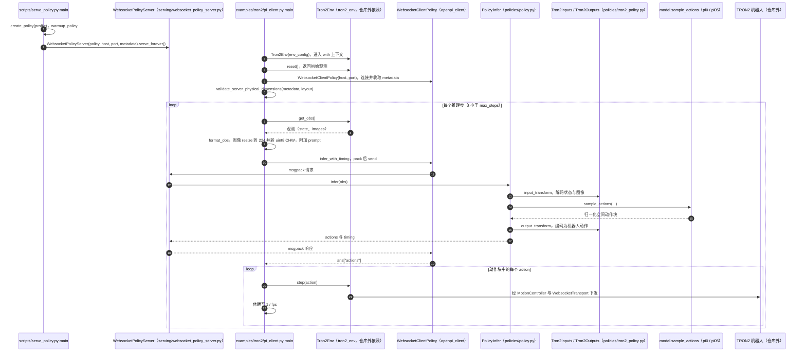

# tron2_openpi

## 一句话定义

**tron2_openpi** 是 [逐际动力](https://github.com/limxdynamics) 公开的 **VLA/操作模型** 开源项目：VLA/策略接入：模型输出动作块驱动本体执行

## 英文缩写速查

| 缩写 | 英文全称 | 简要说明 |
|------|----------|----------|
| SDK | Software Development Kit | 真机控制与状态读取接口 |
| RL | Reinforcement Learning | 强化学习训练与策略优化 |
| VLA | Vision-Language-Action | 视觉–语言–动作统一策略 |
| Sim2Real | Simulation to Real | 仿真策略迁移真机 |
| URDF | Unified Robot Description Format | 机器人描述与仿真资产 |

## 为什么重要

- 收录于 [国内具身智能开源全景（76 家 · 424 项）](../overview/china-domestic-embodied-opensource-76-companies-technology-map.md) 的 **第一层** 分组。
- 与 [Humanoid Motion Intelligence](../entities/humanoid-motion-intelligence.md) 同源策展；本页为 **独立详情节点**，便于从公司清单跳到机制与入口说明。

## 核心原理

| 字段 | 内容 |
|------|------|
| 机构 | 逐际动力 |
| 类别 | VLA/操作模型 |
| 官方组织 | https://github.com/limxdynamics、https://github.com/FluxVLA |

## 工程实践

1. 从官方 GitHub/Gitee 组织检索 `tron2_openpi` 仓库并核对 README 许可与依赖。
2. 对照本库 [424 项覆盖索引](../queries/china-domestic-opensource-424-coverage.md) 查看同公司其它入口是否共用训练/部署链路。
3. 若与既有方法页（如 RL 框架、VLA、SDK）主题相同，优先读关联页中的「开源入口」小节，避免重复维护平行叙事。

## 局限与风险

- 公众号清单为 **策展快照**（2026-09-06）；仓库更名、归档或许可证变化须回官方组织页核实。
- **开源状态**：以仓库 README 与 release 为准（入库日按文章描述归纳，未逐仓 clone 验证）。

## 源码运行时序图

入口：服务端 `uv run scripts/serve_policy.py --profile configs/deploy/candy_server.yaml`；客户端 `uv run examples/tron2/pi_client.py --profile <client 配置 YAML>`（需先启动服务端，机器人处于初始状态）

图依据：limxdynamics/tron2_openpi@9a4d7ed，README.md（运行命令段）、examples/tron2/pi_client.py、scripts/serve_policy.py（main 段）、examples/tron2/deploy_config.py（format_obs 与 infer_with_timing 段）、packages/openpi-client/src/openpi_client/websocket_client_policy.py（关键段）、src/openpi/serving/websocket_policy_server.py（关键段）、src/openpi/policies/policy.py（infer 段）

## 关联页面

- [国内具身开源全景技术地图](../overview/china-domestic-embodied-opensource-76-companies-technology-map.md)
- [HMI 开源项目主表导读](../queries/hmi-opensource-projects-coverage.md)
- [Humanoid Motion Intelligence](../entities/humanoid-motion-intelligence.md)

## 参考来源

- [tron2_openpi 源码归档](../../sources/repos/tron2_openpi.md)（<https://github.com/limxdynamics/tron2_openpi>）

- [国内具身智能开源全景（微信公众号）](../../sources/blogs/wechat_embodied_station_domestic_opensource_panorama_2026-09-06.md)

- 源码核对（2026-11-02）：limxdynamics/tron2_openpi@9a4d7ed，读过 README.md（运行命令段）、examples/tron2/pi_client.py、scripts/serve_policy.py（main 段）、examples/tron2/deploy_config.py（format_obs 与 infer_with_timing 段）、packages/openpi-client/src/openpi_client/websocket_client_policy.py（关键段）、src/openpi/serving/websocket_policy_server.py（关键段）、src/openpi/policies/policy.py（infer 段）；对 src/openpi/policies/tron2_policy.py 仅检索类与函数定义；时序图依据以上文件，未运行代码。

## 推荐继续阅读

- [逐际动力 官方组织](https://github.com/limxdynamics)
