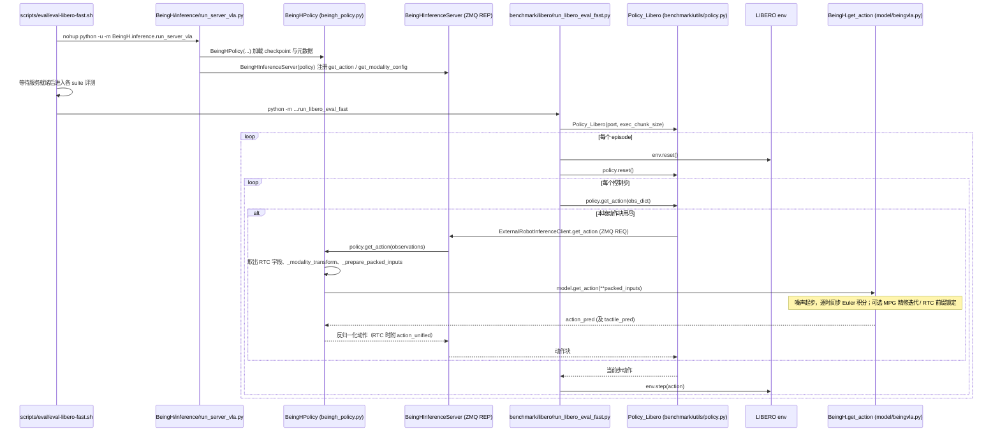

# TTP

## 一句话定义

**TTP** 是 [智在无界](https://github.com/BeingBeyond) 公开的 **数据集/Benchmark** 开源项目：数据采集/转换工具：同步记录并可转入 LeRobot/RLDS 训练栈

## 英文缩写速查

| 缩写 | 英文全称 | 简要说明 |
|------|----------|----------|
| SDK | Software Development Kit | 真机控制与状态读取接口 |
| RL | Reinforcement Learning | 强化学习训练与策略优化 |
| VLA | Vision-Language-Action | 视觉–语言–动作统一策略 |
| Sim2Real | Simulation to Real | 仿真策略迁移真机 |
| URDF | Unified Robot Description Format | 机器人描述与仿真资产 |

## 为什么重要

- 收录于 [国内具身智能开源全景（76 家 · 424 项）](../overview/china-domestic-embodied-opensource-76-companies-technology-map.md) 的 **第二层** 分组。
- 与 [Humanoid Motion Intelligence](../entities/humanoid-motion-intelligence.md) 同源策展；本页为 **独立详情节点**，便于从公司清单跳到机制与入口说明。

## 核心原理

| 字段 | 内容 |
|------|------|
| 机构 | 智在无界 |
| 类别 | 数据集/Benchmark |
| 官方组织 | https://github.com/BeingBeyond |

## 工程实践

1. 从官方 GitHub/Gitee 组织检索 `TTP` 仓库并核对 README 许可与依赖。
2. 对照本库 [424 项覆盖索引](../queries/china-domestic-opensource-424-coverage.md) 查看同公司其它入口是否共用训练/部署链路。
3. 若与既有方法页（如 RL 框架、VLA、SDK）主题相同，优先读关联页中的「开源入口」小节，避免重复维护平行叙事。

## 局限与风险

- 公众号清单为 **策展快照**（2026-09-06）；仓库更名、归档或许可证变化须回官方组织页核实。
- **开源状态**：以仓库 README 与 release 为准（入库日按文章描述归纳，未逐仓 clone 验证）。

## 源码运行时序图

入口（LIBERO 评测）：`bash scripts/eval/eval-libero-fast.sh`，脚本后台起 `python -u -m BeingH.inference.run_server_vla`，再跑 `python -m BeingH.benchmark.libero.run_libero_eval_fast`，两进程经 ZeroMQ（REQ/REP）通信。人体触觉任务另有服务入口 `BeingH/inference/run_server_TTP.py`（`BeingHPolicy` 同一实现，额外注册带计时与压缩解码的 `get_action`），客户端示例为 `BeingH/inference/run_client.py`。

图依据：BeingBeyond/TTP@591815c，读过 `README.md`、`scripts/eval/eval-libero-fast.sh`、`scripts/train/train_human_tactile.sh`、`BeingH/inference/{run_server_vla,run_server_TTP,beingh_service,beingh_policy,run_client}.py`、`BeingH/benchmark/libero/run_libero_eval_fast.py`、`BeingH/benchmark/utils/policy.py`、`BeingH/model/beingvla.py`（`get_action` 段）、`BeingH/train/pretrain.py`（入口与参数）。预训练入口为 `bash scripts/train/train_human_tactile.sh`（`torchrun BeingH/train/pretrain.py`），未单独画图。

## 关联页面

- [国内具身开源全景技术地图](../overview/china-domestic-embodied-opensource-76-companies-technology-map.md)
- [HMI 开源项目主表导读](../queries/hmi-opensource-projects-coverage.md)
- [Humanoid Motion Intelligence](../entities/humanoid-motion-intelligence.md)

## 参考来源

- [TTP 源码归档](../../sources/repos/ttp.md)（<https://github.com/BeingBeyond/TTP>）

- [国内具身智能开源全景（微信公众号）](../../sources/blogs/wechat_embodied_station_domestic_opensource_panorama_2026-09-06.md)
- 源码核对（2026-11-02）：BeingBeyond/TTP@591815c，读过 README.md、scripts/eval/eval-libero-fast.sh、scripts/train/train_human_tactile.sh、BeingH/inference/{run_server_vla,run_server_TTP,beingh_service,beingh_policy,run_client}.py、BeingH/benchmark/libero/run_libero_eval_fast.py、BeingH/benchmark/utils/policy.py、BeingH/model/beingvla.py、BeingH/train/pretrain.py；时序图依据以上文件，未运行代码。

## 推荐继续阅读

- [智在无界 官方组织](https://github.com/BeingBeyond)
