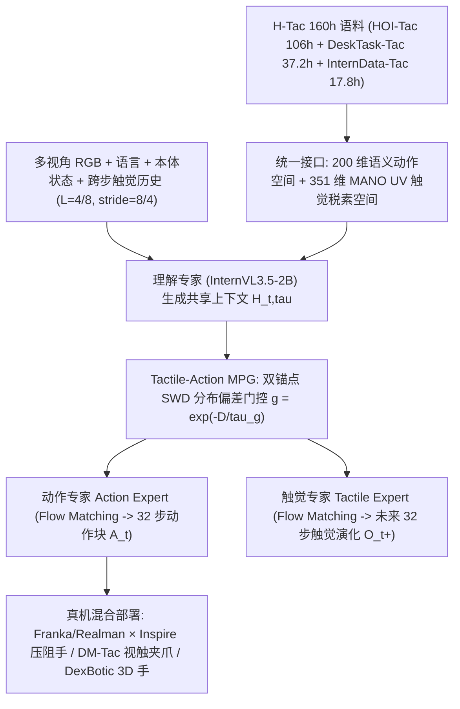
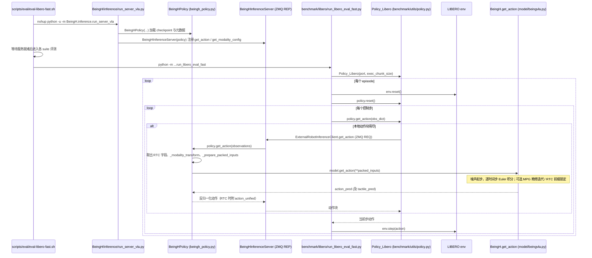

# TTP：面向灵巧操作的以人为中心可迁移触觉预训练系统

## 一句话定义

**TTP**（Transferable Tactile Pre-Training，`arXiv:2607.01067`）是智在无界（BeingBeyond）开源的人-机统一触觉预训练 VLA 系统：提出规模达 **160 小时 / 135k 回合的 H-Tac 触觉数据集**，并将 **UniTacHand 351 维 MANO UV 触觉表征**与双专家（动作+触觉未来预测）协同架构注入 **Being-H0.5**，显著提升削皮、取放脆薯片、折纸及盲视插拔等富接触灵巧任务精度。

## 英文缩写速查

| 缩写 | 英文全称 | 简要说明 |
|------|----------|----------|
| TTP | Transferable Tactile Pre-Training | 基于统一时空触觉与动作空间的跨人机触觉预训练及后训练系统 |
| H-Tac | Human-Centric Tactile Dataset | 汇集 HOI-Tac（106h）、DeskTask-Tac（37.2h）与 InternData-Tac（17.8h）的 160h 语料 |
| MPG | Tactile-Action Manifold-Preserving Gating | 通过切片 Wasserstein 距离（SWD）计算动作/触觉双锚点可靠性门控以抑制漂移 |
| SWD | Sliced Wasserstein Distance | 用于衡量当前特征上下文相对真实动作与触觉流形偏离度的尺度不变分布距离 |

## 为什么重要

1. **将触觉从「小数据集下游补丁」升级为「人-机联合预训练基础模态」**：传统 VTLA 仅在微调阶段接入零散真机触觉数据，导致视觉主导策略往往忽略微弱力觉信号且极易过拟合。TTP 通过与预训练严格一致的 200 维动作空间和 351 维 MANO 触觉空间，直接从 160h 人类交互中习得物理接触动力学先验。
2. **显式未来触觉预测专家 + 可靠性门控保障力控稳定性**：双专家并行为动作生成注入即将到来的接触力反馈想象，结合 MPG 避免视觉或触觉突发干扰导致 Euler 积分步放大误差。

## 核心原理

1. **H-Tac 160 小时三源合一数据集（300+ 任务、135k+ 回合）**：
   - **HOI-Tac（~106h, 124.8K 序列）**：从 14 个公开 3D 手-物交互集抽取手物网格近距接触阈值标签并投影至 [UniTacHand](cn-os-unitachand.md) 351 维 MANO UV 空间；
   - **DeskTask-Tac（37.2h, 947 回合 @ 30Hz）**：三视角 RealSense 配合 RawHand / AprilTag+动捕双管线触觉手套桌面实采；
   - **InternData-Tac（17.8h, 9,563 回合）**：在 InternDataEngine 仿真（Genie1/Lift2/Split ALOHA）外挂接触高斯扩散与邻近伪接触边车记录。
2. **三专家 MoT 与统一双模态 Flow-Matching**：基于 Being-H0.5（`InternVL3.5-2B` + `Qwen3`），在相同理解上下文上挂载**动作专家**与**触觉专家**，同时在 [0, 1] 流匹配路径上回归未来 32 步 200 维动作轨迹与 351 维触觉演进，避免后训练接口分布失配（无触觉仿真环境用 `pad(s_t - a_{t-1})` 作为代理触觉以维持双分支同步优化）。
3. **Tactile-Action MPG 流形保持门控**：构建噪声自由动作锚点 $\bar{Z}^{\text{act}}$ 与触觉锚点 $\bar{Z}^{\text{tac}}$，经 32 方向随机切片 Wasserstein 距离计算双边偏移 $D = \frac{1}{2}(D_{\text{act}} + D_{\text{tac}})$，得到调制系数 $g = \exp(-D/\tau_g)$ 对残差条件修正加权，降低上下文外推风险。

## 工程实践

- **多平台实测与仿真成绩**：
  - **仿真基准（无真实触觉代理下保持高水准）**：LIBERO **98.1%**、LIBERO-plus 零样本 **76.3%**、RoboCasa **55.1%**（高于 Being-H0.5 `53.9%` 与 $\pi_{0.5}$ `41.4%`）；
  - **9 项跨构型真机触觉实验**（覆盖 Franka 7-DoF / Realman 6-DoF 双臂 × Inspire 压阻灵巧手 / DM-Tac 视触平行夹爪 / DexBotic 12-DoF 3D 触觉手）：精细操作平均进展率 **96.7%**（白萝卜持续削皮 `23.33 cm`、单手擦花瓶 `100%`）、易碎与富接触任务 **79.2%**（完整抓放脆弱薯片 `80%` vs $\pi_{0.5}$ `10%`；双臂控力折纸折痕率 `84%` vs `0%`）、视觉遮挡/缺陷任务 **37.8%**。
- **开箱源码与权重（`BeingBeyond/TTP @ 591815c`）**：仓库已开源 `scripts/train/train_human_tactile.sh`（支持从 `Being-H05-2B` 恢复并开启 `USE_MPG=True`）、`BeingH/inference/{run_server_TTP.py,real_robot_server.py,real_robot_client.py}` 以及 `TTP-{pretrained,libero,libero-plus,robocasa}` Hugging Face 权重和 `H-Tac_Sample` 示例子集（完整 160h 数据集标注即将放出）。

## 结论

**TTP 率先把「160h 人类+仿真触觉预训练、统一 351 维 MANO UV 触觉空间、双专家未来动作+触觉同步流匹配及 MPG 流形门控」完整走通并开源落地于三类真实异构触觉末端。**
- 在脆品抓放（80% vs 10%）与双臂可控折纸（84% vs 0%）上展现出无触觉 VLA（$\pi_{0.5}$、Being-H0.5）难以突破的精细物理力控壁垒；
- 触觉预训练在无触觉纯视觉仿真（LIBERO 98.1%、RoboCasa 55.1%）上亦未损伤反而微升了泛化表现；
- 完整 160h H-Tac 全量数据仍待后续全面释放。

## 局限与风险

1. **视觉完全失效下的盲插成功绝对值仍偏低**：在「全黑插座盲插（PlugIn）」等极端视觉缺陷任务中虽压过全 0 基线，成功率仅 `20%`（ID/OOD）量级，对极细微轴孔对准探索策略仍需强化。
2. **序列开销增大**：新增历史触觉块（`HISTORY_SIZE=8`）与未来 32 步触觉专家预测令牌增加了显存与前向步长计算预算；全量 160h H-Tac 目前仅先释出了示例子集。

## 源码运行时序图

入口（LIBERO 评测）：`bash scripts/eval/eval-libero-fast.sh`，脚本后台起 `python -u -m BeingH.inference.run_server_vla`，再跑 `python -m BeingH.benchmark.libero.run_libero_eval_fast`，两进程经 ZeroMQ（REQ/REP）通信。人体触觉任务另有服务入口 `BeingH/inference/run_server_TTP.py`（`BeingHPolicy` 同一实现，额外注册带计时与压缩解码的 `get_action`），客户端示例为 `BeingH/inference/run_client.py`。

图依据：BeingBeyond/TTP@591815c，读过 `README.md`、`scripts/eval/eval-libero-fast.sh`、`scripts/train/train_human_tactile.sh`、`BeingH/inference/{run_server_vla,run_server_TTP,beingh_service,beingh_policy,run_client}.py`、`BeingH/benchmark/libero/run_libero_eval_fast.py`、`BeingH/benchmark/utils/policy.py`、`BeingH/model/beingvla.py`（`get_action` 段）、`BeingH/train/pretrain.py`（入口与参数）。预训练入口为 `bash scripts/train/train_human_tactile.sh`（`torchrun BeingH/train/pretrain.py`），未单独画图。

## 关联页面

- 所属机构实体：[智在无界（BeingBeyond）](beingbeyond.md)
- 核心触觉空间奠基：[UniTacHand：统一时空触觉表征](cn-os-unitachand.md)
- 上游跨本体基座与对比：[Being-H](cn-os-being-h.md) 与 [Rethink_VLA](cn-os-rethink-vla.md)
- [国内具身开源全景技术地图](../overview/china-domestic-embodied-opensource-76-companies-technology-map.md)

## 参考来源

- 一手论文：`arXiv:2607.01067v1` 全文归档（[ttp_arxiv_2607_01067.md](../../sources/papers/ttp_arxiv_2607_01067.md)）
- 源码核对（2026-11-02）：`BeingBeyond/TTP@591815c`，读过 README.md、scripts/eval/eval-libero-fast.sh、scripts/train/train_human_tactile.sh、BeingH/inference/{run_server_vla,run_server_TTP,beingh_service,beingh_policy,run_client}.py、BeingH/benchmark/libero/run_libero_eval_fast.py、BeingH/benchmark/utils/policy.py、BeingH/model/beingvla.py、BeingH/train/pretrain.py，归档于 [ttp.md](../../sources/repos/ttp.md)；时序图依据以上文件，未运行代码。
- [国内具身智能开源全景（微信公众号）](../../sources/blogs/wechat_embodied_station_domestic_opensource_panorama_2026-09-06.md)

## 推荐继续阅读

- [arXiv:2607.01067 论文页面](https://arxiv.org/abs/2607.01067)
- [BeingBeyond/TTP GitHub 仓库](https://github.com/BeingBeyond/TTP)
- [TTP 官方博客与模型权重页](https://research.beingbeyond.com/TTP)
