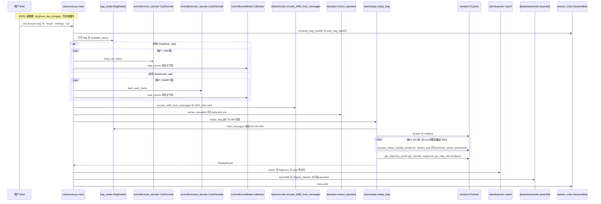

# umi-dex

## 一句话定义

**umi-dex** 是 [灵心巧手](https://github.com/linker-bot) 公开的 **数据集/Benchmark** 开源项目：面向灵巧手操作采集高质量示范数据，连接人类操作输入、灵巧手状态与训练数据转换。

## 英文缩写速查

| 缩写 | 英文全称 | 简要说明 |
|------|----------|----------|
| SDK | Software Development Kit | 真机控制与状态读取接口 |
| RL | Reinforcement Learning | 强化学习训练与策略优化 |
| VLA | Vision-Language-Action | 视觉–语言–动作统一策略 |
| Sim2Real | Simulation to Real | 仿真策略迁移真机 |
| URDF | Unified Robot Description Format | 机器人描述与仿真资产 |

## 为什么重要

- 收录于 [国内具身智能开源全景（76 家 · 424 项）](../overview/china-domestic-embodied-opensource-76-companies-technology-map.md) 的 **第三层** 分组。
- 与 [Humanoid Motion Intelligence](../entities/humanoid-motion-intelligence.md) 同源策展；本页为 **独立详情节点**，便于从公司清单跳到机制与入口说明。

## 核心原理

| 字段 | 内容 |
|------|------|
| 机构 | 灵心巧手 |
| 类别 | 数据集/Benchmark |
| 官方组织 | https://github.com/linker-bot |

## 工程实践

1. 从官方 GitHub/Gitee 组织检索 `umi-dex` 仓库并核对 README 许可与依赖。
2. 对照本库 [424 项覆盖索引](../queries/china-domestic-opensource-424-coverage.md) 查看同公司其它入口是否共用训练/部署链路。
3. 若与既有方法页（如 RL 框架、VLA、SDK）主题相同，优先读关联页中的「开源入口」小节，避免重复维护平行叙事。

## 局限与风险

- 公众号清单为 **策展快照**（2026-09-06）；仓库更名、归档或许可证变化须回官方组织页核实。
- **开源状态**：以仓库 README 与 release 为准（入库日按文章描述归纳，未逐仓 clone 验证）。

## 源码运行时序图

入口：`uv run umi-process <bag> --vocab ./config/ORBvoc.txt --settings ./config/intel_d455.yaml --out sessions/<session_id>/`（`src/umi_dex/cli/process.py` 的 `main`，由 `pyproject.toml` 的 `[project.scripts]` 注册）

图依据：umi-dex@b5c88d0，README.md、pyproject.toml、docs/processing.md、src/umi_dex/cli/process.py（完整读过）、cli/extract.py、cli/slam.py、cli/inspect.py（读过入口与参数）、src/umi_dex/bag_reader.py（类与方法定义）、slam/replay.py（replay_bag 全函数）、slam/exporter.py 与 dataset/assemble.py（仅 grep 函数定义与输出文件名）、controllers/can_decode.py（仅 grep 类与方法定义）；usart_decode.py、calibrate.py、video/encode.py、episodes.py 仅见 process.py 中的调用。未运行代码。

## 关联页面

- [国内具身开源全景技术地图](../overview/china-domestic-embodied-opensource-76-companies-technology-map.md)
- [HMI 开源项目主表导读](../queries/hmi-opensource-projects-coverage.md)
- [Humanoid Motion Intelligence](../entities/humanoid-motion-intelligence.md)

## 参考来源

- [umi-dex 源码归档](../../sources/repos/umi-dex.md)（<https://github.com/linker-bot/umi-dex>）

- [国内具身智能开源全景（微信公众号）](../../sources/blogs/wechat_embodied_station_domestic_opensource_panorama_2026-09-06.md)

- 源码核对（2026-11-02）：linker-bot/umi-dex@b5c88d0，读过 README.md、pyproject.toml、docs/processing.md、src/umi_dex/cli/{process,extract,slam,inspect}.py、src/umi_dex/slam/replay.py；时序图依据以上文件，未运行代码。

## 推荐继续阅读

- [灵心巧手 官方组织](https://github.com/linker-bot)
