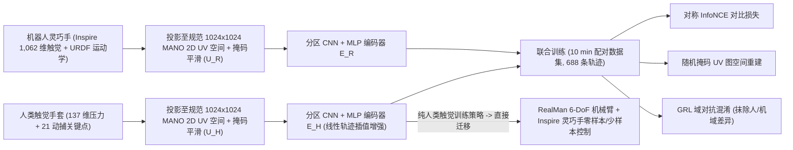

# UniTacHand：人手与灵巧手触觉技能迁移的统一时空触觉表征

## 一句话定义

**UniTacHand**（`arXiv:2512.21233`）是智在无界（BeingBeyond）提出的跨本体统一时空触觉表征框架（注：早期外部分类曾误将其归为“具身 Agent/规划”，实为触觉形态统一与表征对齐系统）：将结构迥异的人手触觉手套与机械灵巧手阵列统一投影至 **MANO 手表面 2D UV 规范空间**，经 10 分钟配对抓握对齐后，支撑无需真机触觉样本的**零样本人手到机器人触觉技能迁移**。

## 英文缩写速查

| 缩写 | 英文全称 | 简要说明 |
|------|----------|----------|
| MANO | Hand Model with Articulated and Non-rigid Deformations | 统一映射人类与机器人手指及手掌拓扑的参数化 3D 手表面网格模型 |
| UV | Texture Parameterization Coordinates (U, V) | 将 3D MANO 手网格展开为 1024×1024 形态一致二维触觉特征平面的坐标系统 |
| InfoNCE | Information Noise-Contrastive Estimation | 用于拉近同一抓握交互下人-机同步触觉表征的对称对比学习损失 |
| GRL | Gradient Reversal Layer | 反向梯度层，用于域对抗训练使编码特征对「人手/机器人」域不可区分 |

## 为什么重要

1. **解决触觉传感器构型碎片化的根本障碍**：人类触觉手套传感器布局、通道数量（如 137 维）与各类商业/科研灵巧手（如 Inspire Hand 1,062 维压阻矩阵）完全无法维度一一对应；直接在特征向量层面拼凑无法迁移策略。MANO UV 投影提供了物理拓扑不变的统一画布。
2. **极低真机配对开销赋能纯人类触觉预训练**：仅需 **10 分钟**配对采集（50 类物体、688 条轨迹、16K 帧）即可打通对齐空间，后续下游任务甚至无需任何真机触觉数据即可零样本部署，并且直接成为后续 [TTP](cn-os-ttp.md) 大规模触觉 VLA 系统的 351 维基础触觉接口。

## 核心原理

1. **规范 2D MANO UV 触觉映射**：依据手指/掌心局部解剖对应关系，分别把人类手套传感坐标（137 维）与机器人 URDF 上的传感器税素坐标（如 Inspire Hand 1,062 维）映射到一致的 **1024×1024 MANO 表面 UV 展开图**，通过有效区域掩码与高斯核平滑生成对齐触觉矩阵 $U_H, U_R$（在下游高效接口中被降采样为 **351 维标准税素向量**）。
2. **轻量化数据采集与增广**：录制约 **10 分钟配对人-机同类抓握交互**（50 种物体、688 条轨迹、40 Hz 共 16K 帧），引入沿轨迹线性插值的平滑增强以覆盖接触力变化连续谱。
3. **三目标联合表征对齐**：经独立分区 CNN+MLP 编码器（$E_H, E_R$）映射后，联合最小化：（a）跨本体对称 **InfoNCE** 损失对齐物理接触语义；（b）**Masked UV Reconstruction** 迫使编码器补全被遮蔽手指的接触分布；（c）**GRL 域对抗判别损失**对齐两域潜空间分布。

## 工程实践

- **真机零样本与共训成效（RealMan 6-DoF + Inspire DexHand）**：
  - **零样本纯人类策略迁移**：SoftHardPickPlace（软硬分拣）成功率 **85%**、ObjectLocating **100%**、CompliantControl（柔顺力控）**40%**（大幅超越 PatchMatch 基线 `10%`），真实物体分类零样本达 **38.6%**；
  - **人机混合 1-shot 协同训练**：仅补充 1 条真机演示共训即可达到 **73.3%** 成功率，相对纯视觉基线（`43.3%`）提升 +30 个百分点。
- **下游生态复用**：[TTP](cn-os-ttp.md) 直接继承 UniTacHand 的 **351 维 MANO UV 税素空间**构造 160 小时 `H-Tac` 预训练库，兼容压阻阵列、视触传感器（DM-Tac）与三指/五指机械手。
- **开源状态核查**：**源码运行时序图：不适用**（截至 2026-11-21，官方仓库 [BeingBeyond/UniTacHand](https://github.com/BeingBeyond/UniTacHand) commit `f8fa22b` 仅含 `README.md` 与 `docs/` 展示静态文件，无 UV 投影或对齐训练代码；已据此修正早期误标的“已开源”状态。可执行参考代码可参照其直接继承者 [BeingBeyond/TTP](https://github.com/BeingBeyond/TTP)）。

## 结论

**UniTacHand 证明「统一三维人手表面参数化（MANO 2D UV）+ 小规模配对对比/对抗对齐」可以打通人类触觉手套到异构机械灵巧手的技能迁移瓶颈。**
- 无需重新设计昂贵的新手硬件，仅靠几何拓扑映射与 10 分钟配对数据即可完成人-机触觉对齐；
- 零样本 85%/100% 与 1-shot +30% 的真机增益证实触觉表征在接触遮挡与软硬分辨任务上的决定性作用；
- 核心代码目前需等待官方释放，或通过后续 [TTP](cn-os-ttp.md) 开源代码生态复用其 351 维 MANO UV 触觉接口。

## 局限与风险

1. **对传感器物理量纲/滑移切向力的差异敏感**：纯法向压力投影在面对含丰富切向剪切力纹理信息的视触觉传感器（如 GelSight 类）时可能损失部分高频剪切细节。
2. **开源实现暂缺**：`f8fa22b` 仓库尚未释出 UV 标定脚本与 CNN-MLP 编码器权重，复现需自行依据论文配对投影实现或参照 TTP 数据预处理脚本。

## 关联页面

- 所属机构实体：[智在无界（BeingBeyond）](beingbeyond.md)
- 大规模 VLA 演进工作：[TTP：以人为中心的可迁移触觉预训练系统](cn-os-ttp.md)
- 同公司灵巧抓握对比：[DemoGrasp：单演示通用灵巧抓取](cn-os-demograsp.md)

- [机器人操作](../tasks/manipulation.md)：了解物体抓取与操作任务。
- [机器人操作系统与末端执行器](../methods/robotic-manipulation-systems.md)：了解机械臂、末端与控制接口。

## 参考来源

- 一手论文：`arXiv:2512.21233v3` 全文归档（[unitachand_arxiv_2512_21233.md](../../sources/papers/unitachand_arxiv_2512_21233.md)）
- 代码仓库核查：[unitachand.md](../../sources/repos/unitachand.md)（`BeingBeyond/UniTacHand @ f8fa22b`）
- 行业全景索引：[wechat_embodied_station_domestic_opensource_panorama_2026-09-06.md](../../sources/blogs/wechat_embodied_station_domestic_opensource_panorama_2026-09-06.md)

## 继续阅读

- [arXiv:2512.21233 论文页面](https://arxiv.org/abs/2512.21233)
- [UniTacHand 官方项目主页](https://beingbeyond.github.io/UniTacHand/)
- [BeingBeyond/UniTacHand GitHub 仓库](https://github.com/BeingBeyond/UniTacHand)
