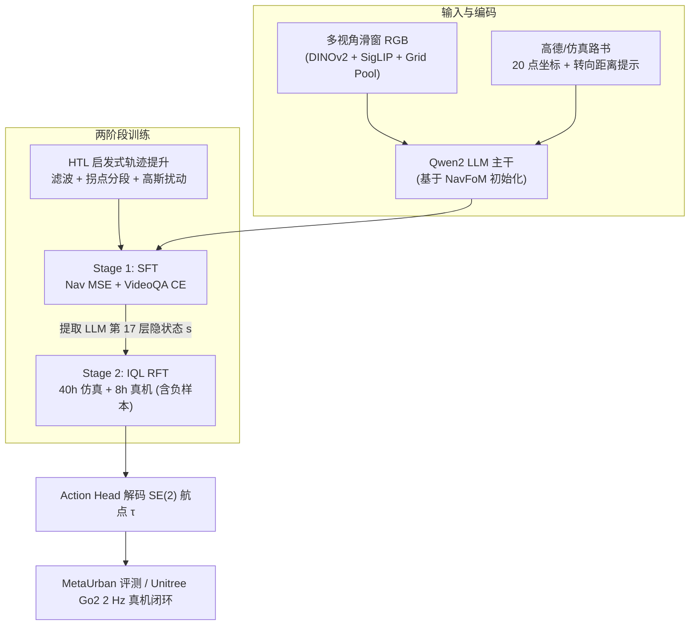
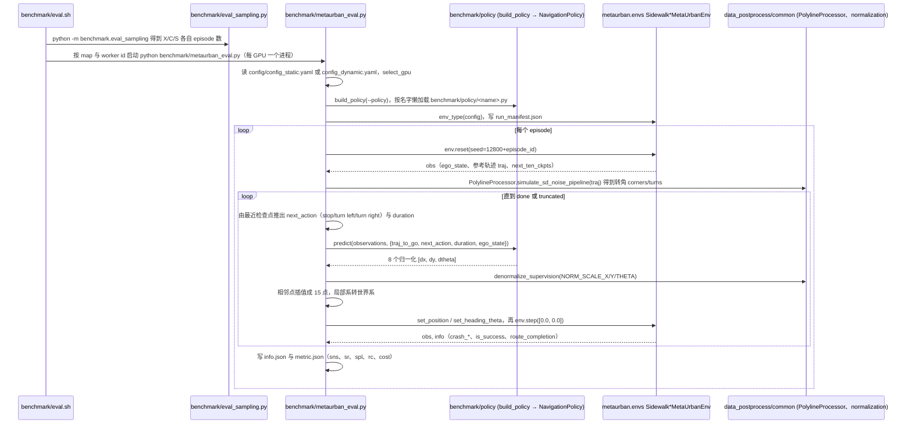

# UrbanVLA

## 一句话定义

**UrbanVLA** 是 [银河通用](https://github.com/GalaxyGeneralRobotics) 公开的 **VLA/操作模型** 开源项目：将第一视角视觉、语言指令与机器人状态映射为移动决策，使机器人在室外或半开放城市环境中完成目标导向导航。

## 英文缩写速查

| 缩写 | 英文全称 | 简要说明 |
|------|----------|----------|
| VLA | Vision-Language-Action | 视觉–语言–动作统一策略模型 |
| HTL | Heuristic Trajectory Lifting | 启发式轨迹提升，加噪抽象路书以防过拟合 |
| SFT | Supervised Fine-Tuning | 第一阶段监督微调（仿真/网路轨迹 + VideoQA） |
| RFT / IQL | Reinforcement Fine-Tuning / Implicit Q-Learning | 第二阶段离线强化微调，提升安全与抗偏离能力 |
| SNS / SPL | Social Navigation Score / Success weighted by Path Length | 社交合规评分与路径长度加权成功率 |

## 为什么重要

- 针对**无高精度 HD 地图**的大尺度城市非结构化行人环境（>500 m 长程导航），解决导航软件路书与物理路面存在数米～十米错位的工程痛点。
- 给出“**仿真/网路视频 SFT + 混合仿真真机 IQL RFT**”的两阶段训练范式，仅凭 RGB 在 MetaUrban PointNav/SocialNav 上超越 LiDAR 基线。
- 官方仓库公开了与基准严密对齐的 MetaUrban 采集、轨迹加噪、99 分位归一化及评测协议，可直接作为城市微出行策略的通用评测床。

## 核心原理

| 字段 | 内容 |
|------|------|
| 机构 | 北京大学 · 银河通用（Galbot）· 中国科大 · 智源（BAAI） |
| 论文 / 会议 | [arXiv:2510.23576](https://arxiv.org/abs/2510.23576)（ICRA 2026） |
| 开源仓库 | <https://github.com/GalaxyGeneralRobotics/UrbanVLA>（Apache-2.0，部分开源） |

UrbanVLA 基于预训练导航基座 **NavFoM**，把“导航 App 路书”编码为未来 40 m（每 2 m 采样 20 点）自车系坐标与下一路口转向距离/方向提示，与滑窗多视角 RGB 经 **DINOv2 + SigLIP → 网格池化 → 双层 MLP** 共同送入 **Qwen2** 主干，双分支输出 VideoQA 文本或由 ActionModel 解码未来 $N$ 步 $SE(2)$ 航点：

1. **HTL 路书加噪增强：** 对 MetaUrban 专家与 Sekai 街景解析轨迹做平滑滤波与拐点分段，向每段注入高斯位置扰动后再重采样，迫使策略依靠视觉对齐而非死背完美规划路线（真机 C 形路测试去除 HTL 时路线完成度从 100% 跌至 42%）。
2. **SFT + IQL 两阶段微调：** SFT 联训路径回归（MSE）与 VideoQA（交叉熵）；RFT 提取 SFT 模型 LLM **第 17 层隐状态**作为状态表征，在 2,400 回合仿真 + 8 小时北京真机遥操作（含负奖励样本）上以安全/完成度复合奖励执行离线 **IQL** 优势加权回归（AWR），使 SocialNav Unseen SR 从 82% 提升至 88%、碰撞 Cost 从 0.98 降至 0.82。

### 流程总览

图依据：arXiv:2510.23576v2 §III-A–C、Fig. 2–3。

## 实验与评测

- **MetaUrban-12K 基准（Table I，纯 RGB 对比 7 个 LiDAR 基线）：** PointNav Test SR **94%** / SPL **0.91**、Unseen SR **97%** / SPL **0.95**；SocialNav Test SR **91%** / SNS **0.87**、Unseen SR **88%** / SNS **0.85**。
- **HTL 与 RFT 消融（Table II–III）：** 60 m C 形人行道真机测试（导航折线偏差约 10 m）中，SFT+HTL 路线完成度 **100%** vs 去 HTL **42%**；加入 IQL RFT 后 SocialNav Unseen SR **82% → 88%**，Cost **0.98 → 0.82**。
- **真机系统：** Unitree Go2 搭载 4 相机 + Jetson Orin + 5G CPE + GNSS + 高德 Web API，远程 RTX 4090 服务器以 **2 Hz** 推理并由本地规划器执行，完成过街天桥、斑马线与 >500 m 长程测试。

## 工程实践

1. **环境编译与资产初始化：** 按 README 使用 Python 3.9，编译 `metaurban/orca_algo/compile.sh`，执行 `python -m metaurban.pull_asset` 与 `verify_headless_env` 验证无头 Panda3D 渲染环境。
2. **数据采集与严格归一化：** 使用 `python scripts/collect.py --policy {astar,rl} --env {static,dynamic} --view_mode {front,panorama}` 采集，并运行 `data_postprocess.metaurban.*` 计算未来 8 步相对运动的 99 分位 `NORM_SCALE_X / Y / THETA`；自定义 `NavigationPolicy` 子类必须精确回填同一组常量。
3. **基准复现与模型接入：** 用 `MAX_EPISODES=1 NO_VISUALIZATION=1 bash benchmark/eval.sh pointnav-test 0` 冒烟测试，`POLICY=metaurban_ppo` 跑内置 PPO 专家；自定义模型在 `benchmark/policy/<name>.py` 继承 `NavigationPolicy` 并用 `@register_policy` 注册即可接入评测。
4. **开源核查（2026-11-21）：** `GalaxyGeneralRobotics/UrbanVLA@c75294a` 已开源 MetaUrban 仿真与 ORCA 扩展、数据采集/后处理及评测管线（Apache-2.0）；**UrbanVLA 模型结构、SFT/RFT 训练代码与预训练权重仍在 README TODO 列表，尚未发布**。

## 局限与风险

- **核心模型与权重未开源：** 截至 `c75294a`，仓库仅可复现数据收集与 MetaUrban 评测基准，无法直接复现论文中的 NavFoM+Qwen2 模型训练与推理。
- **仿真评测与真机部署差异：** MetaUrban 基准评测使用轮椅载体并按预测航点直接位移代理（上限 1.5 m），而论文真机部署运行于 Unitree Go2 + 局部规划器且推理依赖远程 RTX 4090（2 Hz）与安全员实时接管。
- **归一化尺度静默失配风险：** `NORM_SCALE_X/Y/THETA` 若未与训练数据后处理输出严格一致，会在不报错的情况下直接扭曲物理尺度航点输出。

## 源码运行时序图

官方仓库当前公开的是数据采集、后处理与 MetaUrban 基准评测流水线（README 称模型结构、训练代码与 checkpoint 尚未发布），下图画的是评测主循环。

入口：`MAX_EPISODES=1 NO_VISUALIZATION=1 bash benchmark/eval.sh pointnav-test 0`（默认 `POLICY=dummy`；`POLICY=metaurban_ppo` 可跑自带 PPO 专家）

图依据：GalaxyGeneralRobotics/UrbanVLA@c75294a，读过 README.md、evaluation.md、benchmark/eval.sh、benchmark/metaurban_eval.py、benchmark/policy/__init__.py、benchmark/policy/dummy.py、scripts/collect.py、scripts/rl_expert_collect.py。注：`control_mode="env_action"` 的策略（如 metaurban_ppo）走 `predict_action` 并直接 `env.step(action)`，图中未画此分支。

## 关联页面

- [VLA](../methods/vla.md)
- [视觉语言导航（VLN）](../tasks/vision-language-navigation.md)
- [国内具身开源全景技术地图](../overview/china-domestic-embodied-opensource-76-companies-technology-map.md)
- [HMI 开源项目主表导读](../queries/hmi-opensource-projects-coverage.md)
- [Humanoid Motion Intelligence](../entities/humanoid-motion-intelligence.md)

## 参考来源

- [UrbanVLA 论文原文归档（arXiv:2510.23576）](../../sources/papers/urbanvla_arxiv_2510_23576.md)
- [UrbanVLA 源码归档](../../sources/repos/urbanvla.md)（<https://github.com/GalaxyGeneralRobotics/UrbanVLA>，commit `c75294a`）
- [国内具身智能开源全景（微信公众号）](../../sources/blogs/wechat_embodied_station_domestic_opensource_panorama_2026-09-06.md)

## 推荐继续阅读

- [UrbanVLA 论文（arXiv:2510.23576）](https://arxiv.org/abs/2510.23576)
- [UrbanVLA 项目页](https://pku-epic.github.io/UrbanVLA-Web/)
- [UrbanVLA 官方仓库](https://github.com/GalaxyGeneralRobotics/UrbanVLA)
