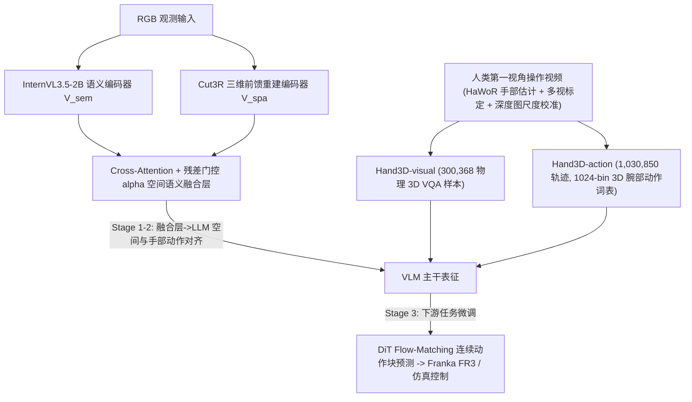

# VIPA-VLA：基于人类视频视觉-物理对齐的空间感知 VLA 预训练

## 一句话定义

**VIPA-VLA**（`arXiv:2512.13080`，CVPR 2026）是智在无界（BeingBeyond）提出的空间感知视觉-语言-动作预训练框架：将 **InternVL3.5-2B** 二维语义编码器与 **Cut3R** 三维前馈几何编码器融合，并在完全无需真机遥操作轨迹的 **Hand3D** 人类视频数据集上建立从 2D 像素到 3D 物理空间的视觉-动作对齐。

## 英文缩写速查

| 缩写 | 英文全称 | 简要说明 |
|------|----------|----------|
| VIPA-VLA | Visual-Physical Alignment VLA | 通过人类视频视觉-物理空间对齐预训练的空间感知 VLA 框架 |
| Cut3R | Continuous 3D Reconstruction | 提供前馈三维点图与几何结构表征的空间视觉编码器 $V_{\text{spa}}$ |
| DiT | Diffusion Transformer | 下游阶段接入连续动作流匹配的扩散 Transformer 动作头 |
| VQA | Visual Question Answering | 本作用于训练 3D 位姿、尺寸比较与可操作性的图文问答监督格式 |

## 为什么重要

1. **打破「VLA 预训练依赖昂贵机器人多视角/深度传感器」约束**：传统空间 VLA 要么必须额外接入深度图/点云传感，要么仍高度依赖真实机器人轨迹做空间接地；VIPA-VLA 证明仅从纯第一视角人类操作视频校准出物理尺度的 Hand3D 语料即可无机器人预训练出强三维感知底座。
2. **语义视觉与 3D 几何显式解耦融合**：单独依靠多模态大模型 ViT 易缺乏精确度量深度与相对空间方向感，引入 Cut3R 交叉注意力+残差门控有效补齐三维推理短板。

## 核心原理

1. **双路 2D 语义 + 3D 几何视觉融合**：并行运行 `InternVL3.5-2B`（$V_{\text{sem}}$）与 `Cut3R`（$V_{\text{spa}}$），利用交叉注意力机制与可学习残差系数 $\alpha$ 将空间三维先验注入语义特征令牌，在保留预训练图文常识的同时显著增强三维距离与朝向敏感度。
2. **Hand3D 无真机人类空间-物理数据管线**：
   - **Hand3D-visual（300,368 条）**：利用多相机标定与人手关键点尺度对齐深度图，还原真实物理尺度并生成 3D 位姿、物体尺寸对比与可操作性 VQA；
   - **Hand3D-action（1,030,850 条）**：将人手腕 3D 平动与旋转离散化为 1024-bin 空间动作词汇。
3. **三阶段协同课程**：Stage 1 冻结主干仅训 2D-3D 融合模块（Hand3D-visual）；Stage 2 解冻融合与 LLM 主干对齐空间动作（Hand3D-action）；Stage 3 接 **DiT Flow-Matching** 连续动作头对下游具体机械臂做端到端微调。

## 工程实践

- **基准与真机表现（零机器人预训练底座）**：
  - **LIBERO**：双视角平均成功率 **96.8%**，单视角 **92.4%**；
  - **RoboCasa**：平均成功率 **45.8%**（高于 $\pi_{0.5}$ 的 `41.4%`）；
  - **真机实验（Franka FR3 + Inspire Hand）**：在 Wipe-Board 任务中 Seen 达 **83%**、Unseen 泛化达 **60%**（显著高于 Being-H0 `40% / 10%` 与 GR00T N1.5 `57% / 30%`）。
- **开源状态核查**：**源码运行时序图：不适用**（截至 2026-11-21，官方仓库 [BeingBeyond/VIPA-VLA](https://github.com/BeingBeyond/VIPA-VLA) commit `33e9e48` 仅包含 `README.md`、`LICENSE` 与 `docs/assets/` 静态图片，README 声明 *"Code is coming soon!"*，尚未释放 Hand3D 管线与模型源码；已据此更正早期“已开源”归档偏差）。

## 结论

**VIPA-VLA 通过双路 2D 语义 + 3D Cut3R 视觉融合与百万级无真机 Hand3D 人类尺度校准语料，证明无需在预训练期投入真机轨迹即可学得可迁移的 3D 物理接地 VLA 基座。**
- 在无真实机器人预训练数据前提下仍可在 RoboCasa（45.8%）和 Franka 真机泛化上压过同期强基线；
- Cross-Attention + 可学习残差门控是保留 VLM 原生语意与注入三维先验的低代价平衡点；
- 目前主要阻塞在于训练与 Hand3D 生成代码尚未开源。

## 局限与风险

1. **深度校准前提依赖**：Hand3D 构造阶段依赖人体手部先验与视角深度比例标定以消除单目尺度模糊，在手部被严重遮挡的长尾野外视频上自动过滤率与精度会受限。
2. **代码与数据集暂未释出**：当前 GitHub `33e9e48` 仅占位文档，无法第三方独立复现三阶段训练超参。

## 关联页面

- 所属机构实体：[智在无界（BeingBeyond）](beingbeyond.md)
- 同路线人类视频预训练：[Being-H0：大规模人手视频 VLA](paper-notebook-being-h0-vision-language-action-pretraining-from.md) 与 [JALA：野外视频联合隐动作对齐](cn-os-jala.md)
- 后续隐式世界-动作模型：[Being-H0.7](../methods/being-h07.md)

## 参考来源

- 一手论文：`arXiv:2512.13080v1`（CVPR 2026）全文归档（[vipa-vla_arxiv_2512_13080.md](../../sources/papers/vipa-vla_arxiv_2512_13080.md)）
- 代码仓库核查：[vipa-vla.md](../../sources/repos/vipa-vla.md)（`BeingBeyond/VIPA-VLA @ 33e9e48`）
- 行业全景索引：[wechat_embodied_station_domestic_opensource_panorama_2026-09-06.md](../../sources/blogs/wechat_embodied_station_domestic_opensource_panorama_2026-09-06.md)

## 继续阅读

- [arXiv:2512.13080 论文页面](https://arxiv.org/abs/2512.13080)
- [VIPA-VLA 官方项目主页](https://beingbeyond.github.io/VIPA-VLA)
- [BeingBeyond/VIPA-VLA GitHub 仓库](https://github.com/BeingBeyond/VIPA-VLA)
