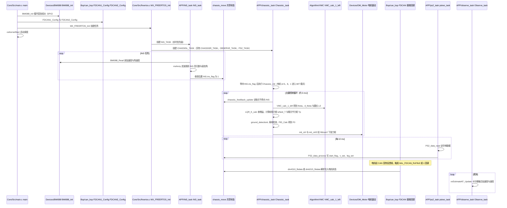

# wheel-legged

## 一句话定义

**wheel-legged** 是 [达妙科技](https://github.com/dmBots) 公开的 **工程与工具** 开源项目：提供达妙轮足机器人控制与开发资料，用于平衡、移动和执行器系统联调。

## 英文缩写速查

| 缩写 | 英文全称 | 简要说明 |
|------|----------|----------|
| SDK | Software Development Kit | 真机控制与状态读取接口 |
| RL | Reinforcement Learning | 强化学习训练与策略优化 |
| VLA | Vision-Language-Action | 视觉–语言–动作统一策略 |
| Sim2Real | Simulation to Real | 仿真策略迁移真机 |
| URDF | Unified Robot Description Format | 机器人描述与仿真资产 |

## 为什么重要

- 收录于 [国内具身智能开源全景（76 家 · 424 项）](../overview/china-domestic-embodied-opensource-76-companies-technology-map.md) 的 **第一层** 分组。
- 与 [Humanoid Motion Intelligence](../entities/humanoid-motion-intelligence.md) 同源策展；本页为 **独立详情节点**，便于从公司清单跳到机制与入口说明。

## 核心原理

| 字段 | 内容 |
|------|------|
| 机构 | 达妙科技 |
| 类别 | 工程与工具 |
| 官方组织 | https://github.com/dmBots |

## 工程实践

1. 从官方 GitHub/Gitee 组织检索 `wheel-legged` 仓库并核对 README 许可与依赖。
2. 对照本库 [424 项覆盖索引](../queries/china-domestic-opensource-424-coverage.md) 查看同公司其它入口是否共用训练/部署链路。
3. 若与既有方法页（如 RL 框架、VLA、SDK）主题相同，优先读关联页中的「开源入口」小节，避免重复维护平行叙事。

## 局限与风险

- 公众号清单为 **策展快照**（2026-09-06）；仓库更名、归档或许可证变化须回官方组织页核实。
- **开源状态**：以仓库 README 与 release 为准（入库日按文章描述归纳，未逐仓 clone 验证）。

## 源码运行时序图

入口：`Core/Src/main.c` 的 `main()`，由 `硬件/打印件版/代码/DM-balance打印件版本/DM-balanceV1/MDK-ARM/CtrlBoard-H7_IMU.uvprojx`（MDK-ARM）编译烧录，上电复位后执行（固件，非命令行程序）

图依据：达妙 wheel-legged@a6613d4，`硬件/打印件版/代码/DM-balance打印件版本/DM-balanceV1/` 下的 Core/Src/main.c（main 初始化段）、Core/Src/freertos.c（任务创建与任务入口）、User/APP/INS_task.c、chassisL_task.c、ps2_task.c、observe_task.c（主循环段）、User/Bsp/can_bsp.c（FIFO 接收回调）、User/Devices/DM_Motor/dm4310_drv.c（仅 grep 函数签名）；VMC、LQR 与 PID 相关函数、BMI088driver.c 仅从调用端确认。右腿 ChassisR 与左腿对称（经 hfdcan1），未单独画出。另有机加版与群友版固件目录，本图只取打印件版本。未运行代码。

## 关联页面

- [国内具身开源全景技术地图](../overview/china-domestic-embodied-opensource-76-companies-technology-map.md)
- [HMI 开源项目主表导读](../queries/hmi-opensource-projects-coverage.md)
- [Humanoid Motion Intelligence](../entities/humanoid-motion-intelligence.md)

## 参考来源

- [wheel-legged 源码归档](../../sources/repos/wheel-legged.md)（<https://github.com/dmBots/wheel-legged>）

- 源码核对（2026-11-02）：dmBots/wheel-legged@a6613d4，读过 硬件/打印件版/代码/DM-balance打印件版本/DM-balanceV1/ 下 Core/Src/main.c、Core/Src/freertos.c、User/APP/INS_task.c、User/APP/chassisL_task.c、User/APP/ps2_task.c、User/APP/observe_task.c、User/Bsp/can_bsp.c；时序图依据以上文件，未运行代码。

- [国内具身智能开源全景（微信公众号）](../../sources/blogs/wechat_embodied_station_domestic_opensource_panorama_2026-09-06.md)

## 推荐继续阅读

- [达妙科技 官方组织](https://github.com/dmBots)
