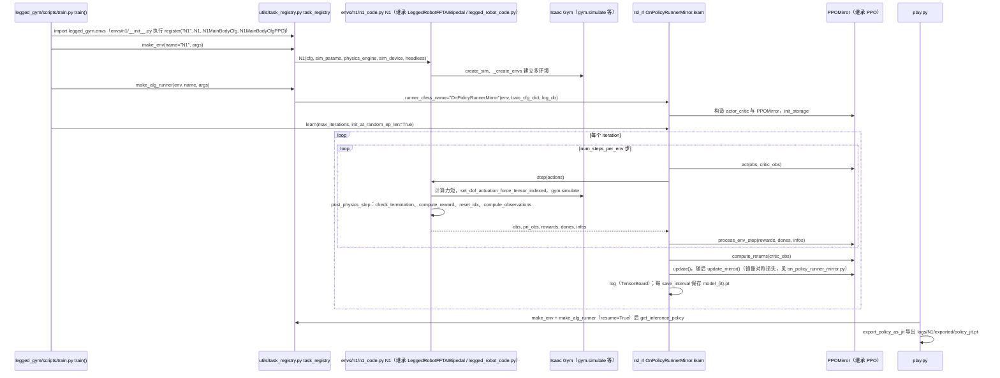

# Wiki-GRx-Gym

## 一句话定义

**Wiki-GRx-Gym** 是 [傅利叶智能](https://github.com/FFTAI) 公开的 **运动RL/技能训练** 开源项目：并行 RL 运动训练框架（含仿真任务与策略导出链路）

## 英文缩写速查

| 缩写 | 英文全称 | 简要说明 |
|------|----------|----------|
| SDK | Software Development Kit | 真机控制与状态读取接口 |
| RL | Reinforcement Learning | 强化学习训练与策略优化 |
| VLA | Vision-Language-Action | 视觉–语言–动作统一策略 |
| Sim2Real | Simulation to Real | 仿真策略迁移真机 |
| URDF | Unified Robot Description Format | 机器人描述与仿真资产 |

## 为什么重要

- 收录于 [国内具身智能开源全景（76 家 · 424 项）](../overview/china-domestic-embodied-opensource-76-companies-technology-map.md) 的 **第一层** 分组。
- 与 [Humanoid Motion Intelligence](../entities/humanoid-motion-intelligence.md) 同源策展；本页为 **独立详情节点**，便于从公司清单跳到机制与入口说明。

## 核心原理

| 字段 | 内容 |
|------|------|
| 机构 | 傅利叶智能 |
| 类别 | 运动RL/技能训练 |
| 官方组织 | https://github.com/FFTAI |

## 工程实践

1. 从官方 GitHub/Gitee 组织检索 `Wiki-GRx-Gym` 仓库并核对 README 许可与依赖。
2. 对照本库 [424 项覆盖索引](../queries/china-domestic-opensource-424-coverage.md) 查看同公司其它入口是否共用训练/部署链路。
3. 若与既有方法页（如 RL 框架、VLA、SDK）主题相同，优先读关联页中的「开源入口」小节，避免重复维护平行叙事。

## 局限与风险

- 公众号清单为 **策展快照**（2026-09-06）；仓库更名、归档或许可证变化须回官方组织页核实。
- **开源状态**：以仓库 README 与 release 为准（入库日按文章描述归纳，未逐仓 clone 验证）。

## 关联页面

- [国内具身开源全景技术地图](../overview/china-domestic-embodied-opensource-76-companies-technology-map.md)
- [HMI 开源项目主表导读](../queries/hmi-opensource-projects-coverage.md)
- [Humanoid Motion Intelligence](../entities/humanoid-motion-intelligence.md)

## 源码运行时序图

入口：`cd legged_gym/legged_gym/scripts && python train.py --task=N1 --headless`（回放与导出策略：`python play.py --task=N1 --num_envs=1`）

图依据：FFTAI/Wiki-GRx-Gym@25693a5，读过 `README.md`、`legged_gym/legged_gym/scripts/train.py`、`play.py`（部分）、`legged_gym/legged_gym/utils/task_registry.py`（make_env、make_alg_runner）、`legged_gym/legged_gym/envs/n1/__init__.py`、`n1_config_main_body.py`（runner_class_name / class_name 行）、`envs/base/legged_robot_code.py`（step、post_physics_step 及相邻片段）、`rsl_rl/rsl_rl/runners/on_policy_runner.py` 与 `on_policy_runner_mirror.py`（learn 循环）、`algorithms/ppo_mirror.py`（头部）。`PPO.update` 内部、`ActorCriticMLP`、奖励函数与 `IsaacGym_Preview_4_Package`（NVIDIA 闭源二进制包）未读；`update_mirror()` 的触发条件（图中省略的判断）未核对。

## 参考来源

- [Wiki-GRx-Gym 源码归档](../../sources/repos/wiki-grx-gym.md)（<https://github.com/FFTAI/Wiki-GRx-Gym>）

- [国内具身智能开源全景（微信公众号）](../../sources/blogs/wechat_embodied_station_domestic_opensource_panorama_2026-09-06.md)
- 源码核对（2026-11-02）：FFTAI/Wiki-GRx-Gym@25693a5，读过 README.md、legged_gym 的 scripts/train.py、scripts/play.py（部分）、utils/task_registry.py、envs/n1/__init__.py、envs/n1/n1_config_main_body.py（部分）、envs/base/legged_robot_code.py（step 与 post_physics_step 片段）、rsl_rl 的 runners/on_policy_runner.py、runners/on_policy_runner_mirror.py、algorithms/ppo_mirror.py（头部）；时序图依据以上文件，未运行代码。

## 推荐继续阅读

- [傅利叶智能 官方组织](https://github.com/FFTAI)
