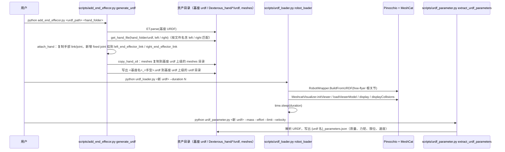

# Wiki-GRx-Models

## 一句话定义

**Wiki-GRx-Models** 是 [傅利叶智能](https://github.com/FFTAI) 公开的 **本体模型资产** 开源项目：官方本体模型资产（URDF/MJCF/USD），供仿真、训练与部署引用

## 英文缩写速查

| 缩写 | 英文全称 | 简要说明 |
|------|----------|----------|
| SDK | Software Development Kit | 真机控制与状态读取接口 |
| RL | Reinforcement Learning | 强化学习训练与策略优化 |
| VLA | Vision-Language-Action | 视觉–语言–动作统一策略 |
| Sim2Real | Simulation to Real | 仿真策略迁移真机 |
| URDF | Unified Robot Description Format | 机器人描述与仿真资产 |

## 为什么重要

- 收录于 [国内具身智能开源全景（76 家 · 424 项）](../overview/china-domestic-embodied-opensource-76-companies-technology-map.md) 的 **第一层** 分组。
- 与 [Humanoid Motion Intelligence](../entities/humanoid-motion-intelligence.md) 同源策展；本页为 **独立详情节点**，便于从公司清单跳到机制与入口说明。

## 核心原理

| 字段 | 内容 |
|------|------|
| 机构 | 傅利叶智能 |
| 类别 | 本体模型资产 |
| 官方组织 | https://github.com/FFTAI |

## 工程实践

1. 从官方 GitHub/Gitee 组织检索 `Wiki-GRx-Models` 仓库并核对 README 许可与依赖。
2. 对照本库 [424 项覆盖索引](../queries/china-domestic-opensource-424-coverage.md) 查看同公司其它入口是否共用训练/部署链路。
3. 若与既有方法页（如 RL 框架、VLA、SDK）主题相同，优先读关联页中的「开源入口」小节，避免重复维护平行叙事。

## 局限与风险

- 公众号清单为 **策展快照**（2026-09-06）；仓库更名、归档或许可证变化须回官方组织页核实。
- **开源状态**：以仓库 README 与 release 为准（入库日按文章描述归纳，未逐仓 clone 验证）。

## 关联页面

- [国内具身开源全景技术地图](../overview/china-domestic-embodied-opensource-76-companies-technology-map.md)
- [HMI 开源项目主表导读](../queries/hmi-opensource-projects-coverage.md)
- [Humanoid Motion Intelligence](../entities/humanoid-motion-intelligence.md)

## 源码运行时序图

入口：仓库主体是 URDF / MJCF / 网格资产，没有训练或部署主程序；可运行的只有 `scripts/` 下四个独立的 Python 命令行工具（用法见 `scripts/scripts_usage.md`）。下图为其中按文档串联的“装手 → 预览 → 导出参数”流程：`python scripts/add_end_effecor.py <基座 urdf> <手部文件夹>`。

图依据：FFTAI/Wiki-GRx-Models@7d96c75，读过 `README.md`、`scripts/scripts_usage.md`、`scripts/add_end_effecor.py`、`scripts/urdf_loader.py`、`scripts/urdf_parameter.py`（主体）。`scripts/mesh_compresser.py` 只读了文档描述，未读代码；URDF / MJCF 资产本身没有运行时调用链，未画。三个脚本之间没有代码级调用，上图的串联顺序来自 `scripts_usage.md` 的 Common Workflows。

## 参考来源

- [Wiki-GRx-Models 源码归档](../../sources/repos/wiki-grx-models.md)（<https://github.com/FFTAI/Wiki-GRx-Models>）

- [国内具身智能开源全景（微信公众号）](../../sources/blogs/wechat_embodied_station_domestic_opensource_panorama_2026-09-06.md)
- 源码核对（2026-11-02）：FFTAI/Wiki-GRx-Models@7d96c75，读过 README.md、scripts/scripts_usage.md、scripts/add_end_effecor.py、scripts/urdf_loader.py、scripts/urdf_parameter.py；scripts/mesh_compresser.py 仅读文档；时序图依据以上文件，未运行代码。

## 推荐继续阅读

- [傅利叶智能 官方组织](https://github.com/FFTAI)
