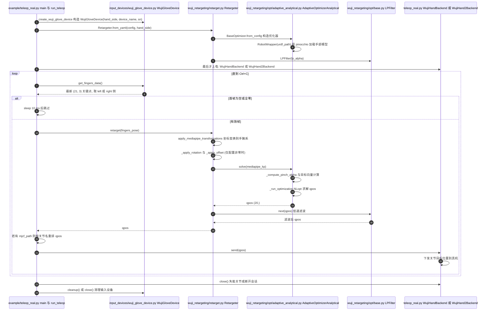

# wuji-retargeting

## 一句话定义

**wuji-retargeting** 是 [舞肌科技](https://github.com/wuji-technology) 公开的 **动作重定向** 开源项目：把Vision Pro获得的人手追踪结果映射为Wuji Hand可执行关节目标，为遥操作和示范采集提供人手到机器人手的映射入口。

## 英文缩写速查

| 缩写 | 英文全称 | 简要说明 |
|------|----------|----------|
| SDK | Software Development Kit | 真机控制与状态读取接口 |
| RL | Reinforcement Learning | 强化学习训练与策略优化 |
| VLA | Vision-Language-Action | 视觉–语言–动作统一策略 |
| Sim2Real | Simulation to Real | 仿真策略迁移真机 |
| URDF | Unified Robot Description Format | 机器人描述与仿真资产 |

## 为什么重要

- 收录于 [国内具身智能开源全景（76 家 · 424 项）](../overview/china-domestic-embodied-opensource-76-companies-technology-map.md) 的 **第三层** 分组。
- 与 [Humanoid Motion Intelligence](../entities/humanoid-motion-intelligence.md) 同源策展；本页为 **独立详情节点**，便于从公司清单跳到机制与入口说明。

## 核心原理

| 字段 | 内容 |
|------|------|
| 机构 | 舞肌科技 |
| 类别 | 动作重定向 |
| 官方组织 | https://github.com/wuji-technology |

## 工程实践

1. 从官方 GitHub/Gitee 组织检索 `wuji-retargeting` 仓库并核对 README 许可与依赖。
2. 对照本库 [424 项覆盖索引](../queries/china-domestic-opensource-424-coverage.md) 查看同公司其它入口是否共用训练/部署链路。
3. 若与既有方法页（如 RL 框架、VLA、SDK）主题相同，优先读关联页中的「开源入口」小节，避免重复维护平行叙事。

## 局限与风险

- 公众号清单为 **策展快照**（2026-09-06）；仓库更名、归档或许可证变化须回官方组织页核实。
- **开源状态**：以仓库 README 与 release 为准（入库日按文章描述归纳，未逐仓 clone 验证）。

## 源码运行时序图

入口：`cd example && python teleop_real.py --input wuji_glove --hand right --glove-sn <YOUR_SN>`（真机；仿真用 `teleop_sim.py`）。

图依据：wuji-technology/wuji-retargeting@531f6ed，实际读过 `README.md`、`example/teleop_real.py`、`example/input_devices/wuji_glove_device.py`（`get_fingers_data`）、`wuji_retargeting/retarget.py`、`wuji_retargeting/robot.py`、`wuji_retargeting/opt/base.py`（`from_config`、`_run_optimization`）、`wuji_retargeting/opt/adaptive_analytical.py`（`solve`）。`mediapipe.py`、`LPFilter` 等未逐行读，仅据调用名画图。未运行代码。

## 关联页面

- [国内具身开源全景技术地图](../overview/china-domestic-embodied-opensource-76-companies-technology-map.md)
- [HMI 开源项目主表导读](../queries/hmi-opensource-projects-coverage.md)
- [Humanoid Motion Intelligence](../entities/humanoid-motion-intelligence.md)

## 参考来源

- [wuji-retargeting 源码归档](../../sources/repos/wuji-retargeting.md)（<https://github.com/wuji-technology/wuji-retargeting>）

- [国内具身智能开源全景（微信公众号）](../../sources/blogs/wechat_embodied_station_domestic_opensource_panorama_2026-09-06.md)
- 源码核对（2026-11-02）：wuji-technology/wuji-retargeting@531f6ed，读过 README.md、example/teleop_real.py、example/input_devices/wuji_glove_device.py、wuji_retargeting/retarget.py、wuji_retargeting/robot.py、wuji_retargeting/opt/base.py、wuji_retargeting/opt/adaptive_analytical.py；时序图依据以上文件，未运行代码。

## 推荐继续阅读

- [舞肌科技 官方组织](https://github.com/wuji-technology)
