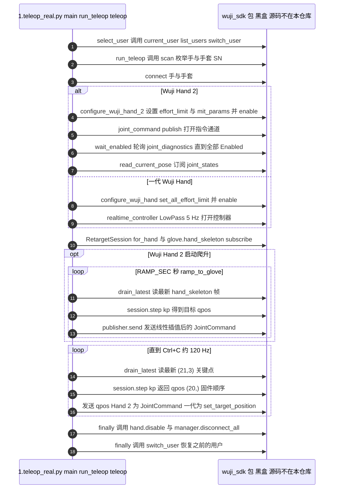

# wuji-sdk

## 一句话定义

**wuji-sdk** 是 [舞肌科技](https://github.com/wuji-technology) 公开的 **SDK/驱动** 开源项目：提供Wuji设备发现、实时数据流和记录接口，可连接数据手套与灵巧手采集链路并为遥操作或离线数据处理提供底层输入。

## 英文缩写速查

| 缩写 | 英文全称 | 简要说明 |
|------|----------|----------|
| SDK | Software Development Kit | 真机控制与状态读取接口 |
| RL | Reinforcement Learning | 强化学习训练与策略优化 |
| VLA | Vision-Language-Action | 视觉–语言–动作统一策略 |
| Sim2Real | Simulation to Real | 仿真策略迁移真机 |
| URDF | Unified Robot Description Format | 机器人描述与仿真资产 |

## 为什么重要

- 收录于 [国内具身智能开源全景（76 家 · 424 项）](../overview/china-domestic-embodied-opensource-76-companies-technology-map.md) 的 **第三层** 分组。
- 与 [Humanoid Motion Intelligence](../entities/humanoid-motion-intelligence.md) 同源策展；本页为 **独立详情节点**，便于从公司清单跳到机制与入口说明。

## 核心原理

| 字段 | 内容 |
|------|------|
| 机构 | 舞肌科技 |
| 类别 | SDK/驱动 |
| 官方组织 | https://github.com/wuji-technology |

## 工程实践

1. 从官方 GitHub/Gitee 组织检索 `wuji-sdk` 仓库并核对 README 许可与依赖。
2. 对照本库 [424 项覆盖索引](../queries/china-domestic-opensource-424-coverage.md) 查看同公司其它入口是否共用训练/部署链路。
3. 若与既有方法页（如 RL 框架、VLA、SDK）主题相同，优先读关联页中的「开源入口」小节，避免重复维护平行叙事。

## 局限与风险

- 公众号清单为 **策展快照**（2026-09-06）；仓库更名、归档或许可证变化须回官方组织页核实。
- **开源状态**：以仓库 README 与 release 为准（入库日按文章描述归纳，未逐仓 clone 验证）。

## 源码运行时序图

入口：`python examples/python/retargeting/1.teleop_real.py [--hand-sn <SN>] [--glove-sn <SN>]`（需 `pip install wuji-sdk numpy`）。仓库内只有示例与文档，SDK 本体以预编译包 `wuji_sdk` 分发，下图把它当作黑盒，仅画示例对其的调用。

图依据：wuji-technology/wuji-sdk@b6be39b，实际读过 `README.md`、`examples/python/README.md`、`examples/python/retargeting/1.teleop_real.py`。`wuji_sdk` 包内部实现不在仓库内，未读，未画。未运行代码。

## 关联页面

- [国内具身开源全景技术地图](../overview/china-domestic-embodied-opensource-76-companies-technology-map.md)
- [HMI 开源项目主表导读](../queries/hmi-opensource-projects-coverage.md)
- [Humanoid Motion Intelligence](../entities/humanoid-motion-intelligence.md)

## 参考来源

- [wuji-sdk 源码归档](../../sources/repos/wuji-sdk.md)（<https://github.com/wuji-technology/wuji-sdk>）

- [国内具身智能开源全景（微信公众号）](../../sources/blogs/wechat_embodied_station_domestic_opensource_panorama_2026-09-06.md)
- 源码核对（2026-11-02）：wuji-technology/wuji-sdk@b6be39b，读过 README.md、examples/python/README.md、examples/python/retargeting/1.teleop_real.py；时序图依据以上文件，未运行代码。

## 推荐继续阅读

- [舞肌科技 官方组织](https://github.com/wuji-technology)
