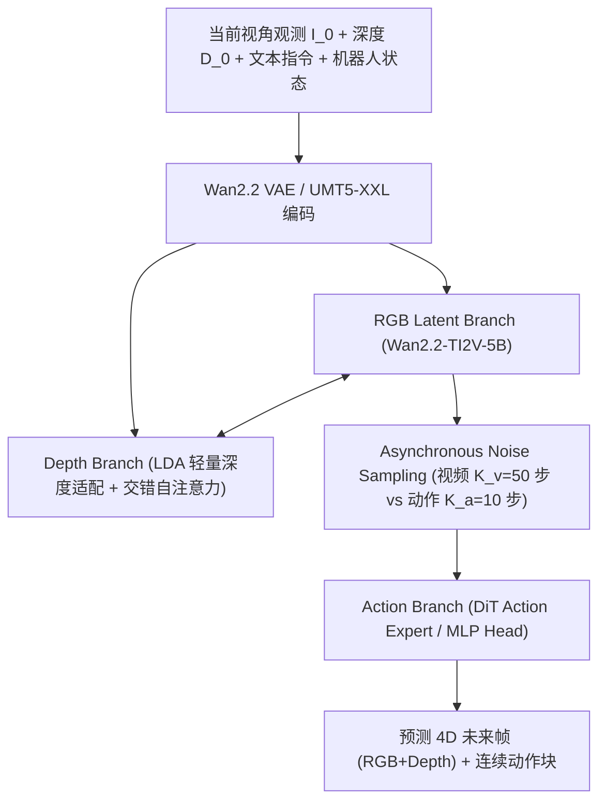
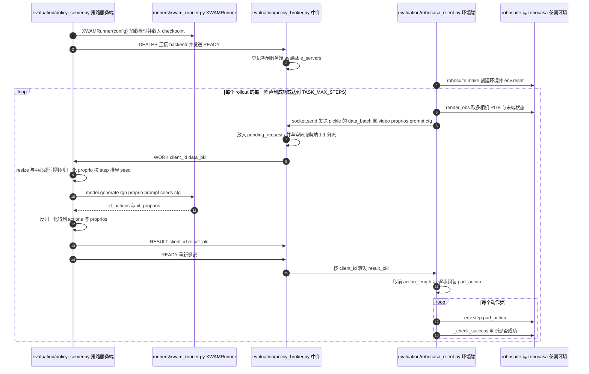

# X-WAM

## 一句话定义

**X-WAM** 是 [小米集团](https://github.com/XiaomiRobotics) 公开的 **世界模型** 开源项目：模型联合学习视频世界变化与机器人动作，在共享表征中支持跨本体操作和未来预测；项目用于检查世界模型输出怎样与动作头连接。

## 英文缩写速查

| 缩写 | 英文全称 | 简要说明 |
|------|----------|----------|
| SDK | Software Development Kit | 真机控制与状态读取接口 |
| RL | Reinforcement Learning | 强化学习训练与策略优化 |
| VLA | Vision-Language-Action | 视觉–语言–动作统一策略 |
| Sim2Real | Simulation to Real | 仿真策略迁移真机 |
| URDF | Unified Robot Description Format | 机器人描述与仿真资产 |

## 为什么重要

- 收录于 [国内具身智能开源全景（76 家 · 424 项）](../overview/china-domestic-embodied-opensource-76-companies-technology-map.md) 的 **第一层** 分组。
- 与 [Humanoid Motion Intelligence](../entities/humanoid-motion-intelligence.md) 同源策展；本页为 **独立详情节点**，便于从公司清单跳到机制与入口说明。

## 核心原理

`X-WAM`（Unified 4D World-Action Modeling，`arXiv:2604.26694`，仓库 `sharinka0715/X-WAM`）在预训练视频扩散主干 `Wan2.2-TI2V-5B` 上以**单阶段端到端联合去噪**同时建模未来 RGB 视频、未来深度图（4D 几何表征）与机器人关节动作轨迹。

- **轻量深度适配（LDA, Lightweight Depth Adaptation）**：保留预训练 RGB 分支权重的跨通道对齐，在相邻层之间插入交错式自注意力与轻量深度通路，避免从头训练破坏先验视频生成质量。
- **异步噪声采样（Asynchronous Noise Sampling）**：为动作序列单独分配独立且更密/更快的扩散时间步调度（默认视频 50 步、动作 10 步），在单主干联合优化下兼顾视频预测质量与高频动作控制延迟。

## 工程实践

- **训练入口**：`scripts/train_sft.py` 通过 PyTorch Lightning + DeepSpeed 调度 `UnifiedWorldModel`（默认 `Wan2.2-TI2V-5B`，`bf16-mixed` 精度），支持 `robotwin` 与 `robocasa` 两套配置文件（`configs/`）。
- **推理与异步评估**：`evaluation/` 采用 `policy_server.py`（模型加载与推理）+ `policy_broker.py`（请求分发）+ `robocasa_client.py` / RoboTwin 客户端架构，隔离仿真环境依赖与 GPU 推理节点。
- **预训练权重与评测基准**：官方 Hugging Face `sharinka0715/X-WAM-checkpoints` 提供微调权重；论文报告 RoboCasaGR1Tabletop 24 任务平均成功率 **79.2%**，RoboTwin 2.0 清洁/随机化设定分别为 **89.8% / 90.7%**。

## 局限与风险

- **长时程物理一致性依赖视频先验**：闭环高频干扰下若视频分支预测偏移，跨模态注意力仍可能将伪影传导至动作预测；此外全量 5B DiT 训练与推理依赖多卡 A100/H100 级显存。
- **真机与仓库范围边界**：当前仓内主要提供 RoboTwin 2.0 / RoboCasa 仿真训练与评测脚本及对应 checkpoints，跨本体真机硬件控制驱动需按本体适配，并应结合 [X-WAM 论文页](./paper-rcl-2604-26694-unified-4d-world-action-modeling-from-video-prio.md) 核对最新消融数据。

## 源码运行时序图

入口（评测为三个进程）：`python evaluation/policy_broker.py --frontend_port 10086 --backend_port 10087`；`CUDA_VISIBLE_DEVICES=0 python evaluation/policy_server.py --exp_path checkpoints/robocasa_sft --wan_checkpoint_dir <wan22_5b 路径> --broker_port 10087 --denoise_steps 50 --action_denoise_steps 10`；环境端 `python evaluation/robocasa_client.py`（参数见 `evaluation/README.md`）。

图依据：sharinka0715/X-WAM@72cfb86，实际读过 `README.md`、`evaluation/README.md`（前 80 行，启动命令段）、`evaluation/policy_broker.py`、`evaluation/policy_server.py`、`evaluation/robocasa_client.py`（`main` 与 `render_obs` 相关段）。`runners/xwam_runner.py` 内部未读，`XWAMRunner.generate` 仅据 `policy_server.py` 中的调用名标注；RoboTwin 客户端与训练流程未画。未运行代码。

## 关联页面

- [X-WAM 论文页（Unified 4D World-Action Modeling）](./paper-rcl-2604-26694-unified-4d-world-action-modeling-from-video-prio.md)
- [国内具身开源全景技术地图](../overview/china-domestic-embodied-opensource-76-companies-technology-map.md)
- [HMI 开源项目主表导读](../queries/hmi-opensource-projects-coverage.md)
- [Humanoid Motion Intelligence](../entities/humanoid-motion-intelligence.md)

## 参考来源

- [X-WAM 源码归档](../../sources/repos/x-wam.md)（`sharinka0715/X-WAM@72cfb86`，<https://github.com/sharinka0715/X-WAM>）

## 推荐继续阅读

- <https://github.com/sharinka0715/X-WAM>
- <https://sharinka0715.github.io/X-WAM/>

- [国内具身智能开源全景（微信公众号）](../../sources/blogs/wechat_embodied_station_domestic_opensource_panorama_2026-09-06.md)
- 源码核对（2026-11-02）：sharinka0715/X-WAM@72cfb86，读过 README.md、evaluation/README.md（前 80 行）、evaluation/policy_broker.py、evaluation/policy_server.py、evaluation/robocasa_client.py；时序图依据以上文件，未运行代码。

## 推荐继续阅读

- [小米集团 官方组织](https://github.com/XiaomiRobotics)
